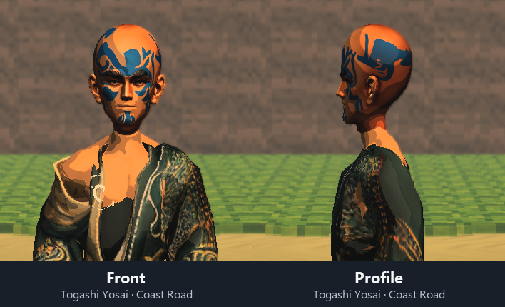

# Togashi Yosai’s replacement head and neckline

Togashi Yosai (`P132`, `side_yosai`) previously pointed to `side_yosai_face`. The first Hunyuan head had a tilted, closed-eye pose and fabric joined to its wide neck. The new head starts from a regenerated upright version of Yosai’s dialogue bust. The full scalp, open forward-facing eyes, and blue marks identify his character. Dark brown irises were chosen because the original closed-eye portrait supplied no iris color.

1. Hunyuan geometry run `b14df076-bc11-4a08-85e1-16218d28069c` produced the 20,000-face upright donor. Textured run `28e86e42-6096-4779-942e-c91b8cdd878b` reproduced its geometry. See the raw GLBs in `cast_heads` and the generation reference in `reframed_heads`.
2. The donor was seated on two measured neck rings of the existing `shared_male` armature. The final user-directed 20% head reduction took the compact fit’s ear span from 20.61 to 16.49 native units. Both overlap rings stayed seated at their exact centers and dimensions. The face weights resolve on `head` and `neck` and the portable model carries seven independent expression morphs.
3. The neck and jaw texture were cleaned, and three blue chin markings were restored. Three unlit face patches supplied 147 skin texels. The median **sRGB 239, 150, 85** was applied as `0xdd4f17ff` to Yosai’s exposed core, throat, neck and hands. The actor’s fitted body uses the same shared rest geometry and weight data with local neck-normal smoothing in `side_yosai_skin.mdl`.
4. The A111 signature robe neckline was lowered and opened, with the matching decal fitted to the same alteration. The rest of the robe retains its established drape, and the closed-boot fit stays intact. The chest tattoo, ornament and dragon anchor retain their routes. `fit_yosai_neckline.py` contains the localized source transformation.
5. Coast Road (`M811`) verified the face binding, 50 joints, robe, chest ink, front and profile appearance, and walk cycle. Dragon’s Breath (`S460`) returned to the same generated head after the transform and preserved its original area damage and self-burn. The new size clears the A110 and A160 helmet shells in the offline view. Several optional brim hats and the A143 headband still sit loose and need an individual refit.

The illustrated **Traveler humanoid rigging** skill records the general procedure, including the face-to-body skin color step. The fit data and locally archived source assets document this specific model.
