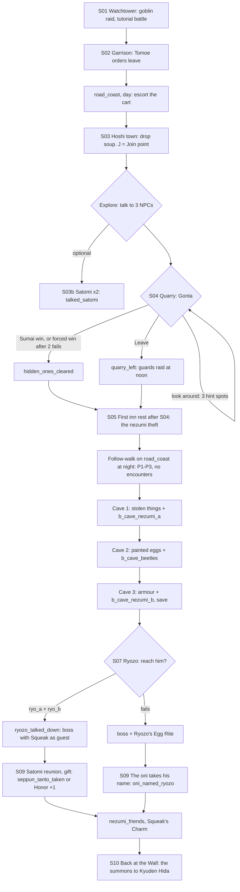

# STORYBOARD — Crab Ch1 · "Eggs and Shadows"
Production: `production/crab-ch1.md` · Lv 1–8 · Region: **Crab coast** (Map A: the coast between Hida Palace and
Yasuki Estates; Map B: the Hiruma/Yasuki strip below the Wall).
Overworld nodes: **KW** (Natsuko's Wall post) → **HI** Hoshi-no-Ichi, plus a cliff-cave branch.
Bestiary F: *Kaiu Wall & Crab coast* (1–8), *Hoshi-no-Ichi caves* (3–8).

## Flow


## Maps

### M1 `wall_watchtower` — the Wall at night (tutorial; starter only)
```
 ##########################################################
 #  [crenel]   [crenel]   [crenel]   [crenel]   [crenel]  #  <- goblins climb from the south edge
 #   b(raid)        Sachiko          Ryoichi        c     #
 #=====================  walkway  =========================#
 #   torch          @Natsuko          torch          :>M2  #
 ##########################################################
              (Shadowlands below, fog, rain)
```
| Spot | What |
|---|---|
| `@` | Natsuko's start, next to the map case |
| `b` | `b_goblin_raid`: auto-starts once the opening dialogue ends (tutorial T1–T5) |
| `c` | **Tutorial chest:** Rice Ball ×3. The first popup explains chests. |
| `:>M2` | stairs down to the garrison |
- No random encounters. This becomes the KW node's battlement view, revisitable at Crab Ch3, in the epilogue and
  post-game.

### M2 `wall_garrison` — Natsuko's Wall post (a hub for Crab Ch1 and Ch3)
```
 ######################### THE KAIU WALL ##########################
 #  :M1 stairs   [Tomoe's office]!S02     [barracks = I]          #
 #                                                                #
 #   [armoury W/A]   (yard: sparring dummies)   [jade store S]    #
 #                                                                #
 #  [WALL GATE]##  (sealed until Crab Ch3)       + shrine   @/>R1 #
 ##################################################################
```
| Spot | What |
|---|---|
| Tomoe's office `!` | S02; S10 at chapter end (a runner at the gate) |
| Barracks `I` | Free rest. Acts as an inn (party swap) once a second traveler joins |
| Armoury `W/A` | Crab T1: Ashigaru Yari, Oak Tetsubo, Ashigaru Lamellar, Jingasa |
| Jade store `S` | Rice Ball, Antidote, **Jade Dust** (Crab specialty) |
| `+` shrine | Taint cleanse, Meditate |
| Wall Gate | Shows "Sealed by order of the Hida." Opens in Crab Ch3 (`wall_gate_dawn`) |
- NPCs: Hida Sachiko (jokes about the hat), Hiruma Ryoichi ("the safest place on the Wall"), a quartermaster
  (sells). Their lines change after S10.

### R1 `road_coast` — the Coast Road (field route, 2 screens) · Danger 1–8
```
 screen A (west)                                 screen B (east)
 #####^^^^^^^^^^^^^^^^^^^^^^^^^           ^^^^^^^^[cliffs]^^^*^^^^^^^^^^^
 @M2 ===road=====≈≈≈≈≈====c=====   >>>    ===≈≈≈≈====road=======> HI (M3)
 ~~~~~ beach ≈≈≈ c*(ledge) ~~~~           ~~~~ tidepools c ~~ [cave mouth]!FW
 ~~~~~~~~~~~~~~~~~~~~~~~~~~~~~~           ~~~~~~~~~~~~~~~~~~ (hidden until S05)
```
| Spot | What |
|---|---|
| Sign at `@` | "Coast Road — Danger 1–8" |
| `c` road (A) | Rice Ball ×2 |
| `c*` beach ledge (A) | **Athletics 1:** a short climb down → Bamboo Yumi |
| `c` tidepools (B) | Antidote ×2 · 80 zeni |
| `*` on the cliff (B) | **Hunting 2** (Natsuko starts at R2): boar tracks → a side path to a boar's hollow (a fixed Wild Boar ×2 fight) and a **Jingasa** chest |
| Cave mouth `!FW` | Invisible until the S05 follow-walk. Afterwards it's a permanent entrance (the dungeon's revisit point) |
| Escort (S02→S03) | The cart follows Natsuko. Random battles happen as normal; the cart waits off-screen. No fail state. |
| Follow-walk (S05, night) | Prompts P1 (prints) on screen A, P2 (hairpin) and P3 (smell) on screen B. **Random encounters are off during the follow-walk** (finding F-3). |
- Encounters: Goblin I, Tide Crab I, Carrion Crow; uncommon Road Bandit I; rare (night) Will-o'-wisp.

### M3 `hoshi_town` — Hoshi-no-Ichi (2 screens)
```
 screen A: market                                          screen B: harbour
 ^^^^^^^^^^^^^^ quarry trail >M4 ^^^^^^^^^^^^^^^^^        ^^^^^ lookout + shrine + ^^^^^^^
 #  [magistrate's office]5  [storehouse C]      #        #   7(kite child)              #
 #                                              #        #  [Satomi's tea house t]4  ?  #
 @R1 = gate === market street ================= > ===    #  [fishmonger 6]              #
 #  [noodle stall]1 J  [egg merchant 2 + henhouse c]     #  [ferry docks: Mantis ferry] ~
 #  [inn I] (M5)   8(drunk veteran)  [W/A] [S]  #        #  c (under the pier)        ~~~
 ################################################        ~~~~~~~~~~~~~~~~~~~~~~~~~~~~~~~
```
**NPCs and path actions**
Rows marked *(added)* are new in the storyboard pass. Without them, some path actions had no target here (F-5).

| # | NPC | Path action | Result |
|---|---|---|---|
| 1 | Kiyo (noodle girl) | Eavesdrop | "Saw a little furry shape on the roof" (hint) |
| 1 | Kiyo | **Charm** *(added)* | She follows the party (Rensei). In battle, *Hot Broth*: a small Fire hit, 2 uses |
| 2 | Egg merchant Gonbei | Discern / Barter | Discern: "His hens are fine." Barter, after the chapter: Fresh Egg |
| 2 | Gonbei | **Pilfer** *(added)* | Henhouse key → opens the henhouse `c` (Herbal Salve). Low Skill |
| 3 | Hida bushi Taneo (the "angry Crab bushi", after S03) | **Duel** *(added)* | Shizue's Iaijutsu 2 → Oak Tetsubo (fine grade) · Glory +1 |
| 4 | Seppun Satomi | Discern / talk ×2 | "Looking for a missing relative" → `talked_satomi` |
| 5 | Magistrate Kanbe | Discern / Sumai | Discern: "He hasn't investigated anything." Sumai: he refuses |
| 5 | Kanbe | **Pilfer** *(added)* | Seized Jade Dust ×2 |
| 6 | Fishwife | Barter | Salt Herring (heal) |
| 7 | Child with kite | **Bless** *(added)* | Haruki leads her to the shrine to pray for her mirror. In battle, *Kite Signal*: the party's Accuracy goes up, 2 uses |
| 8 | Wall veteran (drunk) | Sumai | Win → **Old Jade Bead** (accessory) |
| — | Ferryman | talk | "Isle of Silk. 100 zeni. The captain bites." → the **Mantis ferry** (§4c) |

**Shops and chests**
| Spot | What |
|---|---|
| `W/A` | Crab T1 (Jade weapon variants only start at T2, per `equipment.md`) |
| `S` | Rice Ball, Antidote, Eye Drops, Salt Herring |
| `c` henhouse | Herbal Salve (open via the Pilfer key, or after the chapter) |
| `C` storehouse | Locked lacquer box: 200 zeni + a Painted Egg (cures Silence) |
| `c` under the pier | Jingasa — or 150 zeni if the Jingasa was already found |
| `?` | Side-story icon (post-chapter): the Gonta / Hidden Ones follow-up, if `hidden_ones_cleared` |
| `J` | **Join point** (non-starter): the drop-soup scene plays when the party first walks past the noodle stall |

### M4 `quarry_camp` — the Hidden Ones (reached by the town's north trail)
```
 ^^^^^^^^^^^^ ridge ^^^^^^^^^^^^^^^^^^^^
 ^  [guards + Sergeant]  (@ from M3)    ^
 ^   tents   tents   fire!Gonta  tents  ^
 ^   *1(empty pots) *2(boy, no fish)    ^
 ^   *3(egg-stink prints, leading away) ^
 ^^^^^^^^^^ c (old quarry ledge) ^^^^^^^^
```
| Spot | What |
|---|---|
| `!Gonta` | S04 (the choice). The Sumai bout is `b_hidden_ones_sumai` |
| `*1–*3` | The "look around first" hint spots. Each one adds a line to Natsuko's case before the Sumai |
| `c` quarry ledge | Ashigaru Yari (or 100 zeni if already owned) |
- Hint spot `*2` sets up the **wooden fish** return (see M6). No new flag.
- If `quarry_left`: on revisit the camp is burned out, and Gonta is gone until Crab Ch2.

### M5 `hoshi_inn` — the inn
- An ordinary inn, plus the **S05 trigger**: the night event plays on the **first rest after S04**. Before S04,
  resting works normally (finding F-2).
- Travel Banter TB-crab1-a/b/c plays here.

### D1 `egg_caves_1–3` + `egg_caves_altar` — the Egg Caves (dungeon, 4 maps) · Danger 3–8
The **Rumble meter** is shown in every battle here, random encounters included.
```
 Cave 1 (nests)               Cave 2 (painted eggs)                 Cave 3 (armour)          Altar
 @R1                          >C1                                   >C2                      >C3
  %nests%  c                    eggs   eggs   [*Tremor wall] c        c                      ( heap of eggs )
  (stolen-thing circles)*S      b_cave_beetles                         [armour stand]!          candles   B
  b_cave_nezumi_a  c            ~~ side tunnel -> pool  c (dead end)   b_cave_nezumi_b   C       Ryozo !S07
  >C2                           >C3                                     § save  >Altar
```
| Spot | What |
|---|---|
| C1 `c` ×2 | Rice Ball ×2 · **Scroll: Summon Fog** (Haruki's field spell. Kept as an item until he joins) |
| C1 `*S` stolen-thing circles | Pick up **Kite Mirror**, **Wooden Fish** and **Pearl Hairpin** (key items). Return them after the chapter: the mirror to the kite child (→ Crow Feather + Kite Signal improved), the fish to Gonta's boy (→ "Hidden Ones' Thanks": 1 free hire of Gonta in Crab Ch2), the hairpin to Kiyo (→ "Drop Soup" item: heals 30%). [IF quarry_left] the fish can only be sold. |
| C2 `[*Tremor wall]` | Haruki's **Tremor** collapses the cracked wall → a chest: Jade Dust ×2 + Kozuka (a revisit reward) |
| C2 dead end | Underground pool → chest: Eye Drops ×2 · 150 zeni |
| C3 `!` | The armour line (`talked_satomi` variant) |
| C3 `C` | Locked lacquer box, Ryozo's kit: Seppun Guard's Jingasa (Def +4) + 300 zeni |
| C3 `§` | Save point before the altar |
| Altar `B` | S07 → S08 → S09 |
| After the boss | **The altar cave collapses** ("Roof go crack"). Caves 1–3 stay open for revisits. Nothing is lost: the altar room has no chests (F-4). |
- Encounters: Cave Beetle, Mamushi Viper; uncommon goblins.

## Simulated playthrough
**Starter run (Lv 1):**
1. Tutorial battle → the chest → down to the garrison → leave orders.
2. Coast road with the cart: about 4 encounters, Lv 3 on arrival. The Hunting side path gives a boar fight and a
   Jingasa.
3. Hoshi-no-Ichi: drop soup, then shops. Talking to 3 NPCs opens the quarry objective. Satomi ×2 is easy to miss,
   but she's in the harbour tea house with a "?" bubble after the first talk.
4. Quarry: the hint spots, then Sumai.
5. Inn → the theft → the night follow-walk (no fights, so the chase feels like a chase).
6. Caves: about 8 encounters plus 3 fixed battles. Lv 7–8 at the altar. The Rumble meter teaches restraint with area
   skills.
7. Ryozo: with `talked_satomi`, both persuasion options are available. Without it, only `ryo_b` is reachable, so
   the boss always gets the Egg Rite variant. That's intended: it makes the Satomi talk matter.
8. Boss → Satomi → nezumi → back on the Wall. Total ≈ 75–90 minutes, close to an OT1 chapter 1.

**Recruit run (party of 1–3 arriving from Kudo or the ferry, Lv ~10):**
- The party walks into the market. The drop-soup scene plays on its own, and Natsuko sits at the stall `J`.
- Talk → join → **Memory**: S01–S02 in about 10 lines, no battle.
- Objective: "Look around Hoshi-no-Ichi."
- Every path-action NPC now gives each traveler something to do: Charm Kiyo, Bless the child, Pilfer
  Gonbei/Kanbe, Duel Taneo, Barter the fishwife, Discern Gonbei/Satomi, Eavesdrop Kiyo.
- The caves at Lv 10+ are easy. That's normal for OT1 recruits, whose Ch1s are under-levelled.

**Revisit (post-chapter):**
- Return the three stolen things; open the Tremor wall and the lacquer box.
- Without `hidden_ones_cleared`, the quarry stays empty.

## Findings → fixes
| # | Finding | Fix |
|---|---|---|
| F-1 | No recruit version (the README R-1 rule) | Join point and Memory added to `production/crab-ch1.md` |
| F-2 | "Forced first rest" would fire if the player rested before S04 | Trigger is now "the first inn rest after S04" |
| F-3 | Random encounters during the night follow-walk would break the chase | Encounters off on `road_coast` during the follow-walk |
| F-4 | The cave-in might lock out a dungeon | Only the altar collapses (it has no chests); caves 1–3 stay revisitable |
| F-5 | Charm, Bless, Pilfer and Duel had no targets in Hoshi-no-Ichi | Four NPC rows added (Kiyo, kite child, Gonbei/Kanbe, Taneo) |
| F-6 | The ELSE branch (`oni_named_ryozo`) left Satomi waiting forever in the tea house | Closure lines added: Natsuko tells her he's lost in the caves; Satomi leaves the coast and no gift is offered |
| F-7 | Stolen town goods vanished from the story after the caves | Three return-the-item pickups (no new flags) give the town a post-chapter payoff, Octopath style |
| F-8 | The Isle of Silk (Gendo's Ch1) needs a ferry from somewhere | The Hoshi-no-Ichi docks are one of the two Mantis-ferry ports |
