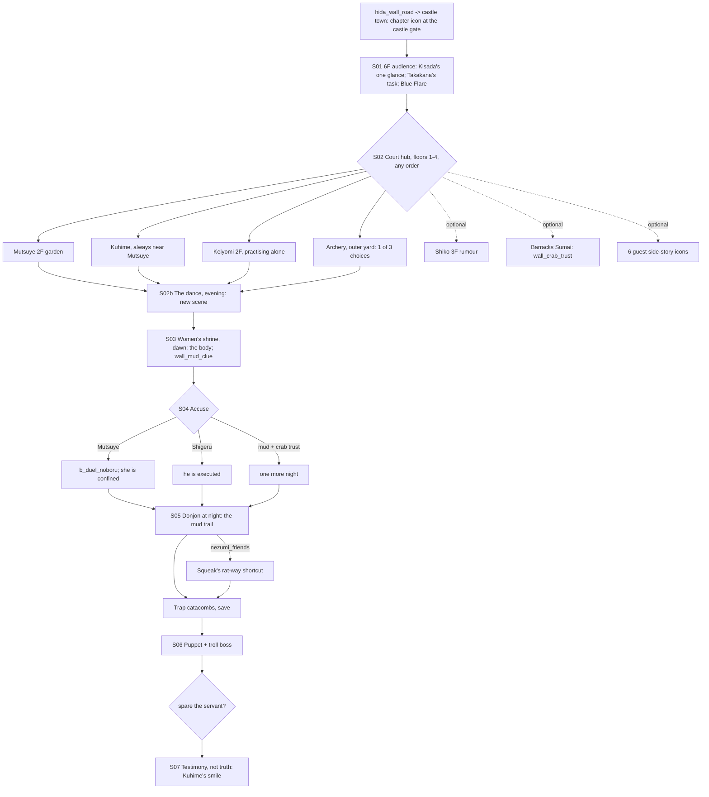

# STORYBOARD — Crab Ch2 · "Winter Court at Kyuden Hida"
Production: `production/crab-ch2.md` · Lv 18–25 · Region: **Kyuden Hida** (Map A: Hida Palace, at the river mouth
where the Twilight Mountains meet the sea; Map B: the Hida heartland, inside the red Crab border).
Overworld: **KW** → route `hida_wall_road` → **KH** (castle town + castle). Bestiary F: *Kyuden Hida environs* (18–25),
and a new *Kyuden Hida donjon* row (finding F-6).

## Flow


## Maps

### R `hida_wall_road` — from the Wall to Kyuden Hida (field route, 1 screen) · Danger 18–25
```
 ^^^ Twilight foothills ^^^^^^^^^^^^^^^^^^^^^^^^
 @KW == road ≈≈≈≈ [waystation shrine +] ≈≈≈ c ==> KH castle town
 #### (the Wall, always on the left) #### c*(Athletics 3: a Wall-stair)
```
| Spot | What |
|---|---|
| `+` | Roadside shrine (Taint cleanse) |
| `c` | Herbal Salve ×2 |
| `c*` | **Athletics 3:** up a Wall-stair → Crab Plate (T2). An early heavy-armour reward on Natsuko's home road |
- Encounters: Mountain Bandit, Drunken Samurai (II palette); uncommon Border Patrol; rare Yurei.

### T `kyuden_hida_town` — the castle town (new map, finding F-1)
```
 ################## [castle gate]!chapter icon  >castle 1F ######################
 #  [Kaiu forge W]   [Hida armoury A]    [jade merchant S]     [dojo]?(Hida school, R2)  #
 #  [inn I]          (market square: winter stalls)            + [Hachiman shrine]       #
 #  [tea house t]    c (behind the rain barrels)    C (forge storeroom)                  #
 @hida_wall_road ======================== river road ======================= >port (closed)
```
| Spot | What |
|---|---|
| Shops | **Crab T2:** Iron-studded Tetsubo, Lacquered Yari, Crab Plate, Kabuto, **Jade weapon variants (T2)**, Jade Dust, Herbal Salve, Incense |
| Dojo `?` | **Hida secondary school.** It unlocks at chapter end (production `[UNLOCK]`). Before that: "Come back when the court is done with you." |
| Tea house `t` | Hire help (ronin); rumours (Courtier) |
| `c` | 300 zeni · Calming Tea ×2 |
| `C` | Locked lacquer box: Kaiu Tetsubo blueprint (sells for 1,500 zeni, or trade it at the forge for 1 free T3 Tetsubo in Ch3) |
- Reused in Crab Ch4 (summer: the wedding banners).

### KH `kyuden_hida_6f`, `kyuden_hida_court` 1F–4F, 5F window — the castle (vertical hub)
```
 6F  [AUDIENCE HALL]  Kisada on the dais · court along the walls             !S01 !S04 !S07
 5F  [Takakana's corridor + the window over the Wall]                         !S01 (flares) !S07
 4F  [great dining hall]  Kurako 6 · [kitchens] 9 (servant)   c
 3F  [guest wings]  Shigeru's room (forged scrolls)*  · Shiko 3 · Kage (maps) · Kuhime's room (always empty) C
 2F  [winter garden]  Mutsuye 1 · Kuhime 2 · Keiyomi 4 (practising) · Akiko 5 · O-Shito 7
 1F  [entry hall] · [barracks = I]  Sachiko + Wall veterans 8 · [outer yard: archery !] · [basement stair: Shigeru & Taira 10]  >donjon (locked until S05)
```
**NPCs and path actions.** The production file had no town table; this one has been added there (F-2).
| # | NPC (floor) | Path action | Result |
|---|---|---|---|
| 1 | Isawa Mutsuye (2F) | **Bless** (Haruki, after S03) | She asks him to pray with her → info: "Every evening Kuhime touches my sleeve." |
| 2 | Asako Kuhime (2F) | Discern (Gendo) | "Nothing. Absolutely nothing. That's what's wrong." (She can't be discerned. A first hint.) |
| 2 | Kuhime | Eavesdrop (Mitsue) | Fails automatically: "She stops talking whenever you get close. Every time." |
| 3 | Shosuro Shiko (3F) | Eavesdrop / Pilfer | Eavesdrop: "Kuhime's room is always empty at night." Pilfer: Fine Sake |
| 4 | Ide Keiyomi (2F) | Barter (Tamotsu) | Teaches the dance's name and history → **Unicorn Dance Ribbon** (sell/lore; returned to O-Shito after S03 → Honor +1) |
| 5 | Isawa Akiko (2F) | Charm | Follows (battle: "Carp-Pond Splash", Water hit, 2 uses) |
| 6 | Yasuki Kurako (4F) | Barter | Incense Stick ×3 at cost |
| 7 | Shinjo O-Shito (2F) | Duel (Iaijutsu 3) | Lacquered Do-maru |
| 8 | Wall veteran (1F barracks) | Sumai | `wall_crab_trust` (filed chains) |
| 9 | Kitchen servant (4F) | Pilfer | Herbal Salve ×2 |
| 10 | Yogo Shigeru / Kuni Taira (1F stair) | Discern | Shigeru: "He forges — love letters. Badly." Taira: "Tainted, and delighted by the filed chains. Curious, not guilty." |
| — | Hiruma Kage (3F) | talk | Bond lines ("He's looked now"). Changes after S03 |
| — | 6 guest side-story icons `?` | — | Goro (1F barracks), Fujio (3F, writing letters), Sakura (2F), Takeo (1F yard), Mai (basement stair), Michio (2F, watching Mutsuye) |

**Chests:** 4F kitchens `c` (Fine Sake). 3F Kuhime's room `C`: a locked box holding a **Blue-Silk Veil Thread**
(lore item). Natsuko: "This is silk from the Crane coast, not the Phoenix." It's a quiet link to Crane Ch2, where she appears as Doji Miyako.

### S03 `womens_shrine` — the mountainside shrine (dawn)
```
 ^^^^^^^^^^^^^^ (mountain) ^^^^^^^^^^^^^^^^^
 ^   [shrine steps] !body · courtiers ring ^
 ^   *red clay path   *grey Wall mud (Kuhime's hem) ^
 @ (from castle 1F rear gate) ==============
```
- The evidence spots appear within the scene (production text), plus party lines (Haruki, Gendo).
- After the chapter: the shrine is a revisit spot (Taint cleanse; lantern for Keiyomi).

### D `kyuden_hida_donjon_1`, `trap_catacombs`, `kyuden_hida_donjon_2` — the donjon (dungeon) · Danger 20–25
```
 donjon_1 (cells)                           trap_catacombs                      donjon_2
 :1F stair @                                >D1                                 >TC
  [troll cell, open]! (filed chains)         *roller (3rd stone)                 [deepest cell]
  b_donjon_goblins     c                     *jade-dust line (stepped over)      puppet + troll  B
  [rat-way]*N ------------------------\      c   c (dead end: a Kaiu trap-maker's cache)
  c (long way round)  >TC              \---> § save                              c (after the boss: the troll's straw: Troll Hide)
```
| Spot | What |
|---|---|
| `*N` | [IF nezumi_friends] Squeak's rat-way: a crawlspace that skips half of donjon_1 and has its own chest (Squeak's stash: 2 Painted Eggs) |
| D1 `c` | Herbal Salve ×2 · Jade Dust ×2 |
| TC `*` roller / jade line | Interaction shortcuts (production) |
| TC dead end | Kaiu trap-maker's cache: **Kaiu Iron Caltrops** (battle item: Speed down on all enemies) ×3 + 500 zeni |
| TC `§` | Save point |
| D2 `B` | `b_boss_puppet_troll` (the troll is a hazard) |
- **Encounters** (new bestiary row): Goblin Warmonger, Cave Bat Swarm; uncommon Yurei (catacombs).
- **Revisit:** the troll stays chained. Talking to it: "…Hrm." Natsuko: "Same."

## Simulated playthrough
1. Lv ~18 on arrival. The town gives the first T2 shopping. The Crab Plate on the Wall-stair is a strong early
   pickup.
2. 6F audience (short) → 5F flares → the hub. The required four (Mutsuye, Kuhime, Keiyomi, archery) are all on 2F
   and the outer yard, so the hub has a clear centre. Optional scenes are spread over 1F, 3F and 4F, which rewards
   climbing the castle.
3. **S02b:** without a dance scene, the death of "the girl who danced" had no setup. The new evening scene: Keiyomi
   dances alone, the court titters, and Kuhime watches without blinking. It also gives the player a "time passes"
   beat before S03.
4. S03: the evidence plays within the scene. The mud clue always fires, so `wall_crab_trust` (the optional barracks
   Sumai) is the real gate for the best accusation. Shiko's rumour on 3F points to the barracks.
5. S04: three routes. On the Mutsuye and Shigeru routes, Natsuko still goes down to the donjon that night. A
   one-line motivation was added (F-3).
6. Donjon at Lv 21–23: about 6 encounters plus 1 fixed battle. The troll hazard teaches Razor's Edge. The boss is
   about 6 minutes.
7. S07 closes on Kuhime's smile, the hook for Ch3 and Ch4. Total ≈ 100 minutes.

**With the party:** Haruki adds a Bless on Mutsuye after S03 and the Speak to the Soul line; Gendo the knife line and
the failed Discern on Kuhime; Mitsue the failed Eavesdrop. The two auto-fails are deliberate: Nashiko is the only
NPC who blanks path actions. That **pattern is now a rule** (F-4): every Nashiko disguise in every chapter blanks
Discern and Eavesdrop with a distinctive line.

## Findings → fixes
| # | Finding | Fix |
|---|---|---|
| F-1 | Kyuden Hida had no inn or shops (an Octopath town needs both); a Ch2 hub can't be castle-only | New map `kyuden_hida_town`; also reused in Ch4 |
| F-2 | No town NPC table (required by the production README) | Table added to `production/crab-ch2.md` |
| F-3 | On the Mutsuye and Shigeru routes, nothing motivated the night trip to the donjon | One internal line added at S05 |
| F-4 | Kuhime (Nashiko) had no path-action behaviour | New rule: **Nashiko blanks Discern and Eavesdrop** (here, Crane Ch2, Crab Ch4 and the finale herald) |
| F-5 | S03 depended on a "dance contest" that never played | S02b "The Dance" added, gated on the four required hub scenes |
| F-6 | No encounter table for the donjon | Row added to bestiary F |
| F-7 | The route from the Wall to Kyuden Hida wasn't defined | `hida_wall_road` (route map) |
