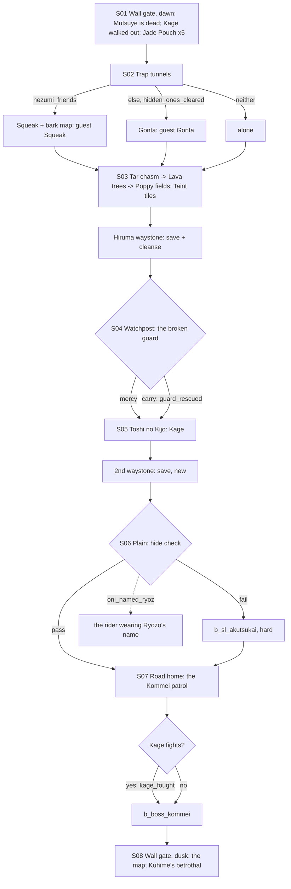

# STORYBOARD — Crab Ch3 · "Beyond the Wall"
Production: `production/crab-ch3.md` · Lv 30–35 · Region: **the Kaiu Wall gate → the Shadowlands** (Map A: south-west,
"The Shadowlands", below the Twilight Mountains; Map B: past the white Wall line).
Overworld: **KW** Wall gate → a one-way Shadowlands **expedition** (no overworld access until post-game) → KW.
Bestiary F: *Shadowlands (Ch3)* (28–35).

## Flow


## Point of no return
`wall_gate_dawn` warns: **"Beyond the Wall there is no turning back until you reach home. Prepare."** The Shadowlands
reopen post-game (bestiary F, post-game row). Skill-locked chests left behind are a post-game reward.

## Maps

### M1 `wall_gate_dawn` — the Wall gate (KW node, gate side)
```
 ############################ THE KAIU WALL ##############################
 #  (Ch1 garrison: inn I, armoury W/A, jade store S)  > M2 garrison          #
 #  Sachiko!S01      Takakana!(arrives)           [quartermaster: Crab T3]   #
 #  ====[ THE GATE ]==== (open today) ====  :> trap_tunnels_wall            #
 ##########################################################################
```
- The quartermaster has **Crab T3** stock for this chapter: Kaiu Tetsubo, Hida Heavy Plate, Jade Dust ×10 limit, and
  Jade variants. The Kaiu Tetsubo Blueprint (Crab Ch2) can be traded here.

### D1 `trap_tunnels_wall` — the trap tunnels (1 screen)
```
 :@ ==*roller==*spikes==*jade line== c ==\
      c (side niche: Crab sapper's kit)    \==> far mouth !S02 (Squeak / Gonta) > SL1
```
- `*` traps: Natsuko auto-solves them ("Third stone. Skip the fourth."). Without her the traps hurt, but she can't be
  absent: it's her chapter.
- `c`: Ginseng Tonic ×2 · Crab sapper's kit (Kaiu Iron Caltrops ×3).
- **Guest at the far mouth (fix F-3):**
  - Squeak: battle guest *Pocket Sand* (Blind), 2 uses, plus a new skill *Dark-ways*: reveals the map's chests.
  - Gonta: battle guest *Landslide* (Earth hit on all enemies), 1 use.

### D2 `sl_tar_chasm` → `sl_lava_trees` → `sl_poppy_fields` (dungeon, part 1) · Danger 28–35
```
 sl_tar_chasm                    sl_lava_trees (upside-down forest)        sl_poppy_fields
 @D1                              >SL1                                      >SL2
  tar tar [rope bridge]= c         ↓roots↑  c*(Athletics 5: up a root)        "poppies" (toothed, follow you)
  tar  *map landmark 1  tar        fire-drip tiles  b_sl_goblins             b_sl_onikage   c
  c (tar-edge, a Taint tile)       *map landmark 2   c (dead end: a Hiruma    [ridge]!marks the map
  >SL2                             >SL3               scout's bones, Hiruma   [Hiruma waystone] § + cleanse
                                                     Scout's Jingasa)         >watchpost
```
| Spot | What |
|---|---|
| Taint tiles | The tar pools in SL1, the fire-drip tiles in SL2, the poppy tiles in SL3. Each step: Taint chance (Jade Pouch / Jade Dust cleanses it) |
| `*map landmark 1/2` | Interaction prompts: Natsuko compares her father's map ("Tar chasm. Rope bridge.") |
| SL1 `c` | Jade Dust ×2 (the tar-edge chest sits on a Taint tile: a deliberate risk) |
| SL2 `c*` | **Athletics 5:** climb a hanging root → **Fine Katana** (T3) |
| SL2 dead end | A fallen Hiruma scout's bones → **Hiruma Scout's Jingasa** (Taint resist +) and a short note in his hand |
| SL3 `c` | Ginseng Tonic · 1,200 zeni |
| SL3 waystone `§ +` | Save, cleanse Taint, Meditate |
- Encounters: Goblin Warmonger, Zombie, Onikage; uncommon Ogre; rare Toothed Poppy (weak V palette, poppy tiles only).

### D3 `sl_watchpost` (S04) and `toshi_no_kijo` (S05)
```
 sl_watchpost                       toshi_no_kijo (troll coliseum)
 [ruined post]                       ( broken pottery ring )
  !broken guard (corner)              !Kage, hurling jars       c (among the jars)
  c (old patrol chest: Signal Horn)   [2nd Hiruma waystone § +]  NEW (finding F-1)
  >TK                                 >sl_plain
```
| Spot | What |
|---|---|
| Watchpost `c` | Signal Horn (sell) + Old Whetstone ×2 |
| Coliseum `c` | Troll's hoard: Hida Heavy Plate, or 1,500 zeni if already owned |
| `§ +` new waystone | Placed **after** the Kage scene, so the player saves between the emotional scene and the hard plain |
- After S05, Kage walks with the party as a **follower**. He doesn't fight random battles ("A daimyo, without
  armour").

### D4 `sl_plain` (S06) and `sl_road_home` (S07 boss)
```
 sl_plain                                       sl_road_home
 @TK  ≈≈≈≈≈≈ open ground ≈≈≈≈≈≈ [hide spot]!    @  ≈≈ road ≈≈  [the "patrol"]!B  ≈≈ >wall_gate_dawn (S08)
      (akutsukai shadows sweep)  c (a cairn)        c (a dropped Hida banner: Hida Mon Charm)
```
| Spot | What |
|---|---|
| Hide spot `!` | One Stealth check with the party's best Stealth. **[IF guard_rescued] −2 rank** (carrying him: the real cost of "slower", fix F-2) |
| Hide fails | `b_sl_akutsukai`. After it, the hide spot is spent (no second try) |
| [IF oni_named_ryozo] | The Ryozo rider lingers (production text) |
| Cairn `c` | Kansen Mist ×2 |
| Road home `c` | Hida Mon Charm (Clan Mon Charm, sell) |
| `!B` | `b_boss_kommei` with the Kage choice. Kage joins as a 5th fighter (not a guest call), only if `kage_fought` |

## Simulated playthrough
1. Lv ~30. The quartermaster's T3 stock and the Jade Pouch ×5 make the warning fair.
2. The trap tunnels take a minute. Squeak's *Dark-ways* is a nice guest skill for a Taint dungeon: fewer wasted
   steps on Taint tiles.
3. Part 1: about 10 encounters, Taint 2–4 if careless. The Athletics root and the dead-end bones reward exploring.
   The waystone resets Taint.
4. Watchpost choice → Toshi no Kijo. The Kage scene ends on "Someone has to," which echoes Ch1. **New save
   point** right after.
5. The plain: the hide check is meaningful (it's harder if carrying the guard). Failing means a hard fight but no
   game over. With `oni_named_ryozo`, the Ryozo rider scene plays here.
6. Boss on the road: the command-swap gimmick. Kage's tetsubo makes the fight easier but costs him HP. This is the
   chapter's one gimmick (taint tiles are a status, not a gimmick).
7. Dusk at the Wall: the map, then Kuhime's betrothal. Total ≈ 90 minutes.

## Findings → fixes
| # | Finding | Fix |
|---|---|---|
| F-1 | Only one save point, 3 maps before the boss, with a hard optional battle between | 2nd Hiruma waystone at Toshi no Kijo (production `[SAVE]` added after S05) |
| F-2 | "Carry him home (slower)" had no game effect | Hide check at −2 Stealth rank while carrying him |
| F-3 | Squeak and Gonta appeared but did nothing | Guest skills defined (production text) |
| F-4 | The Shadowlands are a one-way trip with no warning | Point-of-no-return prompt; post-game reopening keeps skill-locked chests fair |
| F-5 | If both `nezumi_friends` and `hidden_ones_cleared` are set, Gonta never appears | Accepted. Squeak is the stronger story link, and Gonta's payoff is the finale montage (`hidden_ones_cleared`) |
