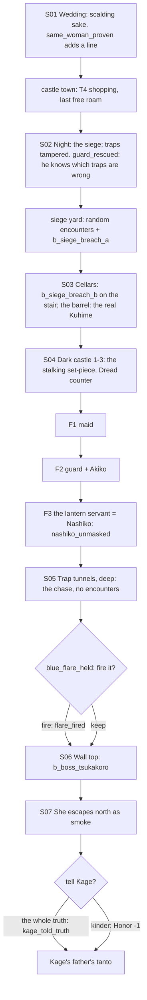

# STORYBOARD — Crab Ch4 · "The Fairest One of All"
Production: `production/crab-ch4.md` · Lv 41–45 · Region: **Kyuden Hida** in summer (the KH node from Ch2, with
wedding banners), then under siege at night.
Bestiary F: *Kyuden Hida environs* (Ch4 rows: IV palettes during the siege).

## Flow


## Maps

### T `kyuden_hida_town` (summer) and `kyuden_hida_wedding`
- The town from Ch2 with summer palettes. **Shops now at Crab T4:** Hida Tetsubo, Kaiu Iron Mountain, Jade T4 variants.
  Trading the Bone-cage Fragment comes after the boss.
- The wedding uses the 6F audience hall, re-dressed. Natsuko stands at the back. Kuhime's lines play (production S01).
- **Last free-roam window:** after S01 the night siege starts, and the chapter runs on rails to the end. Prompt:
  "Night will fall when you return to the castle." (finding F-4)

### M1 `kyuden_hida_siege` — the outer yard under attack (dungeon, part 1) · Danger 42–46
```
 ################# THE KAIU WALL (fire, horns) #################
 #  [gate tower]  goblins on ladders ≈≈≈≈≈≈≈≈≈≈≈≈≈≈≈            #
 #  Takakana!S02     ≈≈ b_siege_breach_a ≈≈     c (a burst supply crate) #
 #  [broken roller trap]*  [filled pit]*   ≈≈≈≈   C (armoury, locked)    #
 #  guard!(guard_rescued)        >M2 cellar stair (b_siege_breach_b)       #
 ##################################################################
```
| Spot | What |
|---|---|
| `*` tampered traps | Trap tiles that hurt (roller, pit). **[IF guard_rescued]** he marks them, so no trap damage (fix F-2: a real payoff for carrying him home) |
| `≈` | Random encounters during the siege: Bakemono Wolf-rider IV, Maho-bujin IV; uncommon Ogre |
| `b` | `b_siege_breach_a` in the yard (new, finding F-1) |
| `c` | Ginseng Tonic ×3 · Jade Pouch ×2 |
| `C` | The armoury: **Hida Tetsubo** (T4) or Kaiu Iron Mountain |

### M2 `cellars` — the cellars (S03)
```
 :stair (b_siege_breach_b: the ogre goes for the courtiers)
 [pickle barrels]  courtiers (frightened)   [wax-sealed barrel]!S03
 c (sake store: Fine Sake ×2)    >dark_castle_1 (back up the servants' stair)
```
- `b_siege_breach_b` on the stair: protect the courtiers. Natsuko's Razor's Edge draws the ogre away from them.
- Save point `§` by the barrels **after** S03 ("prepare before you climb").

### M3 `dark_castle_1–3` — the stalking set-piece · no random encounters
```
 F1 (great hall, lanterns out)   F2 (stairwell + guest wing)       F3 (children's quarters, roof door)
 @cellar stair                   @                                  @
  maid!(sake test)                guard!(stone test)                servant with lantern!(Nashiko)
  [split junction]⇆               Akiko!(jade-glove test)  [split]⇆  laughter from every direction
  >F2                             vent: Squeak (nezumi_friends)       >trap_tunnels_deep
```
| Mechanic | Rule (production `SYSTEM`, with the details the simulation needed) |
|---|---|
| **Tests** | At each disguised NPC, pick a test: *offer hot sake* · *give a smooth stone "jade"* · *brush with the jade-dust glove*. Then pick *Accuse* or *Let pass*. |
| **Dread** | Starts at 0, max 3. Each wrong accusation, or an accusation without a test, adds 1. At 3, she knocks out one party member (they return after the boss). Then Dread resets. |
| **"One mind at a time"** | At each `⇆` split junction, the field command *Split up*: two travelers go different ways and she can follow only one. Dread −1, once per floor (finding F-3: this replaces "split the party", which had no mechanic) |
| Order | Fixed: maid (F1) → guard and Akiko (F2) → the servant (F3). The real Nashiko is always the lantern servant, so the challenge is in testing properly, not in guessing. |
| Chests | **None** (the stalk keeps its tension). The yard and cellars hold this chapter's chests. |

### M4 `trap_tunnels_deep` — the chase (S05) · no random encounters
```
 @F3 stair ==*roller==*jade==*spiked pit==  (Nashiko screams behind)  ==> tunnel mouth !flare choice >M5
```
- An auto-scroll chase cutscene with 3 prompts: Natsuko springs a trap behind her each time.
- The tunnel mouth `!` is the blue-flare choice.

### M5 `wall_top` — the boss (S06–S07)
```
 ######## battlements ########
 #  Nashiko (floating, smoke)  #
 #  Oni no Tsukakoro   B       #   [IF flare_fired] Crab archers along the parapet
 #  @tunnel mouth              #
 ##############################  (S07: Kage on the Wall steps at dawn)
```

## Simulated playthrough
1. Lv 41. The wedding, then the town (T4 shopping; the prompt warns that night falls on return).
2. The siege yard: about 4 encounters plus `b_siege_breach_a`. The tampered traps hurt unless the guard was
   rescued in Ch3. **Before this pass the chapter had one battle in total; it now has 3 fixed battles plus
   encounters,** in line with an OT Ch4.
3. Cellars: the stair battle (protect the courtiers), then the barrel. Save.
4. The stalk: about 8 minutes. The tests are clear. *Split up* gives the player a tool against Dread.
5. The chase cutscene → the flare choice → the boss (Razor's Edge redirects *Bounce Chain*) → smoke north → Kage.
   Total ≈ 80 minutes.

## Findings → fixes
| # | Finding | Fix |
|---|---|---|
| F-1 | Only one battle in the whole Ch4 (the boss) | `b_siege_breach_a/b` (bosses.md) plus siege-yard encounters |
| F-2 | `guard_rescued` only changed dialogue in Ch4 | He marks the tampered trap tiles in the siege yard (no trap damage) |
| F-3 | "Split the party to confuse her" had no mechanic | *Split up* at junctions: Dread −1, once per floor |
| F-4 | The chapter runs on rails from nightfall; the player might not have shopped | A last-free-roam prompt before returning to the castle |
| F-5 | Stalking floors with chests would break the tension; the castle must stay revisitable | No chests in the dark castle; the yard and cellar chests stay revisitable as normal castle maps |
