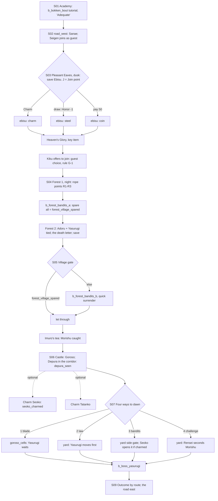

# STORYBOARD — Crane Ch1 · "Heaven's Glory"
Production: `production/crane-ch1.md` · Lv 1–8 · Regions:
- **Kakita Academy** (KA, near Kyuden Doji, east coast).
- **Beiden Pass** (VP: Map A's "Beiden", in the hills between the Lion and Scorpion; Map B: an Akodo enclave on the
  Lion–Scorpion road).

Overworld: **KA** → `road_west` (a 4-day palanquin trip shown as a cutscene plus 1 field screen) → **VP** Pleasant
Eaves → the forest → Goroso's castle.
Bestiary F: *Crane coast & Beiden forest* (2–8).

## Flow


## Maps

### M1 `kakita_academy` — the Kakita Dueling Academy (starter only; the KA node later)
```
 ######## [dojo hall] ######## [Masanori's veranda]!
 #  white-sand courtyard: b_bokken_bout (S01)          #
 #  [students' quarters I]  c (Rensei's chest: Rice Ball ×3, Travelling Clothes)  #
 #  [Kakita smith W] (closed: "graduates only, Rank 2")  >road_west (gate)           #
 ######################################################
```
- After the chapter, KA is a **revisit node**. The Kakita smith opens at Rank 2: Crane katana shop T2+, and the
  forge for Fine Katana Fragments (`equipment.md` A2). Students run a **Duel ladder** (Shizue's path action, R2+).
- In the epilogue it hosts Rensei's coda (`kakita_academy` E01).

### R `road_west` — the mountain road (S02; 1 screen plus a "four days" fade) · Danger 2–8
```
 @KA ==== palanquin ==== (fade: "Four days of road") ==== c ==== ≈≈ ==== >VP Pleasant Eaves
                                       Seigen rides up!S02     c*(Hunting: a hollow → boar)
```
- `c`: Rice Ball ×2, 60 zeni. `c*`: Hunting 2 → a fixed Wild Boar fight → Boar Meat ×2.
- **Seigen joins** here as the guest (Evidence).

### T `pleasant_eaves` — Pleasant Eaves (1 screen, "a short street")
```
 %%%%%%%%%%%%%%%%%%%%%%%% Mountains' Cloak Forest %%%%%%%%%%%%%%%%%%%%%%%%%%%%
 % >forest_1 (north path)       [shrine +]   3(old woman)                      %
 @road_west === muddy street ======!S03 (Ebisu in the mud) J ==================== > Beiden Pass road (to SA)
 [inn I] 4(innkeeper)   [headman's house]2 C   [peddler S/W]6   1(Ebisu, after S03)   5(bruised youth)
 c (behind the inn: woodpile)      7(Lion tax-collector at the gate)
```
**NPCs and path actions** (*(added)* rows give every path action a target, finding F-6)
| # | NPC | Path action | Result |
|---|---|---|---|
| 1 | Ebisu | Discern / Charm | Discern: "Found it by the waterfall." Charm: he leads you to the **waterfall glade** (forest 1 side path) |
| 2 | Torishigawa (headman) | Discern / Charm / **Eavesdrop** *(added)* | Discern: "He knows where the bandits are." Charm fails. Eavesdrop: at the back door he tells a runner, "Let the Crane through if they come gently." |
| 3 | Old woman | **Bless** *(added)* | Follows (battle: "Green Ronin's Blessing", small party heal, 1 use) |
| 4 | Innkeeper | Barter / **Pilfer** *(added)* | Barter: Rice Balls. Pilfer: Fine Sake |
| 5 | Bruised youth | **Sumai** *(added)* | Win → he apologises to Ebisu (Honor +1) and gives Straw Sandals (sell) |
| 6 | Peddler | shop | **Lion T1 (fix F-5):** Ashigaru Yari, Ronin's Katana, Ashigaru Lamellar, Rice Ball, Antidote |
| 7 | Lion tax-collector | **Duel** *(added)* | Iaijutsu 1 → Glory +1 · Ashigaru Yari (fine) |
| `C` | Headman's storehouse | locked box | The **tax ledger** (lore: Goroso's taxes have tripled) + 150 zeni |
| `c` | Woodpile | chest | Antidote ×2 |
| `J` | **Join point** (non-starter) | | The Ebisu beating plays as the party enters. Rensei steps in, then talk to him |

### D1 `mountains_cloak_forest_1–2` — Mountains' Cloak Forest (night dungeon) · Danger 3–8
```
 forest_1                                                   forest_2
 @PE ≈≈≈ lanterns drift ≈≈≈ R1(rope)* ≈≈≈ c                 >F1
   ≈≈ [waterfall glade]*E (Ebisu-led) c ≈≈                     [clearing] Adoru + Yasurugi tied!  c
   ≈≈ R2(rope + soft ground)* → [pit trap]                      § save (after S04)
   ≈≈ R3("ghost" lantern)* → twins  b_forest_bandits_a          >bandit_village (trail)   c (dead end: an old Kakita
   >F2                                                                                     training post: Kozuka)
```
| Spot | What |
|---|---|
| R1–R3 `*` | The rope interaction points (production). Cutting R2 first reveals the pit. Walking into it without cutting R2 costs 10% HP and lands the party in the pit chamber, which has a chest (Eye Drops ×2): a forgiving failure |
| Waterfall glade `*E` | Only with Ebisu (Charm) or Gendo (Discern, the scuffed rocks). **Morishu's Inro** (lore: a letter he never sent his mother) + Old Whetstone |
| F1 `c` | Rice Ball ×2 · Jingasa |
| F2 `c` | 120 zeni · Bamboo Yumi |
| F2 dead end | An old Kakita training post → Kozuka |
| `§` | Save after the clearing scene |
- Encounters: Road Bandit I, Grey Wolf, Wild Boar; uncommon Hungry Ronin; rare Will-o'-wisp (the real ones, among the fake lanterns).

### M2 `bandit_village` — the Green Ronin's village
```
 ^^^^^ terraced paddies """" ^^^^^^
 ^ [gate: spears]!(b_forest_bandits_b unless spared)       ^
 ^ [Imuro's house: tea mat]!S05   Sariko   children         ^
 ^ [village shrine +]   c (granary)   [inn mat = I]          ^
 ^^^^^^^^^^^^^^^^^^^^^^^ >goroso_castle (road down) ^^^^^^^^
```
- The gate battle is `b_forest_bandits_b`, now used (finding F-2). The bandits surrender on turn 2–3.
  [IF forest_village_spared] the gate opens instead.
- `c` granary: Rice Ball ×4 (Imuro: "Take them. You'll need them more than the Lion tax-man.")
- The **inn mat** gives an inn rest plus TB-crane1-a.

### D2 `goroso_castle_hall` / `goroso_castle_corridor` / `goroso_cells` / `castle_yard`
```
 hall (S06)                 corridor (S06–S07, guest room)            cells                       castle_yard (dawn)
 Goroso on the dais          Depura + Tama (around a corner)!          [Morishu's cell]            crowd ring  B(routes 2/3/4)
 Sanae kneels; Rensei at      Seoko (garden window)1  Tatanko (shrine)2   Yasurugi in the dark B(route 1)   [side gate]* (route 3:
  the door                    [guest room]!S07 (the choice) § save       c (jailer's box: Antidote)       Seoko opens it if charmed)
```
- **Boss arenas by route (finding F-3):** route 1 → `goroso_cells`; routes 2, 3 and 4 → `castle_yard` (route 3
  starts at the side gate). Same battle in each.
- **Route 2 now has a reason for the fight (F-3):** Yasurugi moves to kill Morishu before the executioner can, so
  the Kakita name dies by a Kakita hand. Rensei intercepts.
- `§` save in the guest room, before the dawn choice.

## Simulated playthrough
**Starter:**
1. The academy tutorial (Lv 1) and road_west: about 3 encounters, Lv 2–3 on arrival.
2. Ebisu choice → Kiku offers to join. **A guest-slot conflict appeared here:** Seigen is already the guest. Under
   the new rule G-1, the player picks one and the other waits at the inn. Kiku is the default because her *Battle-Joy*
   is better in the forest; Seigen's *Evidence* is better for the boss.
3. Forest at night: the ropes, the battle (sparing everyone is easy: they surrender) → the clearing → save.
4. Village tea → castle. Depura sets `depura_seen` automatically. The Seoko and Tatanko Charms are optional.
5. The dawn choice → the boss (the duel phase, then the skirmish). Route 4 gives Heaven's Glory, locked until R2.
   Total ≈ 85 minutes.

**Recruit:** a party coming down the Beiden road from Shiro Akodo, or from the Scorpion north road, sees the Ebisu
beating on entry. Rensei acts, then talk → join → Memory (S01–S02: graduation, "Adequate", Sanae and Seigen).
The Charm/steel/coin choice still belongs to Rensei.

## Findings → fixes
| # | Finding | Fix |
|---|---|---|
| F-1 | Two guests at once (Seigen, then Kiku); the battle rules allow 1 guest | Cross-cutting rule **G-1** (README §3b): one active guest; others wait at the inn and can be swapped at any inn |
| F-2 | `b_forest_bandits_b` was listed but never used | Used at the village gate when `forest_village_spared` is not set |
| F-3 | The routes 1–3 boss took place in "the cell corridor / the crowd / the forest edge", and route 2 had no reason to fight | Arenas fixed (cells for route 1; the yard for 2–4); a route 2 motivation line added |
| F-4 | Route 3 never said where the sword goes | Morishu vanishes with it (production line) |
| F-5 | Pleasant Eaves had no shop | A peddler with Lion T1 stock |
| F-6 | Eavesdrop, Bless, Pilfer, Sumai and Duel had no targets in the town | NPC rows added |
| F-7 | Non-starter version | Join point + Memory (production) |
