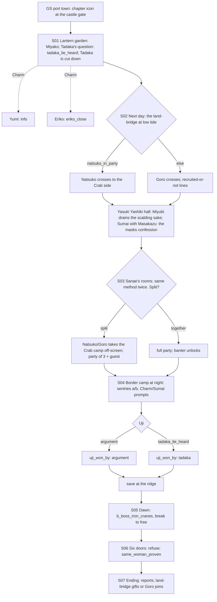

# STORYBOARD — Crane Ch2 · "The Iron Cranes" (Crossroads: Two Faces of the Border)
Production: `production/crane-ch2.md` · Lv 20–25 · Owner: Rensei · Partner: Natsuko (stand-in: Hiruma Goro)
Region: **the Crab–Crane coastal border** (Map A: between Yasuki Estates and the Southern Crane coast; Map B: where
the red Crab border meets the blue Daidoji border on the sea).
Overworld: **GS** Garden Under Shadow City ⇄ `land_bridge` (tidal) ⇄ **YY** Yasuki Yashiki; the border meadow camps in
between. Bestiary F: a new **Crab–Crane border** row (finding F-6).

## Flow


## Maps

### T `garden_under_shadow` — the Daidoji port (town + castle; the port town screen is new, finding F-3)
```
 ~~~~~~~~~~~~~~~ harbour (Daidoji warships) ~~~~~~~~~~~~~~~~~~~~~~~~~~~~
 ~ [docks] c       [fish market S]   [Daidoji armoury W/A]   [inn I]   ~
 = port street ================================================== > land_bridge (south)
 [castle gate]!chapter icon  >castle: [lantern garden]!S01 · [Sanae's rooms]!S03 · [Miyako's chamber]!S06
 [Kakita Yumi's studio]1     [shrine to Suitengu +]    t [tea house]    C (harbour office)
```
| Spot | What |
|---|---|
| Shops | **Crane T2:** Clan Katana, Lacquered Do-maru, Rattan Yumi, Herbal Salve, Fine Sake; Daidoji War Fan blueprint (display only) |
| `1` Kakita Yumi | Charm (production info) |
| Daidoji Eriko (garden) | Charm → `eriko_close` |
| Harbour master | **Barter**: Sea Salt ×3 (a Remedy ingredient), Tide Chart (key item: shows when the land-bridge is open) |
| Dock porter | **Pilfer**: Pirate Charm (fake) |
| Daidoji sailor at the docks | **Sumai**: win → "Wako come in on the north tide" (Crane Ch3 foreshadowing) |
| Old Daidoji veteran (tea house) | **Duel** (Iaijutsu 3): Daidoji Sash (sell) · Glory +1 |
| Shrine priest | **Bless**: follows ("Tide Blessing", Water resist for the party, 2 uses) |
| Doji Miyako (garden; S01 only) | **Blank** (rule N-1): Discern → "Flawless. Not a single crack. No one is flawless." Eavesdrop → "She stops speaking whenever you are near." |
| `c` docks | Herbal Salve ×2 · 400 zeni |
| `C` harbour office | Locked box: a copy of the Daidoji–Crab trade treaty (lore) + Fine Sake |

### R `land_bridge` — the tidal land-bridge (field route, 1 screen) · Danger 20–25
```
 YY >  ==== sand causeway ≈≈≈≈≈≈≈≈≈≈≈≈≈≈≈ c ≈≈≈≈≈≈≈≈≈≈ ==== < GS
        ~~~~~~ (high tide: underwater) ~~~~~~   c*(a tide pool, low tide only)
```
- **Tide rule (finding F-4):** the causeway is crossable at **low tide only**. At the bridgehead, a prompt: *"Wait for
  low tide?"* (a fade). In S02 the story sets low tide automatically.
- `c`: Herbal Salve. `c*`: low tide only → Crab Shell ×3 + a **Pearl** (sell 600).
- Encounters (new bestiary row): Border Patrol, Tide Crab (II palette), Glory-Hungry Bushi; uncommon Sword-for-Hire;
  rare Yurei (at night).

### T `yasuki_yashiki` — the Yasuki estate (town + hall; a revisit node)
```
 ######### [Yasuki hall]!S02 (scalding sake; sumai ring) ##########
 #  [Yasuki market: the best sell prices in the game, +10%]  S W A  #
 #  [inn I]   [Kuni shrine +] Kuni Akuja (relics)   [warehouse C]   #
 @land_bridge ============================================ >Crab road (to HI / KH)
```
- **Shops: Crab T2** plus Yasuki goods (gaijin pepper as a Remedy ingredient). **Selling earns +10% here** (the
  Yasuki merchant identity).
- Hida General Masakazu: **Sumai** (production). Kuni Miyubi: **Blank** (rule N-1) — Discern: "She smiles at
  nothing in particular, all the time."
- `C` warehouse: Jade Dust ×4 + 500 zeni.

### D `border_camp_1–2` — the border conference (night dungeon)
```
 border_camp_1 (the Crane lines, night)                         border_camp_2 (dawn; the Crane lines → meadow)
 @meadow   tent tent tent ≈≈≈ b_camp_sentries_a                  ridge (Miyako in white)
  ≈ sentry (Charm)*  ≈  tent [Uji's tent]!S04                    [the three Iron Crane generals]  B
  ≈ b_camp_sentries_b ≈ c (quartermaster wagon)                  § save at the ridge foot (before the boss)
  ≈ c*(Crab side, Sumai prompt)  meadow edge: Yakamo!            c (a dropped general's fan: Daidoji War Fan, only if all 3 freed)
```
| Spot | What |
|---|---|
| `≈` | Random encounters (the border row) between the fixed sentry battles |
| `*` | Charm prompt (Rensei), Sumai prompt (Natsuko, if present and **together**) |
| `c` | Ginseng Tonic · Incense ×2 |
| `§` | Save at the foot of the ridge (production had no save between the camp and the boss; finding F-7) |
| **camp_split (F-5)** | **split:** Natsuko (or Goro) leaves the active party at the camp entrance and takes the Crab camp off-screen. Yakamo's scene plays as her report, with a better line. She rejoins for S05. **together:** the full party; Yakamo is met live at the meadow edge; TB-crossroads1 unlocks. |

### M `miyako_chamber` — the six doors (S06)
- A cutscene room. Door visions: Rensei's cousins; **[IF natsuko_in_party AND nezumi_friends] Squeak and the young
  nezumi; [ELSE IF natsuko_in_party] Sachiko and Ryoichi asleep in the barracks** (F-2).

## Simulated playthrough
1. Lv ~20 after Crane Ch1 plus other Ch1s. The port town gives T2 shopping and a tea-house Duel. The Tide Chart from
   the harbour master stops the land-bridge from being a mystery.
2. S01: Tadaka's lie, then his death, makes Rank-1 helplessness concrete. The Eriko Charm pays off in the boss barks.
3. S02 (Natsuko): fun Sumai with Masakazu. (Goro): if the player never met Goro at Kyuden Hida, the old line "the
   bodyguard Rensei met at Kyuden Hida" made no sense. It is now conditional (F-1).
4. S03: the split choice now changes something concrete: party size in the camp versus a live Yakamo scene and a
   banter.
5. Camp: 2 fixed battles plus 3–4 encounters, the Uji choice, save, then the boss (Break to free the generals; a
   good Suki tutorial at R2).
6. Six doors → `same_woman_proven` → reports → gifts on the land-bridge. Total ≈ 90 minutes.

## Findings → fixes
| # | Finding | Fix |
|---|---|---|
| F-1 | The stand-in line assumed Rensei had met Goro at Kyuden Hida; Goro might also be recruited already from his own side story | Conditional lines: [IF goro recruited] old friend; [ELSE] "a Crab bodyguard on loan from the Yasuki". The end-of-chapter `+Goro` only fires if he isn't recruited yet |
| F-2 | Natsuko's door vision showed Squeak even without `nezumi_friends` | Conditional on `nezumi_friends`, with a barracks fallback |
| F-3 | No inn or shops at the port | A port-town screen added to `garden_under_shadow` |
| F-4 | The tidal land-bridge had no traversal rule | "Wait for low tide?" prompt; the Tide Chart key item |
| F-5 | `camp_split` had no mechanical meaning | Split: −1 party member in the camp, Yakamo as a report; together: full party, live scene, banter |
| F-6 | No encounter table for the border | New bestiary row: Crab–Crane border (20–25) |
| F-7 | No save point between the night camp and the dawn boss | `§` at the ridge foot |
