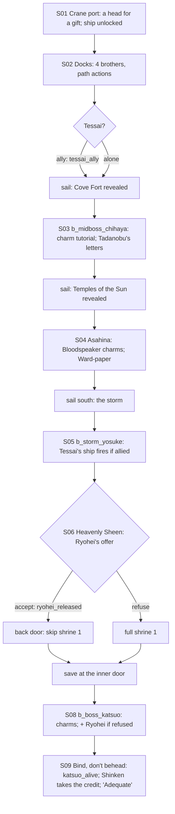

# STORYBOARD — Crane Ch3 · "The White Squid"
Production: `production/crane-ch3.md` · Lv 30–35 · Region: **the Crane sea** (Map A: the Northern Crane coast below
Slow Tide Harbor and the islands off the coast; Map B: the blue Doji/Asahina coastline and the dotted sea lanes).
Overworld: **CP** Crane port → **the ship** (sea travel unlocks) → sea nodes revealed one by one.
Bestiary F: *Crane sea & isles* (20–35).

## Flow


## The ship (new hub)
- `ship_deck` is the travelling hub: the **cabin** gives an inn rest, save and party swap (the swap is allowed on
  the ship, finding F-6), and the ship's master sells **Mantis-isles T1–T3** sea gear.
- **Sailing** works like OT2's sea map: a sea chart with nodes, and **sea encounters** on the way (Wako Raider, Sea
  Serpent Eel, Tide Crab; uncommon Mantis Corsair; rare Umibozu Shade in storms).
- Nodes are **revealed by the story**: Cove Fort → Temples of the Sun → the south islands (Heavenly Sheen, with the
  storm en route). After the chapter the ship stays, and sea travel joins the Crane coast, the Phoenix coast and the
  Mantis isles (README §4c).

## Maps

### T `crane_port` — the Crane port (town)
```
 ~~~~~~~~~~~~~~~~~~~~~~~~~~~ harbour: [your ship] ~~~~ [Tessai's ship] ~~~~~~~~~~~~~~
 ~ [docks]: 1 fishwife · 2 drunk sailor · 3 net-mender · 4 charm-seller · Tessai!   c ~
 = harbour street ======================================================= @ coast road (to KD)
 [Sanae's quarters]!S01/S09   [Crane armoury W/A]  [chandler S]  [inn I]  t   [shrine to Suitengu +]
 C (customs house)    5 (Otomo Shinken's clerk)   6 (a Daidoji marine)   7 (a Doji courtier)
```
| # | NPC | Path action | Result |
|---|---|---|---|
| 1 | Fishwife | Discern | "Four ships, all the same, all painted white." |
| 2 | Drunk sailor | Eavesdrop | "Yosuke the Bold drinks in the south islands." |
| 3 | Net-mender | **Barter** *(added)* | Storm Kama (T3 Tanto-class) |
| 4 | Charm-seller | Discern / **Pilfer** *(added)* | Discern: "…'the White Brother' — Katsuo — at a shrine." Pilfer: a **real** White Squid charm (the Bloodspeaker kind; Taint +1 when equipped; sells for 2,000) |
| 5 | Shinken's clerk | **Charm** *(added)* | Info: "The magistrate sails in four days. She always arrives when it's safe." (flavour: the rival is not a timer, F-3) |
| 6 | Daidoji marine | **Duel** *(added)* | Iaijutsu 4 → Daidoji War Fan · Glory +1 |
| 7 | Doji courtier | **Bless** *(added)* | Follows ("Courtly Grace", party Etiquette up: Charm odds +10% in this chapter) |
| — | Dock porter | **Sumai** *(added)* | Win → a stevedore's gossip: "The fourth white ship is never loaded. It's a decoy." |
- Shops: **Crane T3** (Fine Katana, Scorpion Silk Armour — imported, Daikyu-pattern Yumi), Ginseng Tonic, Fine Sake.
- `c` docks: 1,000 zeni · Eel ×2. `C` customs house: Pearl ×2 + Tsuruchi arrow-crate (Daikyu-pattern Yumi).

### S `cove_fort` — the first island (mid-boss)
```
 ~~~ [moored white ship] ~~~ mooring rope: Chihaya! (b_midboss_chihaya) ~~~
 ~  [palisade]  c (pirate store)  c*(Athletics 4: up the lookout)  ~
 ~  @landing  ≈≈ (beach encounters) ≈≈                                                                       ~
```
- `c`: Ginseng Tonic ×2. `c*` (Athletics 4): Pirate Charm ×2.
- After the mid-boss: Chihaya's sash holds **Tadanobu's Letters**.

### T `temples_of_sun` — the Asahina temple (small temple-town node)
```
 [white-wood temple]!S04 (the priest)   [Asahina charm-house S: Robes T3, Incense, Ward-papers]   [pilgrim inn I]
 @ sea steps (from the ship)     + [sun shrine]     c (offering box, Bless-locked: Haruki → Rejuvenating Tea ×3)
```
- The **Asahina Ward-paper** is given in S04, and more can be bought here (a consumable version: one battle).

### S `storm_sea` — the storm (S05) and `heavenly_sheen_isle` (S06)
```
 storm_sea: ship deck in the rain · the Orochi silhouette (cutscene) · b_storm_yosuke (boarding battle)
 heavenly_sheen_isle:
 ~~~ white sand ~~~ Ryohei! (white flag) ~~~ [cliff path] > squid_shrine_1 (front) ~~~
 ~  c (a wrecked tribute crate: the Emperor's lacquered screen, a key item, returned in S09)  ~
 ~  [hidden cove]* (Hunting 5: tracks → the shrine's back door, opened only if ryohei_released) ~
```
- **[IF tessai_ally]** Tessai's ship fires a broadside in `b_storm_yosuke`: fixed damage on turn 2 (finding F-1).
- The tribute screen `c` is a key item, and S09 gets a line for it: Sanae: "And the screen?" Rensei: "In the hold,
  my lady. Slightly damp."

### D `squid_shrine_1–2` — the White Squid shrine (dungeon) · Danger 32–35
```
 squid_shrine_1 (front: charm workshops)               squid_shrine_2 (inner)
 @cliff path   brushes/bones/ink   c  c(Tessai's)       >S1 or the back door
  ≈ tide-pools (glow) ≈  c (dead end: drowned shrine)    [inner door] § save (new, F-4)
  [something white moves in the deep water]!            Katsuo painting charms  B   (+ Ryohei, if refused)
  >S2                                                    c (after the boss: Katsuo's paint box — Fine Sake ×2, Poison Kit)
```
| Spot | What |
|---|---|
| `c(Tessai's)` ×2 | **[IF tessai_ally]** Tessai claims these two loot chests ("My cook's knives!"); otherwise they're yours: Fine Katana + 1,500 zeni (the "cleaner, but you keep the loot" trade-off, F-1) |
| Other `c` | Ginseng Tonic ×2 · Sea Salt ×3 · (dead end, drowned shrine) Eel ×3 + Pearl |
| `§` inner door | **New save point** before the boss. The production `[SAVE]` was at the outer gate, which left a whole dungeon between the save and the boss (F-4) |
| Back door | **[IF ryohei_released]** enter straight into shrine_2 at the save point: shorter, and Katsuo fights without Ryohei (F-2) |
- Encounters: Wako Raider (III palette), Mantis Corsair, Sea Serpent Eel; rare Umibozu Shade (flooded hall only).

## Simulated playthrough
1. Lv ~30. The port shops (T3) and path actions. The four-brothers info comes from the docks. Choosing **Tessai**
   means a broadside in the storm but losing 2 loot chests. **Alone** means no help but all the loot.
2. Sailing: the sea chart shows Cove Fort only. About 2 sea encounters per leg. Chihaya (the mid-boss) teaches
   stealing and breaking charms before the boss uses them.
3. Temples (a short stop) → the storm (cutscene plus the boarding battle) → the isle. Ryohei's offer: **accept**
   gives a shorter dungeon and an easier boss; **refuse** gives a full dungeon and Ryohei in the boss.
4. The shrine: save at the inner door → Katsuo: steal or break the charms; his 25% line, then "Then I won't kill you."
5. Port: Shinken takes the credit; "Adequate" from Sanae. Total ≈ 95 minutes (about 75 with the back door).

## Findings → fixes
| # | Finding | Fix |
|---|---|---|
| F-1 | `tessai_ally` had no effect besides one bark ("a second ship"; "slower, cleaner") | Ally: a storm broadside, but Tessai takes 2 shrine loot chests. Alone: no help, all the loot |
| F-2 | Ryohei's "back door" didn't change the dungeon | `ryohei_released` → enter at shrine_2's save point (shorter route, easier boss) |
| F-3 | The rival magistrate is called a "story clock" but there is no timer | Marked as flavour only (gimmick budget: the fake charms) |
| F-4 | The only dungeon save was at the outer gate | `§` added at the inner door |
| F-5 | `katsuo_alive` was in the header but never set | `[SET katsuo_alive]` in S09 (always set: Rensei binds him) |
| F-6 | The ship had no rest or swap point, though sea legs are long | The ship cabin works as an inn (rest, save, swap) |
| F-7 | The stolen tribute screen was never recovered | A key item on Heavenly Sheen, and an S09 line |
