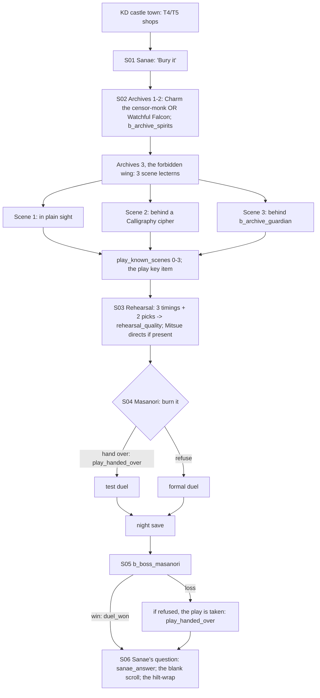

# STORYBOARD — Crane Ch4 · "The Play No One Performs"
Production: `production/crane-ch4.md` · Lv 41–45 · Region: **Kyuden Doji** (Map A: "Esteemed Palaces of the Crane",
Northern Crane coast, south of the Quiet City; Map B: the Doji heartland).
Overworld: **KD** (castle town + castle + archives) and **KA** (the Kakita dueling ground next door).
Bestiary F: *Kyuden Doji archives* (40–46), now with 3 archetypes (finding F-4).

## Flow


## Maps

### T `kyuden_doji` — the castle town (screen added) and the court
```
 ~~~~~~~~~~~~~~~~~~~~~~~ sea ~~~~~~~~~~~~~~~~~~~~~~~~~~~~~~~~~~~~~~~~~~~~~~~~~~
 [castle: court · Sanae's rooms!S01/S04/S06 · archive stair >D]   [rehearsal hall (night)!S03]
 = garden avenue (white gravel) ================================================ > KA dueling ground
 [Doji silk house A]  [Kakita sword gallery W]  [apothecary S]  [inn I]  t [tea house: actors]  + [Amaterasu shrine]
 1 censor's clerk   2 Doji poet   3 Kakita smith's apprentice   4 Asahina pilgrim   5 a Daidoji guard   c   C
```
- **Shops: Crane T4** (Excellent Katana, Shadow Cloth, Tsuruchi Longbow) and some **T5** items (Master-forged Katana
  needs 3 Fine Katana Fragments at the Kakita smith). This is the expensive-accessory hub.
- **NPC path-action targets:**
  - Censor's clerk: Eavesdrop → "Shelf nine is warded with a cipher only a calligrapher reads."
  - Doji poet: Charm → follows ("Verse of Reproach": enemy ATK down, 2 uses).
  - Smith's apprentice: Barter → Fine Katana Fragment ×1.
  - Asahina pilgrim: Bless → Rejuvenating Tea ×3.
  - Daidoji guard: Duel (Iaijutsu 6) → Champion's Sageo · Glory +2.
  - Actor at the tea house: Sumai (a drunk actor!) → a costume: **Actor's Mask** (sell / Mitsue flavour).
  - Pilfer: the poet's purse → 1,500 zeni.
- `c`: Ginseng Tonic ×3. `C`: Fine Sake ×3 + a Doji Mon Charm.

### D `doji_archives_1–3` — the archives (dungeon) · Danger 40–46
```
 archives_1 (public stacks)          archives_2 (sealed stacks)              archives_3 (the forbidden wing)
 @castle stair                       >A1                                     >A2
  censor-monk!(Charm / Falcon)        ≈ paper storms ≈  b_archive_spirits     [lectern 1]* Scene 1 (in plain sight)
  ≈ shelves ≈  c   c*(Discern:        c  c (dead end: a misfiled diary of     [lectern 2]*C Scene 2 (Calligraphy cipher:
   a misfiled box → Old Paper lore)    Komatsu's steward → lore)              Haruki 3 / Gendo 3 / Rensei's Watchful Falcon)
  >A2                                  § save                                [shelf nine] b_archive_guardian → [lectern 3]* Scene 3
                                                                              + the margin note
```
| Spot | What |
|---|---|
| Censor-monk | **Charm** (production), or the **Watchful Falcon** kata (hidden shelves glow) |
| `≈` | Encounters: Paper-spirit; **new** Ink-pot Spirit and Lantern Spirit (tsukumogami; bestiary D) |
| A1 `c*` | Discern (Gendo): a misfiled box → Old Paper ×3 (lore, sell) |
| A2 `c` | Elemental Master's Mantle (T4 robe) · Kansen Mist ×2 |
| A2 dead end | Komatsu's steward's diary (lore: names "the bride who never blinked") |
| A2 `§` | Save |
| **Scene lecterns (F-3)** | Scene 1: in plain sight. Scene 2: behind a **Calligraphy cipher**, which needs Haruki or Gendo at Calligraphy 3, or Rensei with Watchful Falcon equipped. Scene 3: behind `b_archive_guardian`. Each reading is `[play_known_scenes +1]`. The margin note comes with Scene 3. |
| After the guardian | Shelf nine: the play (key item) |

### M `rehearsal_hall` (S03) and `kakita_dueling_ground` (S05)
```
 rehearsal_hall: [stage] three actors · costume trunk (Mitsue, if present) · prompts at the stage edge
 kakita_dueling_ground (KA): white sand · the veranda (court, Sanae) · Masanori · B
```
- **Save** in Sanae's rooms the night before the duel (F-6). The production went straight from S04's choice to dawn.

## Simulated playthrough
1. Lv 41. The town (T4 shopping), then Sanae's order. The archive is the only dungeon. **Before this pass it had
   one enemy type** (Paper-spirit), now three (F-4).
2. A1–A2: the censor-monk gate (Charm or Falcon) → 2 fixed battles → save. A3: in the old text all three scenes
   were read automatically, so `play_known_scenes` was always 3 and the finale checks for `≥ 1` were meaningless.
   Now the scenes depend on skills and a fight (F-3). A Rensei-only party gets Scene 2 with Falcon equipped, so it's
   never locked out.
3. Rehearsal: a short set-piece. Mitsue's lines make it a crossroads moment.
4. S04 choice → night save → the duel.
   - **Bug:** `[SET duel_won]` fired after both the win and the loss text (F-1).
   - **Gap:** refusing and then losing left the play in limbo. Now Masanori takes it, so `play_handed_over` is set
     and Sanae's copy covers it (F-2).
5. S06: Sanae's question, the blank scroll, the hilt-wrap. Total ≈ 85 minutes.

## Findings → fixes
| # | Finding | Fix |
|---|---|---|
| F-1 | `[SET duel_won]` was unconditional (it was set on a loss too) | Moved into the Win branch only |
| F-2 | Refusing, then losing, left the play's fate undefined | On a loss, if not handed over: Masanori takes it → `[SET play_handed_over]` (finale debuffs halved; Sanae's copy) |
| F-3 | `play_known_scenes` was always 3 | The 3 scenes are on 3 lecterns: plain sight / Calligraphy cipher / behind the guardian |
| F-4 | One enemy type in the whole archive | Ink-pot Spirit and Lantern Spirit added (bestiary D) |
| F-5 | Kyuden Doji had no town, and Ch4 has no other shop stop | Castle-town screen: T4/T5, NPC path actions |
| F-6 | No save between the S04 choice and the dawn duel | `[SAVE]` the night before |
