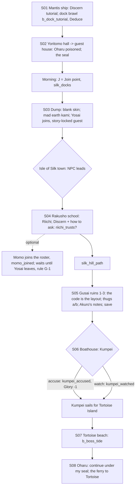

# STORYBOARD — Dragon Ch1 · "Under the Skin"
Production: `production/dragon-ch1.md` · Lv 1–8 · Region: **the Mantis Isles** (Map A: "Coastal Islands" off the
south-east, the Palace of the Mantis and the City of Lightning; Map B: the green Mantis island cluster with dotted
sea lanes).
Overworld: **IS** Isle of Silk. Reached by the **Mantis ferry** (from Hoshi-no-Ichi or Cakon, 100 zeni) when Gendo
isn't the starter.
Bestiary F: *Mantis isles (present)* (1–8).

## Flow


## Maps

### M1 `mantis_ship` — the opening (starter only)
- Deck: Oharu, the captain (Discern tutorial), crew.
- `c` cargo crate: Rice Ball ×3 (tutorial chest).
- Docking leads into `silk_docks` and `b_dock_tutorial`.

### T `silk_docks` (+ `yoritomo_hall`, `guest_house`, `rakusho_school`, `silk_boathouse`) — the Isle of Silk (town)
```
 ~~~~~~~~~~~~ harbour: [Mantis ferry pier] [trade junks] ~~~~~~~~~~~~~~~~~~~~~~~~~~~~~~~~~~~~
 ~ @pier  1 net-mender   2 fishwife   3 Storm Legion thug   [chandler S]  [kama-smith W]   c ~
 = waterfront ================================================================ > silk_hill_path (ruins)
 [Yoritomo hall]!S02    [guest house = I]!(Oharu, recovering)   [Rakusho school]!S04    t [sake house]
 4 Kosai (minder, follows you)    5 Mantis bushi   6 temple teacher   7 Muika (at the dump path) > silk_dump
 [boathouse]!S06 (east, locked until the ruins notes)   C (Yoritomo tax shed)     > tortoise_beach (south)
```
**NPCs and path actions** (*(added)* rows, rule T-1)
| # | NPC | Path action | Result |
|---|---|---|---|
| 1 | Net-mender | Discern | "Saw a 'Crane gentleman' with Nobue." (the S04 lead) |
| 2 | Fishwife | Barter | Eel (heal) |
| 3 | Storm Legion thug | Sumai (Natsuko) / **Pilfer** *(added)* | Sumai: Tortoise Ferry Token (early). Pilfer: Storm Legion Token (sell) |
| 4 | Kosai | Discern / **Eavesdrop** *(added)* | Discern: "Paid by Tadayasu to report everything. Badly." Eavesdrop: "He reports at the boathouse at dusk." (a hint for S06) |
| 5 | Mantis bushi | **Duel** *(added)* | Iaijutsu 1 → Fisherman's Kama (T1 Tanto-class) · Glory +1 |
| 6 | Rakusho teacher | **Charm** *(added)* | Follows ("Recitation": Confuse 1 enemy, 2 uses) |
| 7 | Muika (eta mortician) | Discern / **Bless** *(added)* | Discern: "Washed all three monks." Bless: she follows ("Mortician's Calm": cures Terror, 2 uses). Haruki leading an eta woman through the docks draws stares; that's intended. |
- Shops: **Mantis isles T1:** Fisherman's Kama, Bamboo Yumi, Travelling Clothes, Eel, Sea Salt, Antidote.
- `c` pier crate: 100 zeni · Rice Ball ×2. `C` tax shed: Mantis Sake? → **Fine Sake** + 200 zeni (a bribe ledger, lore).
- `J` **Join point** (non-starter): on the morning after S02, Gendo is on the pier, questioning the ferry crew. The
  party meets him as they step off the ferry.

### S `silk_dump` (S03)
```
 ^^^^ refuse heap above the sea ^^^^
 ^ Yosai (on top, persimmon)!       ^
 ^ [tarp: Nobue's body]!  Muika      ^
 ^ *trembling ground (Commune: Haruki → "BLOOD! FIRE! PAIN!" + a hint) ^
 ^ c (half-buried: an Ink Pot, lore) @waterfront ^
```

### R `silk_hill_path` — to the ruins (field route, new, finding F-3) · Danger 1–8
```
 @town == terraced silk farms """ ≈≈≈ c ≈≈≈ [mulberry grove] c*(Hunting: a viper nest → Viper Skin ×2) ≈≈ > gusai_ruins
```
- Encounters: Dock Ruffian, Tide Crab, Carrion Crow; uncommon Hungry Ronin.

### D `gusai_ruins_1–3` — the Stairs of Kyuden Gusai (dungeon; the code is the layout) · Danger 4–8
```
 ruins_1 (broken stair)                ruins_2 (terrace of stones)              ruins_3 (the wall)
 @path                                 >R1                                      >R2
  steps 1 2 3 [4]* → hidden footpath    stone→ 33 paces → stone→ 33 → stone*     [wall: 20 stones up]* → hollow!
  b_gusai_thugs_a                       b_gusai_thugs_b       c                  (the monks' notes)  § save
  c   c (dead end: a Gusai banner)      c*(Athletics 2: a fallen pillar → Jingasa)   c (a Gusai hostage's cell: Kozuka)
```
| Spot | What |
|---|---|
| `[4]*` | The fourth-step stone → a hidden footpath (cutscene) |
| 3 stones `*` | Marked interaction points with carved arrows; following them is the route |
| `wall*` | 20 stones up → the hollow → the notes |
| `c` | Rice Ball ×2, Antidote ×2, 150 zeni, the Gusai banner (lore), **Scroll: Know the Mind** (Haruki field spell; in ruins_2) |
| `§` | After the notes. The production `[SAVE]` |
- Riichi's chant plays as a subtitle at each code point. [IF riichi_trusts] "slowly" gives a clearer line.

### M `silk_boathouse` (S06) and `tortoise_beach` (S07, boss)
```
 boathouse: nets · Kumpei cowering!  · c (his paint box: Rare Blue Pigment, lore)
 tortoise_beach (dusk): @town   sand   [borrowed boat]   hypnotised shugenja + thugs  B   ~~~ tide line ~~~
```
- `b_boss_tide`. The boss drops the **Tortoise Ferry Token**, which unlocks Tortoise Island on the overworld (needed
  for Dragon Ch2).

## Simulated playthrough
**Starter:**
1. The ship tutorial → the dock brawl → the hall → poisoning (Lv 2).
2. Dump: Yosai joins. **G-1 check:** Yosai is the chapter's story guest, so he's locked as the active guest. If
   Momo joins in S04, she goes to the roster and waits. She becomes usable in Dragon Ch2, where Yosai is "lost in
   the ink" (production party note). That dovetail now makes Momo's Ch2 flag matter (F-2).
3. Town leads → school (Riichi's choice) → the hill path (about 3 encounters) → the ruins (about 6 encounters + 2
   thug battles). Lv 7 at the save.
4. Boathouse choice → the beach boss: the tide timer. Front-row swaps are the lesson.
5. Oharu's blessing → paying a fisherman. Total ≈ 80 minutes.

**Recruit:** the party steps off the ferry and finds Gendo on the pier. Meeting → **Memory** (S01–S02: the ship, the
brawl without its battle, the poisoning, the seal) → resume at S03 (the dump). The Discern tutorial popup is skipped.

## Findings → fixes
| # | Finding | Fix |
|---|---|---|
| F-1 | No recruit version | Join point (the pier, the morning after S02) + Memory |
| F-2 | Two guests (Yosai locked; Momo optional) | G-1 extended: **story-locked guests** stay active; Momo waits on the roster and becomes active in Dragon Ch2 |
| F-3 | No route to the ruins | `silk_hill_path` field route |
| F-4 | Path actions missing (Charm, Eavesdrop, Bless, Pilfer, Duel) | NPC rows added |
| F-5 | "Interrogate" is a battle skill (`battle-skills.md`), but Lion Ch3/Ch4 use it as `[PA …]` | Noted for the Lion files; Dragon Ch1's in-battle use is correct |
