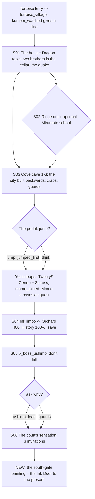

# STORYBOARD — Dragon Ch2 · "The Painting"
Production: `production/dragon-ch2.md` · Lv 20–25 · Regions:
- **Tortoise Island** (Map A: one of the small Coastal Islands; reached with the Tortoise Ferry Token from Dragon Ch1).
- **The year-400 layer** (Map A's Imperial City, with the "antique" overworld palette).

Bestiary F: a new **Tortoise Island & cove** row (finding F-5); *Year 400 capital & coast*.

## The big structural finding (F-1): the party was trapped in the past
In the production text the portal burns behind the party in S03, and they only come home at the very end of Dragon
Ch4. In an Octopath structure that **locks the other seven stories for two whole chapters** and forces a jump from
Lv 25 to 41 inside the past.
**Fix: the Ink Door.** Dragon Ch3 already has *a duplicate of the portal painting by the palace's south entrance*,
painted by Kakita Miyoshi for "a man in a bear mask" (Akuro's spare). At the end of Ch2, Gendo finds it. It is warm,
its ink moves, and on the other side is the grey cove cave of Tortoise Island, in the present.
- **The Ink Door** (overworld unlock): it links the year-400 south gate and the Tortoise cove in both directions. Only
  the active four can cross. **Party swaps happen in the present** (the Tortoise village inn); in the past, the four
  who crossed are the party.
- Time passes at the same rate on both sides (no paradox UI). The History meter keeps its value between visits.
- At the **end of Dragon Ch4** the door closes for good: Kumpei repaints it, "the light exactly right", and it takes
  them home. A warning at the start of Ch4 says the past closes after this chapter.
- Ch3 S03 is reworded: the door's *existence* is known from Ch2; Ch3 asks **who painted it and with what** (the
  mirrors).

## Flow


## Maps

### T `tortoise_village` — Tortoise Island (small town; the present-day anchor of the Dragon arc)
```
 ~~~ [ferry pier] ~~~~ fishing boats ~~~~~~~~~~~~~~~~~~~~~~~~~~~~~~~~~~~~~~~~~~
 = shore lane ========================================= > ridge path (dojo) > tortoise_house (hill)
 [fisher's inn I]  [net shop S]  [shrine to the Tortoise kami +]  1 villager  2 old diver  3 boy with crab
 c (boat shed)    > headland path > cove_cave (sea-cave, round the headland)
```
- **Shops (Mantis T2):** Lacquered Yari, Rattan Yumi, Ironwood Bo, Herbal Salve, Sea Salt, Eel.
- NPC path actions:
  - Villager: Discern → "They paid in glass. Mirrors, small ones."
  - Old diver: Barter → Pearl ×1, and info about the cove's "singing water".
  - Boy with a crab: Charm → follows ("Crab Pinch": small damage plus Speed down, 2 uses).
  - Fisher-wife: Eavesdrop → "The Crane gentleman cried in the night."
  - Shrine-keeper: Bless → Rejuvenating Tea ×2.
  - Drunk sailor: Sumai → Fine Sake.
  - Pilfer: the net shop → Rope (sell).
  - Duel: a Mantis bushi on leave (Iaijutsu 3) → Storm Kama.
- **[IF kumpei_watched]** (F-2): GENDO: "He ran exactly where I hoped. Men who run go somewhere." The villager points
  before being asked.

### M `tortoise_house` — the new house (one-way: it collapses)
```
 [study: alembic, star-chart] c (Tamori alembic, lore)  c (Star-chart, lore)  :cellar
 [cellar] two shapes under cloth!  → quake cutscene → escape through the window
```
- **Chests are in the study, which the player passes through before the cellar.** The collapse is triggered by the
  cellar scene, so nothing can be missed (F-3). On a revisit: rubble, plus a cat.

### S `ridge_dojo` (S02, optional; required for the Mirumoto school)
- Old Mirumoto Koshi. Afterwards: a **Duel** (Shizue) and a sparring post (free kata practice).
- `c`: Wakizashi (T2 Katana-class off-hand: cosmetic until the Daisho Technique).

### D `cove_cave_1–3` — the cove cave (dungeon) · Danger 20–25
```
 cove_1 (tide entrance)            cove_2 (the clay city)                       cove_3 (the portal)
 @headland  ~~ tide pools ~~        [miniature Otosan Uchi, older toward      [two posts, living-ink silk]!S03
  b_cove_crabs  c  ≈≈                its centre]* (Discern: "a map of *when*")  Akuro + Kumpei step through
  c*(Athletics 3: ledge)  >C2       b_cove_guards    c   c (dead end: Kumpei's   (after Ch2: the burned frame;
                                     paint scraps → Ink Pot)                      after the Ink Door: the door's
                                     § save (before the portal)                  present-side exit is here)
```
- Encounters (new bestiary row): Kappa, Wako Raider, Cave Bat Swarm; uncommon Tide Crab (II).
- Kappa: the **Bow** command (bestiary note) is a nice teaching moment here.
- `c`: Herbal Salve ×2, Incense ×2, 500 zeni, Lacquered Do-maru (ledge).
- `§` before the portal (production had no save between the dungeon and the jump; F-4).

### S `ink_limbo` → `orchard_400` (S04–S05)
- Limbo: a cutscene. Yosai's voice fades: **"…still twenty— that doesn't count— still twenty—"** (F-6: his count
  now flows 20 → 21 when he returns in Ch4 → 22 for the dive → the landing doesn't count → 24 in the finale, after
  his side story).
- Orchard: History meter tutorial, `[SAVE]`, then the walk toward the voices → `b_boss_ushimo`.

### T `otosan_uchi_400` — the palace gate area (end of S06; the hub for Ch3–Ch4)
```
 [palace gate] · [guest house = I, no swap] · [south entrance: the Ink Door painting]!NEW · [antique market S/W/A]
```
- **The Ink Door scene (new, end of S06).** GENDO (passing the south entrance): "…That painting is the cove. Our cove.
  (touching it; his hand goes *in*) …It's warm." TOGASHI YOSAI is gone, so a party member reacts (or Gendo alone):
  "Akuro kept a spare." Unlock: **The Ink Door**.
- Antique market: **year-400 T2–T3**, tachi-pattern katana; gaijin goods carry an anachronism warning.

## Simulated playthrough
1. Lv ~20. Tortoise village (T2) → the house (lore chests, then the quake) → the optional dojo (the Mirumoto school
   at R2) → the cove (about 6 encounters + 2 fixed battles, Kappa Bow) → save → the portal choice.
2. Yosai leaps. [IF momo_joined] Momo crosses too. She's the active guest now that Yosai is lost: **this is where
   Momo's flag finally does something** (F-2; the old text read `momo_joined` but never used it).
3. The orchard boss (non-lethal gimmick), the court sensation, then **the Ink Door**. The player can now go home,
   play other chapters, level up, and come back for Ch3 at Lv 30.
4. Total ≈ 75 minutes.

## Findings → fixes
| # | Finding | Fix |
|---|---|---|
| F-1 | The party was trapped in the year 400 from Ch2 to the end of Ch4 | **The Ink Door** (Miyoshi's duplicate), found at the end of Ch2; it closes after Ch4 |
| F-2 | `kumpei_watched` and `momo_joined` were in the header but never used | A Kumpei line in the village; Momo crosses as the guest |
| F-3 | The collapsing house could swallow chests | Chests in the study only; the collapse is triggered after it |
| F-4 | No save between the cove and the portal jump | `§` before the portal |
| F-5 | No encounter table for Tortoise Island | New bestiary row |
| F-6 | Yosai's count ran ahead (limbo "21, 22", then "21!" again in Ch4) | Limbo line changed to "still twenty" |
| F-7 | Yosai is "lost in the ink" from Ch2 to Ch4, but Scorpion Ch4's stand-in is Yosai | Gate it like Phoenix Ch2 (`dragon_ch2_not_done`): see `storyboards/scorpion-ch4.md` |
