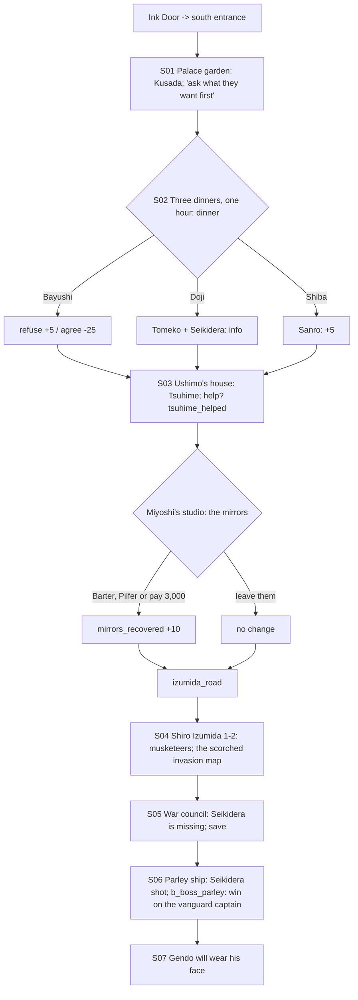

# STORYBOARD — Dragon Ch3 · "Past Mistakes"
Production: `production/dragon-ch3.md` · Lv 30–35 · Region: **the year-400 layer**: Otosan Uchi (Map A's Imperial
City, antique palette), Shiro Izumida (ten miles south), the Mantis shipyard.
Entry: **the Ink Door** (Tortoise cove → the palace south entrance). Bestiary F: *Year 400 capital & coast*.

## Flow


## Maps

### T `otosan_uchi_400` — the capital in the year 400 (town, 3 screens)
```
 screen A: palace                         screen B: streets                       screen C: south gate
 [palace garden]!S01 (Kusada)              [Bayushi mansion]  [Doji mansion]       [south entrance: the Ink Door]
 [war council hall]!S05                    [Shiba mansion]   (S02, one hour)        [Miyoshi's studio]!S03b
 [guest house = I (no swap)]               [antique market: W/A/S, T3]              [Ushimo's house]!S03
 1 court lady  2 palace guard  3 Isawa novice   4 rice seller  5 gaijin trader*  6 street poet  7 a Crane ashigaru  c  C
```
**NPCs and path actions** (in the past, each one notes its **History** effect)
| # | NPC | Path action | Result | History |
|---|---|---|---|---|
| 1 | Court lady | Charm | Follows ("Fan Screen": party Evasion up, 2 uses) | — |
| 2 | Palace guard (tachi) | Duel | Antique Tsuba · Glory +1 | — |
| 3 | Isawa novice | Bless | Rejuvenating Tea ×2 | — |
| 4 | Rice seller | Barter | Ginseng (a Remedy ingredient) | — |
| 5 | Gaijin trader `*` | Eavesdrop / Discern | "He sells glass to 'a man in a bear mask'." (a mirrors hint) | **buying from him: −5** |
| 6 | Street poet | Sumai | Win → a poem about "a Champion who talks to the sea" (a Seikidera hint) | — |
| 7 | Crane ashigaru | Pilfer | Fine Sake | — |
- **Spectacles rule (F-2):** at every noble's door, a prompt: *"Remove your spectacles?"* Yes → no effect (but
  Discern odds −10% inside). No → **History −2**. This puts the History reminder into play instead of leaving it as a
  popup.
- Shops: **year-400 T3** (tachi-pattern Fine Katana, antique armour, Ginseng Tonic). Gaijin goods are labelled
  ⚠ anachronism.
- `c`: 1,500 zeni (palace well). `C`: Shiba mansion storeroom (opened only during dinner C): Isawa Robe.

### M Three mansions (S02) — one hour, one dinner
- Entering one mansion locks the other two for the night. Each mansion is a single room with the lord, plus 1 chest
  that only the guest of that dinner can reach:
  - Bayushi: Shosuro Tanto (T3).
  - Doji: Crane Ward Fan (sell + lore).
  - Shiba: Isawa Robe.

### M `ushimo_house` (S03) and `miyoshi_studio` (S03b)
- Ushimo's house: Tsuhime in the sickbed, the medicine jar (Deduce prompt).
- **Mirrors (F-1):** before this pass, only Tamotsu's **Barter** could recover them. Now there are three ways:
  - Barter (Tamotsu): a discount.
  - Pilfer (Sayo): free, but **witnessed −Honor** (Low Skill).
  - **Pay full price** (3,000 zeni; no path action needed).
  - Any of the three → `[SET mirrors_recovered]` (History +10).

### R `izumida_road` — south to the winter palace (field route, new) · Danger 30–35
```
 @south gate (screen C) == frozen paddies """ ≈≈≈ c ≈≈ [burned waystation] c* (Hunting: musket-ball trail → a gaijin scout camp, fixed battle) ≈≈ > shiro_izumida
```
- Encounters: Palace Guard (bandit palette: deserters), Gaijin Pikeman; uncommon Gaijin Musketeer.

### D `shiro_izumida_1–2` — the winter palace (dungeon) · Danger 30–35
```
 izumida_1 (outer halls)                       izumida_2 (great hall)
 @road  overturned braziers  c                 scorched floor = coast map!* (Discern: dates)
  musket balls in plaster*  b_izumida_musketeers   tortured spirits (Bless: Haruki calms 1 → History +2)
  c (groundskeeper's hut: Ginseng Tonic ×2)       c  c (dead end: a gaijin powder store — **don't touch**: taking it = History −5)
  >I2                                              > ridge (the gaijin army marching: cutscene)
```
- **Musket rule:** dropped muskets can be picked up but not equipped without a confirm: *"Using it: History −15"*.
- `c`: Daikyu-pattern Yumi (T3) · 2,000 zeni · Kansen Mist ×2.

### M `war_council` (S05) and `parley_ship` (S06)
- War council: `[SAVE]` (production). Then a "race to the shipyard" cutscene → the ship.
- Parley ship: `b_boss_parley`. **Barrels on deck:** using one gives History −10 (production bark).

## Simulated playthrough
1. Lv 30 via the Ink Door. Garden → the dinner choice. **Only one dinner per playthrough**, so the other two lords'
   chests are "missable". Acceptable (an Octopath-style choice reward), and listed in the journal.
2. Ushimo's house; the mirrors (now gettable by any party); the road (about 4 encounters); Izumida (about 6
   encounters + 1 fixed battle).
3. The war council (save) → the parley: Seikidera is shot; the boss is won on the vanguard captain.
4. Total ≈ 90 minutes. **History budget check:** a careful run ends around 100–120 (with +5, +10, +10, +2). A careless
   run (agreeing with Bayushi −25, a musket −15, a barrel −10, spectacles −2×3) is around 50. Fine against the
   0-floor and Ch4's −50 Accept option.

## Findings → fixes
| # | Finding | Fix |
|---|---|---|
| F-1 | `mirrors_recovered` needed Tamotsu's Barter | Three ways: Barter / Pilfer / pay 3,000 |
| F-2 | "Don't wear spectacles before nobles" was a reminder with no rule | A door prompt: remove them (Discern −10%) or History −2 |
| F-3 | No route to Shiro Izumida | `izumida_road` field route |
| F-4 | The Ink Door wording | Updated in production S03 (Dragon Ch2 F-1) |
