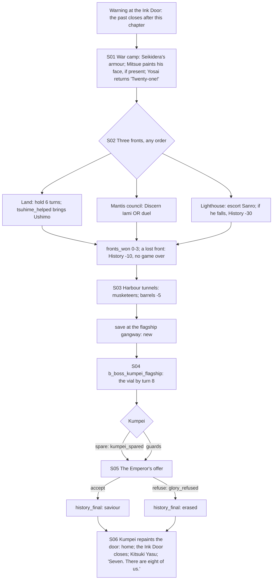

# STORYBOARD — Dragon Ch4 · "The Battle of the White Stag"
Production: `production/dragon-ch4.md` · Lv 41–45 · Region: **the year-400 coast below the capital** (war camp,
three fronts, harbour, flagship), then home: **Tortoise cove → Shiro Kitsuki** (SK, Dragon lands, south slope).
Entry: the Ink Door. Bestiary F: *Year 400 capital & coast* (IV rows: Gusai Mantis Marine, Gaijin Musketeer III+).

## Flow


## Maps

### T `war_camp_400` — the war camp (hub)
```
 [command tent]!S01 (armour stand, Shukujo)   [field kitchen = I: rest/save, no swap]   [quartermaster S/W/A: year-400 T4]
 [Crane lines]  >land_front      [boats]  >mantis_council      [cliff path]  >lighthouse_peninsula      [harbour road] >harbour_tunnels (after 3 fronts)
 1 a Crane veteran   2 a Centipede scout   3 a Dragon courier   4 Doji Tomeko   c   C
```
- **Warning (F-1):** when the party walks through the Ink Door for Ch4, a prompt: *"When this chapter ends, the
  door will close forever. The past's shops and chests will be gone."* (The year-400 layer is sealed after Ch4.)
- NPC path actions:
  - Crane veteran: Discern → "He served under Seikidera: 'the Champion never shouted'". Gendo uses this: the
    land-front line becomes a calm order, a nice touch.
  - Centipede scout: Charm → follows ("Night Sortie": first-turn Speed up, 1 use).
  - Dragon courier: Eavesdrop → "The relief is a day late unless the land front holds".
  - Tomeko: talk only.
  - Pilfer: the quartermaster → a Kami-ichor Drop (one). Sumai: a drunk Mantis sailor → Gusai Sash.
  - Duel: a Crane veteran (Iaijutsu 7) → Fine Katana Fragment.
  - Barter: the quartermaster → Excellent Katana (antique palette).
  - Bless: a wounded ashigaru → he lives (Honor +1).
- `c`: Ginseng Tonic ×3. `C`: the Champion's chest → **Seikidera's Hachimaki** (accessory: Iaijutsu Focus +1; returned
  to Tomeko at the end if you choose).

### S `land_front` · `mantis_council` · `lighthouse_peninsula` — the three fronts (set-piece)
```
 land_front: Crane shield line · 6-turn counter · gaijin pike wall → (relief banners)
 mantis_council: ship cabin · Gusai Iami · [Discern] or [duel his champion: b_front_mantis]
 lighthouse_peninsula: ward-fire on the cliff · Sanro feeds it · waves of marines up the rocks (escort)
```
- **Lost fronts (F-2):** losing a front battle **does not end the game**. That front is lost: History −10, no buff,
  and Gendo's internal line changes ("I filed this battle as a victory. I was wrong."). *Sanro falling* is a
  separate History −30 and also loses the front.
- After each front, the party returns to the war camp (free rest at the kitchen).

### D `harbour_tunnels` — the sea-tunnels (short dungeon) · Danger 42–46
```
 @harbour road  ≈≈ tunnels (burning wrecks above, sharks below) ≈≈ b_harbour_musketeers
  [powder barrels]* (using one: History −5)   c   c (dead end: a Mantis smuggler's cache: Storm Legion Token, Pearl ×2)
  > gangway § save (new, F-3) > gaijin_flagship (boss)
```
- Encounters: Gusai Mantis Marine, Gaijin Musketeer; uncommon Gaijin Pikeman.

### S `gaijin_flagship` (S04) · `palace_400` (S05) · `cove_cave_return` → `kitsuki_yasu_hall` (S06)
- The flagship: cannons on a timer; Kumpei; the vial by turn 8.
- The palace: the Emperor's offer, as a private audience room.
- **The door closes (F-1):** Kumpei paints the orchard dissolving into the grey cove: "the light exactly right".
  They step through. Behind them, the Ink Door on Tortoise Island goes still: just paint. Yosai: "Twenty-three — no,
  that was the landing. That doesn't count." On the overworld the year-400 layer is greyed out: "History is sealed."
- **Shiro Kitsuki** (SK): Lord Kitsuki Yasu's hall. It becomes a revisit node: Gendo's office (the epilogue), and a
  Kitsuki shop (Dragon T4: Bo, Robes, Incense, Togashi Bo).

## Simulated playthrough
1. Lv 41 through the door, with the warning. The camp: shopping, Yosai's return. **G-1:** Yosai is story-locked as
   the guest again; Momo (if she was the guest) returns to the roster.
2. Fronts in any order: land (6 turns), Mantis (Discern is the elegant path; Gendo is always present), lighthouse
   (escort). About 15 minutes each.
3. Tunnels (about 4 encounters, plus the barrel temptation) → save at the gangway → the boss (cannons halved if the
   land front was won; the vial).
4. The offer (Accept vs. Refuse) → home → the jester line → the prophecy beat. Total ≈ 110 minutes.

## Findings → fixes
| # | Finding | Fix |
|---|---|---|
| F-1 | The Ink Door's closing (new in Ch2) needs a warning and a scene | A warning at the door on entering Ch4; the closing line in S06; the past sealed on the overworld |
| F-2 | "A lost front costs History" was impossible: losing a battle means game over | A lost front battle is non-fatal: History −10, no buff |
| F-3 | No save between the tunnels and the boss | `§` at the gangway |
| F-4 | Momo and Yosai both as guests again | G-1: Yosai story-locked; Momo to the roster |
