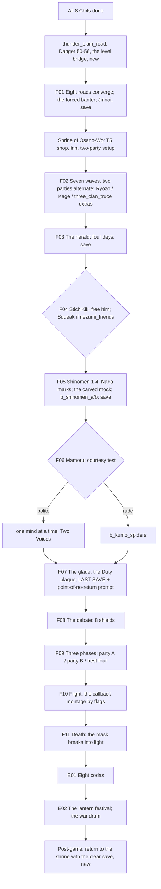

# STORYBOARD — Finale · "The Empress of Nothing"
Production: `production/finale.md` · Lv 55–60 · Region: **the Plains of Thunder and the Shinomen Mori** (Map A: the
open plain north-east of "Shinomen Forest" and the forest itself; Map B: the great green forest west of the
Scorpion lands).
Unlock: all eight Ch4s → the **PT** node lights up (the Shinomen edge sign changes from "The trees will not let you
pass" to "The trees are waiting").
Bestiary F: *Plains of Thunder* (54–58), *Shinomen Mori* (55–60).

## Flow


## Maps

### R `thunder_plain_road` — the approach (field route, new: the level bridge, F-1) · Danger 50–56
```
 @(any Ch4 region) ==== the Plains of Thunder: storm-grass, lightning-struck stones ≈≈≈≈ c ≈≈ [burned village]*
   ≈≈ [Osano-Wo waystone +] ≈≈ c*(Athletics 8: a thunder-split rock → Moonlit Yumi, T5) ≈≈ > osano_wo_shrine
```
- **Why:** the Ch4s end around Lv 45, and the finale is tuned for 55–60. The guest SS2s (Lv 42+) and the post-Ch4 side
  stories cover some of that gap, but the game had **no area tuned for 48–55**. This road (Goblin V, Ogre V,
  Onikage IV+; uncommon Moto Akutsukai; a rare Oni Spawn) gives a Lv 50–56 grind, with T5 chests, right before the
  finale.

### T `osano_wo_shrine` — the Shrine of Osano-Wo (hub, then the battlefield)
```
 [stockade gate]!(party swap between waves)   [abbot's hall] Jinnai · the abbot   [jade stores] (protect)
 [shrine smith W/A: T5: Master-forged Katana, Utaku Yari, Crab Champion Plate, Robe of the Five Rings]   [pilgrim hall = I]
 + [the thunder shrine]   (before F02: free roam; after F03: the gate to Shinomen opens)   c   C
```
- **Two-party setup (production):** the inn screen gets a "Party A / Party B" assignment. Guests: Jinnai (monk guest)
  and, if `glory_refused` or Yosai SS2 done, Togashi Yosai. **G-1:** one guest per party.
- `C`: a jade cache: Jade Pouch ×5.

### S `osano_wo_shrine` (F02, waves) → `shinomen_edge` (F04)
- Waves: the production list. Between waves, the stockade-gate swap. Wave battles are normal battles (a loss is a game
  over); the save comes before F02 and after F03.
- **Stich'Kik (F-3):** "he joins the nezumi of Crab Ch1 afterward" only makes sense with `nezumi_friends`. Otherwise
  NATSUKO: "There's a dry cave near my Wall post. Nobody uses it. You can have it." (He goes there.)

### D `shinomen_1–4` → `kumo_fire` → `corrupted_glade` · Danger 55–60
```
 shinomen_1                 shinomen_2                    shinomen_3                         shinomen_4
 @edge  Naga drag-marks*     >S1  the carved mock-seppuku!  >S2  b_shinomen_a  c  c*(Tremor:  >S3  b_shinomen_b  § mossy shrine
  ≈ Kumo Brood ≈  c          (8 party lines)  c           a root-wall → a Naga shrine: Naga    > kumo_fire (Mamoru) > corrupted_glade
  [Naga watcher]*            ≈ Lava Tree Dryads ≈          Pearl ×2) — [IF naga_talked_down] the Naga
                                                          watcher leaves a gift here instead: Spawn Pearl
```
- Encounters: Kumo Brood, Naga Scout (talk-down on Suki), Lava Tree Dryad, Toothed Poppy; uncommon Oni Spawn; rare
  Wolf-Spirit.
- `corrupted_glade` (approach): the Duty plaque → **LAST SAVE**, plus a **point-of-no-return prompt** (F-2): "Beyond
  this, the Empress waits. You will not return until it's over."

### S `corrupted_glade` (F08–F11) and `starfield` (phase 2)
- The debate set-piece, then the three phases. The F10 montage plays by flags (production list).

### Epilogue maps (E01) — reused hub maps
| Coda | Map (from) |
|---|---|
| Natsuko | `wall_road` (the KW route, Crab Ch1–3) |
| Rensei | `kakita_academy` (KA, Crane Ch1) |
| Gendo | `kitsuki_office` (SK, Dragon Ch4) |
| Shizue | `hiruto_garden` (HC, Lion Ch1) |
| Haruki | `phoenix_garden` (the Kamatori castle garden, Phoenix Ch1) |
| Tamotsu | `ojatara_valley` (`valley_road_home`, Unicorn Ch4) |
| Sayo | `inn_table` (any inn) |
| Mitsue | `south_road` (Scorpion Ch4's fork) |

### Post-game (F-4)
The production ended at the title card, with no rule for what comes next. **Rule (Octopath style):** after the credits,
the clear save returns the party to the **Shrine of Osano-Wo the day before the finale**, with post-game unlocked:
- the Shadowlands reopen through the Wall gate (Crab Ch3's skill-locked chests are now reachable);
- the Shinomen stays open;
- the bestiary's post-game row (Shadowlands deep, Hiruma Castle, Lv 61–80) unlocks.
The finale can be replayed for other montage and coda variants.

## Simulated playthrough
1. Lv ~45 after the last Ch4. The road (F-1) gets the party to Lv 52–55 in about an hour. The shrine: T5 shopping
   and the two-party setup.
2. Waves (7 × about 4 minutes; the extras by flags) → the herald → save → Stich'Kik (Squeak, if friends) → Shinomen
   (about 8 encounters + 2 fixed battles; Naga talk-downs) → save → Mamoru (polite: the hint; rude: spiders) → the
   glade (the plaque, the last save, the prompt).
3. The debate (8 doubt/rebuttal beats, about 15 minutes) → the 3 phases (about 20 minutes) → the flight montage (it
   varies by flag) → death → codas → the lantern festival. Total ≈ 2.5 hours, plus the road.

## Findings → fixes
| # | Finding | Fix |
|---|---|---|
| F-1 | No area tuned for Lv 48–55, between the Ch4s and the finale | `thunder_plain_road` (Danger 50–56; T5 chests) |
| F-2 | No point-of-no-return warning before the debate | A prompt at the glade's last save |
| F-3 | Stich'Kik "joins the nezumi of Crab Ch1" even without `nezumi_friends` | A fallback line (Natsuko's dry cave) |
| F-4 | No post-game rule | A clear save at the shrine; the Shadowlands, Shinomen and post-game regions unlock |
