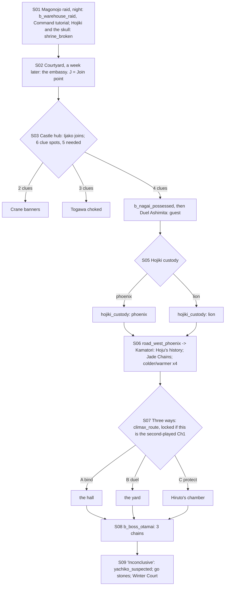

# STORYBOARD — Lion Ch1 · "The Blood of Family" (paired with Phoenix Ch1)
Production: `production/lion-ch1.md` · Lv 1–8 · Region: **the Lion–Phoenix–Crane border** (Map A: where the Lion
lands meet the Phoenix coast, between Loyalty Castle and the Castle of the Centipede; Map B: a small Akodo pocket
between the yellow Lion, orange Phoenix and blue Crane borders).
Overworld: **HC** Hiruto's castle town (start) ⇄ `road_west_phoenix` (the shrine road, with the Magonojo ruins) ⇄
**KM** Shiro no Kamatori. Bestiary F: *Lion plains & border* (1–8), *Phoenix roads & Kamatori* (1–8).

## The pair rule (finding P-1, the biggest Ch1 finding)
Lion Ch1 and Phoenix Ch1 are **the same week, the same castle, and the same boss**. The old text gave no rule for
playing the second one: it would refight O-Tamai after he was already bound, and replay a raid that had already
happened.
**Fix (both production files):**
- **First-played:** plays as written. The other traveler, if not recruited, appears as a **silent NPC** in the right
  place: Haruki as the lowest member of the embassy, carrying scrolls; Shizue at Hiruto's side guarding Hojiki. Their
  stand-ins act for them (Ijako for Shizue; Ashimita and the acolyte for Haruki).
- **Second-played:** a **playable flashback**, "That week at Lord Hiruto's castle". The traveler tells their side of
  that week to the party (an Octopath memory-chapter frame; nothing in it contradicts the first version). Choices
  the first playthrough already made are **locked** where both chapters share them (`climax_route`;
  `hojiki_custody` if it was set). The boss is fought again *in memory*, with the merged lines if the other traveler
  is in the active party.
- Each traveler still has a full Ch1. **Both Ch1s are "done" only when each has been played.**

## Flow


## Maps

### M1 `magonojo_river` — the raid (starter, or the flashback)
```
 ~~~~~~~~~~ Magonojo river (fog) ~~~~~~~~~~~~~~~~~~~~~~~~~~~
 @Lion bank  riders  Gusai!   [Phoenix warehouses] b_warehouse_raid
 ~~~ ford ~~~  (across the water) [roadside shrine]! Hojiki + the skull
```
- One-time map (night). By day, the place is `magonojo_ruins` (Phoenix Ch1 S05), a node on `road_west_phoenix`.

### T `hiruto_castle` — the castle town and castle (town screen added, finding F-2)
```
 screen A: castle town                                        screen B: castle
 [Lion armoury W/A] [rice merchant S] [inn I] t [tea house]    [courtyard]!S02  ·  water barrel* (C2, night)
 [silent shrine +] (Spirit Wasteland: no Commune)              [chapel] Ijako!S03a (C1)  ·  [bathhouse]* (C3)
 1 farmer  2 Crane trader  3 Kitsu child  4 ronin guard  c  C   [barracks] Ryuzoji (C5) · Hojiki   ·  [guest wing] Yachiko (C6)
 @road_west_phoenix (east gate)  > Lion road (to SA)           [Ozaki's room]* (C4: Duel Ozaki or wait for dinner)
                                                              [west tower] (Phoenix mid-boss) · [Hiruto's chamber] · [hall]!S07
```
**Castle-town NPCs** (*(added)*: path-action coverage, rule T-1)
| # | NPC | Path action | Result |
|---|---|---|---|
| 1 | Farmer | **Bless** *(added)* | Follows ("Field Prayer": party heal, small, 1 use) |
| 2 | Crane trader | **Barter** *(added)* / **Eavesdrop** | Barter: Herbal Salve (early). Eavesdrop: "Crane scouts pay him for news" (sets up the S04 banners) |
| 3 | Kitsu child | **Charm** *(added)* | Follows ("Ancestor Whisper": reveals one weakness, 1 use) |
| 4 | Ronin guard | **Sumai** *(added)* / **Pilfer** *(added)* | Sumai: Old Whetstone. Pilfer: a Patrol Writ (avoids one Ashigaru fight on the road) |
- **Castle NPCs** (production table): Hojato, Gusai (Duel), Togawa, Nagai, Ukita, the servant girl.
- **Shops: Lion T1:** Ashigaru Yari, Ashigaru Lamellar, Jingasa, Rice Ball, Antidote. The shrine is **silent**
  (Spirit Wasteland: no cleanse) until S08 clears it, after which it gives full shrine service.
- `c`: 80 zeni (well). `C`: the tea house's back room → Fine Sake + a Crane spy's Note (lore).
- **The Phoenix embassy** (from S02): Kamasari, Ashimita, Yachiko, **and Haruki** (a silent NPC if not recruited:
  "a young Isawa carrying too many scrolls"; P-1).
- `J` **Join point** (non-starter): the courtyard as the embassy arrives (S02).

### Clue spots (S03) — the castle screen
| Spot | Clue | Gate |
|---|---|---|
| Chapel | C1 Hoju's ghost | Ijako's Mask Rite (guest skill, used in the field) |
| Courtyard water barrel, night | C2 the lying ghost | night: rest at the inn → the courtyard |
| Bathhouse | C3 real jade | search |
| Ozaki's room | C4 the looted statue | Duel Ozaki, or come back during dinner (an evening time slot) |
| Barracks | C5 Ryuzoji's wound | talk |
| Guest wing | C6 Yachiko's cipher | Eavesdrop **or** Discern; **or** (no Mitsue/Gendo) Ijako notices the ink on her sleeve after C1–C3 (F-4) |

### R `road_west_phoenix` (= the Lion "shrine_roads") — the shrine road (field route, 2 screens) · Danger 1–8
```
 screen A (west, Lion side)                              screen B (east, Phoenix side)
 @HC == road ≈≈ [shrine S4 view]  ≈≈ [Magonojo ruins]>     ≈≈ [despoiled shrine]* (S2 / Phoenix S06) ≈≈ [shrine S1]* ≈≈ > KM
       c   [shrine S3]*  c*(Athletics 1: river bank)              c   c (Hoju's waystone: Rice Ball ×3)
```
- **The four despoiled shrines** are the compass points (S1–S4). The production's `shrine_roads` and Phoenix's
  `road_west_phoenix` are **one map** (F-3).
- Encounters: Ashigaru Spearman, Grey Wolf, Road Bandit; Will-o'-wisp at night.

### T `shiro_kamatori` (S06) — see `storyboards/phoenix-ch1.md`
- Lion S06 visits Hoju's study (chest: Jade Chains). If Haruki isn't present, the acolyte reads the history.

### S `hiruto_castle` hall / yard / Hiruto's chamber — the shared boss (S07–S08)
- **Arena by route:** A → the hall; B → the yard (Kakita Mizochi arrives); C → Hiruto's chamber (after a 2-point
  chase).
- `§` save: the inn, or the courtyard save stone, before S07.

## Simulated playthrough
**Lion first, no Haruki:**
1. The raid (Lv 1) → the castle (Lv 3).
2. Ijako joins. **G-1:** Ashimita joins after the S04 Duel, so the player picks the active guest. Ijako is better for
   the clues (Mask Rite in the field); Ashimita for the boss.
3. Clues: C6 was gated to Mitsue or Gendo. Ijako's fallback makes the 5-of-6 gate fair for a solo Shizue (F-4).
4. Kamatori by road (about 5 encounters) → the compass → the climax → the boss. Total ≈ 90 minutes.

**Phoenix first, then Lion later as a flashback:** the party recruits Shizue at the castle courtyard (she's there,
preparing for Winter Court). Her Ch1 plays as "That week…": S01 raid → hub → … → S07, with **climax_route locked
to A** (Phoenix-first always uses A). The boss is fought in memory. Merged lines play if Haruki is active.

## Findings → fixes
| # | Finding | Fix |
|---|---|---|
| F-1 (P-1) | The paired Ch1s had no rule for the second-played one | The pair rule: first = as written, plus silent cameos; second = a playable flashback with locked shared choices |
| F-2 | Hiruto's castle had no town | A castle-town screen (Lion T1, inn, NPCs) |
| F-3 | `shrine_roads` and `road_west_phoenix` were two names for one road | Merged into one field route |
| F-4 | Clue C6 needed Mitsue or Gendo; a solo Shizue had exactly 5 other clues, with no slack | Ijako's fallback notice for C6 |
| F-5 | Two guests (Ijako, Ashimita) | G-1 |
| F-6 | Non-starter version | Join point (courtyard, S02) + Memory (S01 raid) |
