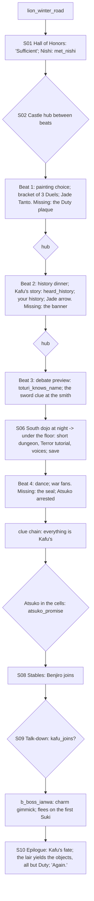

# STORYBOARD — Lion Ch2 · "Shadow of a Doubt"
Production: `production/lion-ch2.md` · Lv 20–25 · Region: **Shiro Akodo, in winter** (Map A: central Lion lands,
between the Swift Sword and Sacred Watch icons; Map B: the Akodo heartland, in the middle of the yellow Lion border).
Overworld: **SA** (castle town + castle). Reached from HC by `lion_winter_road`. Bestiary F: *Shiro Akodo roads
(winter)* (18–25), plus a new *under-dojo* row (finding F-4).

## Flow


## Beat triggers (finding F-1)
The production said "TRIGGER: Beat N" without saying what advances a beat. **Rule:** a beat begins when the player
**talks to the hostess** (Ikoma Ujiaki's wife) in the Hall of Honors, or **rests at the guest quarters** once the
beat's prerequisites are met. Before each beat, a hub phase lets the player explore; the "missing object" escalation
plays on the first walk through the Central Dojo after the beat.
- Beat 2 needs Beat 1 done. Beat 3 needs Beat 2 done. **Beat 4 needs S06** (the night visit). The hostess says: "The
  South Dojo was so cold last night, my lady — has anyone looked?"

## Maps

### R `lion_winter_road` — HC → Shiro Akodo (field route, new) · Danger 18–25
```
 @HC == snowy road ≈≈≈ [frozen ford] c ≈≈≈ [Lion waystation: shrine +, a peddler S] ≈≈ c*(Hunting 4: bear den → Black Bear fight, Bear Gall) ≈≈ > SA
```

### T `shiro_akodo` — the castle town (screen added, F-2) and the castle
```
 screen A: castle town                                  screen B: castle
 [Lion armoury W/A] [war-fan maker] [apothecary S]       [Hall of Honors]!S01/S04/S05/S07 · hostess (beat trigger)
 [swordsmith's shed]!(Beat 3 sword clue)  [inn I]         [Central Garden]!B1 painting · [Central Dojo]!bracket / missing plaque
 + [Hachiman shrine]  t [sake house]  c   C               [North Dojo] Nishi (go Duel) · [South Dojo]!S06/S09
 1 Matsu bushi  2 widow  3 Ikoma bard  4 stable girl       [Hall of Akodo] (the banner) · [library] Atsuko · [kitchens] kitchen girl
 @lion_winter_road (south gate)                           [stables] Benjiro!S08 · [cells] Atsuko (Beat 4+) · [guest quarters = I]
```
**NPC additions** (rule T-1: Sumai, Bless, Pilfer and Barter had no targets)
| # | NPC | Path action | Result |
|---|---|---|---|
| 1 | Matsu bushi (castle town) | **Sumai** | Win → "The Crane girl reads in the library every day. *Only* the war shelf." (an Atsuko hint) |
| 2 | Widow in the shrine | **Bless** | Follows ("Ancestor's Vigil": Terror resist for the party, 1 battle). Useful for S06 |
| 3 | Ikoma bard | **Barter** | "The Ballad of Matsu Joruri" (lore; it gives the Beat 2 history option a second strong line) |
| 4 | Stable girl | **Pilfer** | Benjiro's spare white paint (sell; also *Death Trance* +1 use if returned to him after S08) |
| — | Kitchen girl (production) | Eavesdrop | "Two voices. One is Kafu-sama's." |
| — | Nishi (production) | **Duel** (a go game) | The Duel UI, re-skinned as stones: "Kafu taught me to play." |
- **Shops: Lion T2:** Lacquered Yari, Crab-pattern plate (Lion palette), Kabuto, the war-fan maker (display), Herbal
  Salve, Calming Tea (Terror cure — for S06 and the boss).
- `c` (castle town): 600 zeni. `C` (sake house cellar): Fine Sake ×2 + Calming Tea ×3.

### D `south_dojo_night` → `south_dojo_under` — the South Dojo at night (short dungeon, new, F-3)
```
 south_dojo_night                         south_dojo_under (crawlspace + old drain)
 @castle   cold braziers   wet trail*      >   ≈ fear shades (Terror) ≈   c (a scarf: the first stolen object, glimpsed — the oni drags it away)
  [inner screen] (voices, after the dungeon)    ≈ old drain ≈  c (Jade Dust ×2)   c (dead end: a Kitsu prayer-board → Old Jade Bead)
  b_fear_shades (entering)  § save              > back up through a floor-hatch → the inner screen (voices) → S06 end
```
- **Before this pass the chapter had no dungeon** (Octopath shape: hub → dungeon → boss; F-3). Now S06 is a 2-screen
  crawl with Terror enemies: the Terror tutorial in a fitting place.
- Encounters (new row): **Fear Shade** (bestiary D, II), Cave Bat Swarm.
- After the boss, `south_dojo_under` is **the oni's lair**: the stolen objects are found here (all but Duty, which
  turns up in the finale glade).

## Simulated playthrough
1. Lv ~20 on the winter road (bear den optional). The castle town: T2 shopping, NPCs.
2. S01 → hub → Beat 1 via the hostess: painting choice; bracket. **Rule check:** losing a bracket Duel isn't a game
   over (F-5, global rule): the bracket ends, and Yutaka still presents the Jade Tanto at the closing, "for spirit".
3. Beats 2 and 3 → the sword clue at the swordsmith's shed (now actually on the map) → S06 (dungeon) → Beat 4 → the
   clue chain → Atsuko → Benjiro → the boss. Total ≈ 120 minutes, the longest Ch2 (fine for the template chapter).
4. The debate preview's `[IF climax_route A/B/C]` option is always available, since Lion Ch1 is required first.
   Harmless; it stays as the "evidence from Ch1" tutorial.

## Findings → fixes
| # | Finding | Fix |
|---|---|---|
| F-1 | Nothing advanced the beats | Hostess talk, or a rest once prerequisites are met. Beat 4 needs S06 |
| F-2 | Shiro Akodo had no town; the "swordsmith's shed" had no place | A castle-town screen (shops, smith, shrine, NPCs) |
| F-3 | No dungeon in the chapter | `south_dojo_under`: a 2-screen crawl (S06), later the oni's lair |
| F-4 | No encounter table for inside the castle | A bestiary row and the Fear Shade mob |
| F-5 | Duel losses (the bracket) had no rule | **Global rule (README §3c):** losing a Duel is never a game over |
| F-6 | Path-action gaps (Sumai, Bless, Barter, Pilfer) | NPC rows added |
