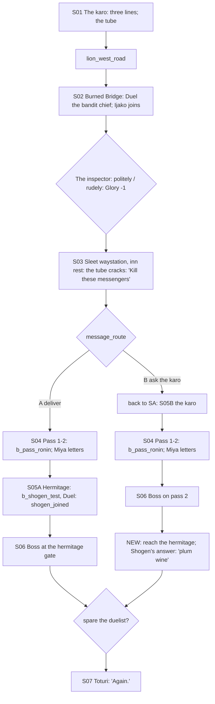

# STORYBOARD — Lion Ch3 · "The Deadly Message"
Production: `production/lion-ch3.md` · Lv 30–35 · Region: **Shiro Akodo → the western Lion hills** (Map A: from the
Lion heartland toward the ridge west of Sacred Watch Palace; Map B: the Lion road toward the Spine).
Overworld: **SA** → `lion_west_road` (spring thaw) → **BB** Village of the Burned Bridge → the sleet waystation →
`mountain_pass_1–2` → **KZ** Kaze-no-Tani. Bestiary F: *Lion mountains (Kaze-no-Tani)* (28–35), plus a new *Lion west
road (spring)* row.

## Flow


## Maps

### R `lion_west_road` — SA → Burned Bridge (field route, new) · Danger 28–35
```
 @SA west gate == muddy thaw road ≈≈≈ [abandoned farm] c ≈≈≈ [river: the burned bridge] > BB
       c*(Athletics 4: a collapsed granary loft → Fine Katana)     [cairn shrine +]
```
- Encounters (new row): Bandit Captain, Sword-for-Hire, Mountain Wolf (III palette); uncommon Glory-Hungry Bushi.

### T `burned_bridge_village` — the Village of the Burned Bridge (refugee village)
```
 ~~~~~~~~~~ river ~~~~~~~~ [burned bridge] ~~~~ ford: bandit chief!S02 (toll) ~~~~ far bank: Ijako! ~~~~~
 [refugee tents]  1 widow with children  2 Lion deserter  3 old storyteller  4 smuggler   [field kitchen = I]
 [refugee market S] (rice, Herbal Salve, Ginseng Tonic, Calming Tea)   + [roadside Hachiman]   c   C
 @lion_west_road                      (beyond the ford) > the inspector!(on the road) > sleet_waystation
```
| # | NPC | Path action | Result |
|---|---|---|---|
| — | Bandit chief | **Duel** (production) | The toll is waived; afterwards his gang guards the ford for the refugees (a line on revisit) |
| 1 | Widow with children | **Bless** | Follows ("Hearth Prayer": a small heal each turn for 2 turns, 1 use) |
| 2 | Lion deserter | **Sumai** / **Discern** | Sumai: he confesses he fled Gusai's war. Discern: "He's afraid of the inspector, not the bandits." |
| 3 | Old storyteller | **Charm** / **Eavesdrop** | Charm: the tale of Kaze-no-Tani ("an old man who splits wood barefoot"). Eavesdrop: "Miya men ask everyone where Lion messengers go." |
| 4 | Smuggler | **Barter** / **Pilfer** | Barter: Shosuro Tanto (T3). Pilfer: Miya Coin (lore; Yachiko's pay) |
- Shops: the refugee market only (no weapons). Shiro Akodo is the shopping stop for this chapter.
- `c` (under the bridge piles): Ginseng Tonic ×2. `C` (the bandit's toll box): 1,500 zeni. Give it back to the
  refugees: Honor +2, money lost. Or keep it.

### M `sleet_waystation` (S03) and `ancestor_shrine`
- The waystation is an inn (the S03 trigger is resting there). Its roadside shrine is the `ancestor_shrine` (Ijako's
  séance) and a **save**.
- Party reactions play by who is present (production).

### D `mountain_pass_1–2` — the snowy pass (dungeon) · Danger 30–35
```
 pass_1                                           pass_2
 @waystation  ≈ switchbacks ≈  c   c*(Hunting 5:  >P1  ≈ ice shelf ≈  "bandits in good boots" → b_pass_ronin
  snow-hare tracks → a frozen hunter's cache:          [defeated ronin]* (search: the Miya letters, F-1)
  Winter Pelt ×2, Ginseng Tonic)                       c (dead end: a frozen courier → Signal Horn, a Patrol Writ)
  >P2                                                  § save  > KZ hermitage (route A)  /  route B: the boss happens here
```
- **The letters (F-1):** the production gated them behind "[PA Discern / Eavesdrop / Interrogate]".
  **Interrogate is a battle skill, not a path action**, and a solo Shizue has neither Discern nor Eavesdrop. Now
  the ronin **surrender** at low HP (bestiary A2), and searching their packs gives the letters to any party. Discern
  or Eavesdrop add the extra line ("same hand as the writ").
- `§` before the hermitage / the B-route boss.

### M `kaze_no_tani_hermitage` — Kaze-no-Tani (S05A / the end of route B)
```
 ^^^^^ peaks ^^^^^
 ^ [hermitage] Shogen splitting wood!   [woodpile] c (Shogen's plum wine — taking it: he notices; Honor −1, it's funny)
 ^ [gate]  B (route A: the Miya killers)   [cold spring +] (cleanse, Meditate)
```
- **Route B ending (F-2):** in the old text Shizue went to "fetch his answer" but never reached him. Now, after the
  pass boss, she reaches the hermitage. Shogen reads the karo's request, laughs, and refuses to come: AKODO SHOGEN:
  "Tell Toturi he still owes me a jar of plum wine. (beat) And tell him his messenger is too polite. She asked."
  `shogen_joined` stays false.

## Simulated playthrough
1. Lv 30. The karo (three lines) → the road (about 4 encounters) → the village (the ford Duel; Ijako joins as the only
   guest) → the inspector → the waystation (rest → the tube cracks → the choice).
2. **A:** the pass (about 6 encounters + the ronin; letters by search) → the hermitage → Shogen's Duel (non-lethal,
   §3c) → the boss at the gate.
3. **B:** back to SA (about 3 encounters each way: longer, with no Shogen) → the karo → the pass → the boss on
   pass 2 → the hermitage coda.
4. S07 "Again." Total ≈ 80 minutes for A, 95 for B.

## Findings → fixes
| # | Finding | Fix |
|---|---|---|
| F-1 | Interrogate was used as a path action (it's a battle skill); a solo Shizue couldn't get the letters | Searching the surrendered ronin gives the letters to anyone; Discern/Eavesdrop add a line |
| F-2 | Route B never resolved "fetch his answer" | Hermitage coda: Shogen declines, with a plum-wine line |
| F-3 | The village had only the ford Duel | NPC path actions, a refugee market, the toll-box moral choice |
| F-4 | No route or encounter table for the lowland road | `lion_west_road`; a new bestiary row |
