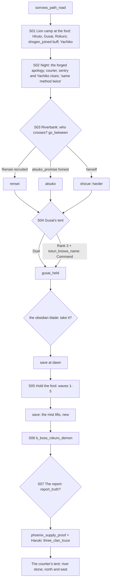

# STORYBOARD — Lion Ch4 · "Sorrow's Path"
Production: `production/lion-ch4.md` · Lv 41–45 · Region: **Kanashimi no Komichi**: the Lion–Crane river (Map A: the
river below Toshi Ranbo / Violence Behind Courtliness City, between Last Breath Castle and Son of the Crane; Map B:
where the yellow Lion border touches the blue Crane border on a river).
Overworld: **SP** (reached by `sorrows_path_road` from SA or HC). Bestiary F: *Sorrow's Path* (40–46).

## Flow


## Maps

### R `sorrows_path_road` — to the ford (field route, new) · Danger 40–46
```
 @SA / HC road == old battlefield (rusted spears, grave-mounds) ≈≈≈ c ≈≈ [Matsu Joruri's victory stone]* (Lore: History → a buff for the waves: +1 Resolve damage, wave 1 only)
              c*(Athletics 6: a collapsed watchtower → Matsu War Yari)  ≈≈ [Lion pickets] > lion_camp_ford
```
- Encounters: Heavy Infantry, Hatamoto's Champion, Sergeant of Spears (deserters and over-eager patrols).

### T `lion_camp_ford` / `camp_night` — the Lion camp (a hub that works as a town)
```
 ~~~~~~~~~~~~~~~~~~~~~~ THE FORD (Crane banners on the far bank) ~~~~~~~~~~~~~~~~~~~~~~~~
 [command tent]!S01 (Hiruto, Shogen)   [Gusai's tent]!S04 (obsidian rack)   [Rokuro, sharpening]
 [quartermaster W/A/S: Lion T4]  [field kitchen = I]  [Yachiko's tent]*(Eavesdrop)   [camp shrine +]
 1 courier (S02)  2 sentry  3 Matsu berserker  4 camp cook  5 Kitsu priest  6 an Ikoma herald   c   C
 @sorrows_path_road                                                              > riverbank (S03)
```
| # | NPC | Path action | Result |
|---|---|---|---|
| 1 | Courier | **talk** (any party, F-1) / Discern / Eavesdrop | Talk: "A lovely courtier met me at the ford. She offered tea." Discern adds: "Blue eyes. He can't stop thinking about them." |
| 2 | Sentry | talk | "A woman with very blue eyes. She went into the Crane camp too." |
| — | Yachiko | Eavesdrop | "Two letters. Two insults. Two armies. Elegant." (she's pleased, not the author) |
| 3 | Matsu berserker | **Sumai** / **Duel** | Sumai: "Rokuro walks at night. Talks to the river." Duel: Glory +1 · Matsu War Yari |
| 4 | Camp cook | **Charm** / **Pilfer** | Charm: follows ("Field Rations": party HP regen in the waves, 1 use). Pilfer: Fine Sake ×2 |
| 5 | Kitsu priest | **Bless** | Calming Tea ×3, and a line about the river's ancestors |
| 6 | Ikoma herald | **Barter** | "Sorrow's Path Chronicle" (lore: the old battle; shows where the oni stole the banner) |
- **Shops: Lion T4:** Matsu War Yari, Kaiu Iron Mountain (Lion palette), Calming Tea, Jade Dust.
- `c`: Ginseng Tonic ×3. `C` (Yachiko's baggage, at night): **Miya Seal Wax** (lore) + 3,000 zeni. Low Skill: Honor −1.
- `!S04` Gusai's tent: the obsidian blade on the rack (the choice).

### M `riverbank` (S03)
```
 reeds  ~~~~~~  [truce point]!S03 (go-between choice)   c (a drowned Crane scout's kit: Tsuruchi Longbow)
 reeds  [Atsuko appears here, if honest]  ~~ ford ~~ >the_ford
```

### S `the_ford` — Hold the Ford (set-piece; 5 waves) · then the boss
```
 Crane bank  ~~~~ [burning bridge] ~~~~ stones ~~~~ shield-line (Lion) ~~~~ Lion bank
 wave 1 berserkers · wave 2 Crane counter-charge · wave 3 archers (far bank) · wave 4 fire tiles · wave 5 terror wave → Rokuro wades in (B)
```
- **Between waves:** a "Hold" pause (items, kata, guest swap; no save).
- **Save:** at dawn before wave 1 (production `[SAVE]` at S04), and **new**: after wave 5, "the mist lifts" `§`,
  before `b_boss_rokuro_demon` (F-2). Five waves plus the boss with no save was the worst stretch in the game so far.
- Wave battles are **normal** battles (a loss is a game over). The gimmick budget holds: the ford waves are the
  set-piece; the boss has no extra gimmick beyond its Terror aura (a skill, not a mechanic).

### M `courtier_tent` (S07)
- An empty tent at the edge of the Crane lines: mask, hair-dye, the river stone. The **Shinomen pointer** (go
  stones on the map).

## Simulated playthrough
1. Lv 41. The road (the victory-stone buff is a nice History tie-in) → camp. With `shogen_joined`, the Old Lion's
   Counsel buff applies.
2. S02: the courier clue, now available to any party by talking (F-1). Discern/Eavesdrop/Yachiko add flavour.
3. Riverbank: the go-between. Gusai's tent: a Duel (non-lethal, §3c), or Command if Rank 3 and `toturi_knows_name`.
   The obsidian choice.
4. Dawn save → 5 waves (about 3–4 minutes each) → **new save** → the boss → the report choice → (with
   `phoenix_supply_proof` and Haruki present) the three-clan truce → the tent. Total ≈ 100 minutes.

## Findings → fixes
| # | Finding | Fix |
|---|---|---|
| F-1 | The courier clue used "Interrogate" as a path action | Talking gives the core clue; Discern/Eavesdrop add detail |
| F-2 | No save between the 5 waves and the boss | `§` "the mist lifts" after wave 5 |
| F-3 | No route to Sorrow's Path; the camp had no shops or NPC coverage | `sorrows_path_road`; camp shops (Lion T4); NPC table |
| F-4 | The wave rules weren't defined | Normal battles with a "Hold" pause between (items, kata, guest; no save) |
