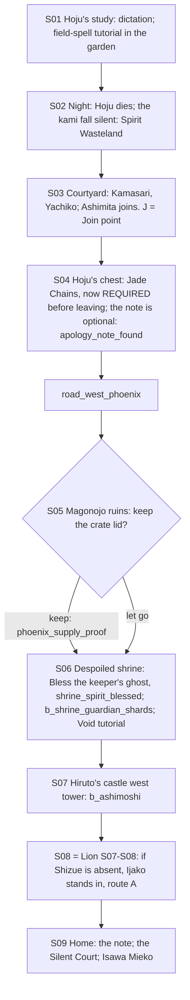

# STORYBOARD — Phoenix Ch1 · "The Silent Kami" (paired with Lion Ch1)
Production: `production/phoenix-ch1.md` · Lv 1–8 · Region: **southern Phoenix lands → the Lion border** (Map A: below
Morning Glory Castle, toward the Castle of the Centipede; Map B: the orange Shiba/Isawa band above the Lion).
Overworld: **KM** Shiro no Kamatori → `road_west_phoenix` (Magonojo ruins, despoiled shrine) → **HC** Hiruto's castle
(the shared climax). Bestiary F: *Phoenix roads & Kamatori* (1–8).
**Pair rule P-1:** see `storyboards/lion-ch1.md`. If Lion Ch1 was played first, this chapter is the flashback "That
week…", with `climax_route` locked to Lion's choice. Played first, Shizue is a silent NPC at Hiruto's side.

## Flow


## Maps

### T `shiro_kamatori` — Shiro no Kamatori (castle town screen added, finding F-2)
```
 screen A: castle town                                         screen B: castle (five towers)
 [Isawa robe-house A] [temple-smith W] [apothecary S] [inn I]   [Hoju's study]!S01/S02/S04/S09 · chest under the desk*
 + [town shrine] (silent after S02)   t [tea house]             [garden shrine]!(Commune/Summon/Sense tutorial)
 1 cook  2 Shiba guard  3 scroll-copier  4 old nun  5 pilgrim   [courtyard]!S03 (embassy musters) J
 c  C   @road_west_phoenix (west gate)                          [tower 3: library] c (Scroll: Sense — duplicate; sells 300)
```
**NPCs** (a town table was missing; added to production, rule T-1)
| # | NPC | Path action | Result |
|---|---|---|---|
| 1 | The cook ("too much salt") | Discern / talk | A **callback**: after S02 he says "Nobody's complained about the salt since…" |
| 2 | Shiba guard | **Duel** | Iaijutsu 1 → Glory +1 · Oak Bo |
| 3 | Scroll-copier | **Charm** / **Eavesdrop** | Charm: follows ("Ink Ward": a small shield, 1 use). Eavesdrop: "Kamasari owes the Crane money" (lore) |
| 4 | Old nun | **Bless** | Rejuvenating Tea ×2 |
| 5 | Pilgrim | **Barter** / **Pilfer** | Barter: Incense ×2. Pilfer: a Pilgrim's Token (sell) |
| — | Stable boy | **Sumai** | Win → "The magistrate's servant left at night, westward, before the embassy." (a Yachiko hint) |
- **Shops: Phoenix T1:** Acolyte Robe, Oak Bo, Rice Ball, Rejuvenating Tea (one per visit). The temple-smith opens
  Jade variants at T2.
- `c` (well): 60 zeni. `C` (Hoju's storeroom): Hoju's Tea Set (sell 500; give it to the cook after the chapter →
  Honor +1).
- `J` **Join point** (non-starter): the courtyard muster (S03). Haruki is the boy with too many scrolls.

### S04 — the chest (F-1)
- The old text made the **Jade Chains optional** ("optional, before leaving"). But the climax binds O-Tamai with
  them. A Phoenix-first run that skipped the chest would have **no chains** at the shared boss.
- **Fix:** the courtyard gate won't open until Hoju's papers (the chest) are collected. ASHIMITA: "Kamasari said
  carry *all* his papers. Even the heavy ones." **The note stays optional:** a separate interaction under the chains,
  so `apology_note_found` keeps its meaning in Ch2–Ch4.

### R `road_west_phoenix` — see `storyboards/lion-ch1.md` (one shared map)
- Phoenix version: by day, westward, with the embassy (Kamasari rides ahead; random battles as normal).
- The `magonojo_ruins` branch: the crate-lid choice (S05).
- The `despoiled_shrine` (S06): the Bless tutorial on the keeper's ghost → `b_shrine_guardian_shards` → `[SAVE]`.

### D `hiruto_castle_west_tower` — the silent hurricane (mid-boss) · Danger 5–8
```
 :ground floor (from the castle screen B)  c  ≈ (wind-ghosts: Will-o'-wisp) ≈
 :2F  c (a Shiba ancestor's blade rack → Oak Bo +)   § save
 :top  Ashimoshi in the silent storm  b
```
- A short tower dungeon (F-3: a small dungeon so Phoenix Ch1 has one; the production listed only the boss room).
- `b_ashimoshi` → Ashimoshi points west, to the barracks → S08.

## Simulated playthrough
**Phoenix first, no Shizue:**
1. Lv 1: the study, the garden tutorial (Commune, Summon, Sense) → Hoju dies → Spirit Wasteland.
2. Courtyard: Ashimita joins (the only guest here, so no G-1 conflict until Ijako stands in at S08: **Ijako takes
   the stand-in role as an NPC actor, not a guest slot**, F-4).
3. Chest (required) → road (about 5 encounters) → ruins (crate lid) → shrine (Bless tutorial + battle + Void
   tutorial) → the tower (about 3 encounters + the mid-boss).
4. S08 (Lion's S07–S08, route A auto) → home → the note. Total ≈ 75 minutes.

**Lion first, then Phoenix later:** recruit Haruki at the Kamatori courtyard → his flashback. At S07, if Shizue is
active, the merged lines play; `climax_route` is locked to Lion's choice.

## Findings → fixes
| # | Finding | Fix |
|---|---|---|
| F-1 | The Jade Chains were optional, but the climax needs them | The chest is required (gate line); the note stays optional |
| F-2 | Kamatori had no town (shops, inn, NPC table) | A castle-town screen with NPCs |
| F-3 | Phoenix Ch1 had no dungeon (Octopath shape: town → dungeon → boss) | `hiruto_castle_west_tower` is a 3-floor tower |
| F-4 | Ijako as a stand-in plus Ashimita as the guest | Stand-ins act in cutscenes; they don't take the guest slot |
| F-5 (P-1) | The paired-chapter rule | Production block added (both files) |
| F-6 | Non-starter version | Join point (courtyard S03) + Memory (S01–S02) |
