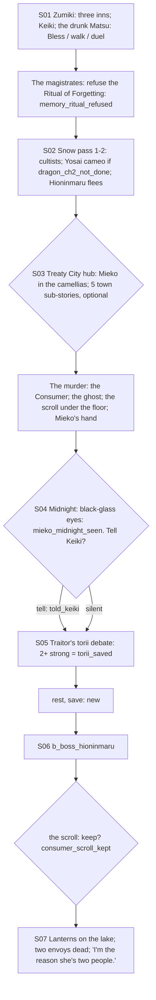

# STORYBOARD — Phoenix Ch2 · "The Silent Court"
Production: `production/phoenix-ch2.md` · Lv 20–25 · Region: **the Lion–Phoenix border in the north** (Map A: the
foothills between Violence Behind Courtliness City and the Phoenix uplands; Map B: the orange/yellow border).
Overworld: **ZU** Zumiki-mihari (village of three inns) → `snow_pass_1–2` → **TC** Honored Treaty City.
Bestiary F: *Snowbound pass (Phoenix)* (18–25).

## Flow


## Maps

### T `zumiki_village` — Zumiki-mihari (village of three inns)
```
 ^^^^^^^ [old Otomo watchtower] ^^^^^^^^^^^^^^^^^^^^^^^^^^^^^^^^^^^^^^^^^^^^^^
 [White Songbird inn = I] (magistrates)!   [Yellow Lantern] (Matsu Hisae)!   [Hidden Poem geisha house] t
 [village store S/A: Phoenix T2]  + [snow shrine]  Keiki!  1 magistrate's clerk  2 geisha  3 old porter  c  C
 @road (from KM / SA)                                                 > snow_pass (caravan gate)
```
- Shops: **Phoenix T2:** Shugenja's Haori, Ironwood Bo, Herbal Salve, Rejuvenating Tea, Calming Tea.
- NPC path actions: Matsu Hisae: **Bless** (production). Magistrate's clerk: **Eavesdrop** → "the 'Phoenix bandits'
  are Kokujin's painted peasants". Geisha: **Charm** → follows ("Song of Mourning": enemy Speed down, 1 use). Old
  porter: **Sumai** → a Snow Lotus (Remedy ingredient). **Pilfer** the clerk → a Patrol Writ. **Barter** at the geisha
  house → Fine Sake. **Duel** a bored Shiba (Iaijutsu 3) → Glory +1.
- `c`: Herbal Salve ×2. `C` (watchtower chest): **Scroll: Summon Fog** duplicate. If Haruki already has it: an
  Incense bundle.

### D `snow_pass_1–2` — the snowbound pass (dungeon, with the caravan) · Danger 18–25
```
 pass_1                                           pass_2
 @Zumiki gate  caravan carts ≈≈ c ≈≈              >P1  slopes: painted cultists rush down!  b_pass_cultists
  ≈ snowdrift (Yosai pops up, if dragon_ch2_not_done)   c*(Athletics 3: an avalanche shelf → Calming Tea ×3)
  c*(Hunting 3: wolf tracks → a Mountain Wolf den, fight)  Unicorn riders + Mantis guards arrive  > TC
```
- Encounters: Painted Cultist (II palette), Mountain Wolf; uncommon Black Bear; rare Yurei.
- No save in the pass. The city is just beyond (the inn is the save).

### T `treaty_city` — Honored Treaty City (hub)
```
 ~~~~~~~~~~~~~~~~~~~~~ the black lake (lanterns, S07) ~~~~~~~~~~~~~~~~~~~~~~~~~~~~~~~
 [memorial halls]!(ceremonies)   [camellia garden] Mieko!   [scholars' house]!murder (floor hiding place*)
 [guest houses = I]!S04 (rest → midnight)   [snow garden]!(midnight)   [spell-scroll archive] (sub-story 2)
 [joint dojo] (sub-story 1)  [Shiba barracks] (sub-story 3)  [lake ice] (sub-story 4)  [Mantis stall, burned] (sub-story 5)
 [Lion–Phoenix market W/A/S: T2]  + [treaty shrine]   c   C       > mountain path > traitors_torii
```
**The five town sub-stories** (previously named but never written; finding F-1). OT1-style: an icon, a request, a
path-action solution, a reward.
| # | Sub-story | Solve with | Reward |
|---|---|---|---|
| 1 | **"The Same Dojo"**: a Hida bushi and a Shiba bushi keep "accidentally" meeting | Eavesdrop (they each want a go-between) → Charm *or* Bless to carry a message | Kabuto (T2) from the Crab, and a TB line |
| 2 | **"The Archive at Night"**: a Crane yojimbo guards the spell-scroll archive | Discern → he's guarding a young Asahina reading forbidden history. Let it be → he pays for silence with a **Scroll: Tremor** (Haruki field spell; opens the Crab Ch1 cave wall) | Scroll: Tremor |
| 3 | **"Sober by Dusk"**: the Shiba commander has been drunk since dawn; he leads the procession at dusk | **Remedy** (Sayo, a sober-up recipe) *or* **Bless** (lead him to the shrine) | Shugenja's Haori (fine) · Honor +1 |
| 4 | **"Ice Duel"**: two families' children are about to fight a blood-feud duel on the lake ice | **Duel** (Shizue: take one child's place, non-lethal) *or* **Charm** the parents | Rattan Yumi · Honor +2 |
| 5 | **"The Burned Stall"**: a Mantis trade stall was set on fire | Discern the soot (a Yasuki lamp oil) → **Sumai** *or* **Pilfer** the rival Yasuki's ledger → he confesses; **Barter** restocks the Mantis | Pearl ×2 · Fine Sake ×2 |
- Murder: Bless the historian's ghost (Haruki, always), Discern/Eavesdrop add extras. **The scroll's hiding place** is
  a search spot under the scholars' house floor (F-2: "recovered later" had no place).
- Shops: **T2 Lion + Phoenix goods** (Lacquered Yari, Shugenja's Haori, Kabuto, Incense).
- `c`: 600 zeni. `C` (memorial-hall storeroom): Rejuvenating Tea ×3.

### S `traitors_torii` (S05 debate → S06 boss)
```
 ^^^ hidden mountain torii (Shiba Mitsuhide) ^^^   mob with torches (day) / Hioninmaru + cultists (night)  B
```
- **New save:** resting at the guest house between S05 and S06 ("night falls") is required and saves (F-3). In the
  old text the debate went straight into the night boss.

## Simulated playthrough
1. Lv 20. Zumiki (the Matsu test, the ritual refusal) → the pass (about 5 encounters + the cultist battle, Yosai if
   early).
2. Treaty City: Mieko → the five sub-stories (each about 5 minutes; they cover every path action) → the murder →
   midnight → the choice.
3. Debate (2 strong answers is easy with Haruki's own lines) → **rest/save** → the boss → the scroll choice → the
   lanterns. Total ≈ 100 minutes including the sub-stories.

## Findings → fixes
| # | Finding | Fix |
|---|---|---|
| F-1 | Five side-story hooks were listed but never written | The five town sub-stories defined (production table) |
| F-2 | "Recovered later from a hiding place" had no location | A search spot under the scholars' house floor |
| F-3 | No save between the debate and the night boss | The guest-house rest → night (save) |
| F-4 | The Tremor scroll (needed for the Crab Ch1 revisit wall) had no source | Sub-story 2 reward |
