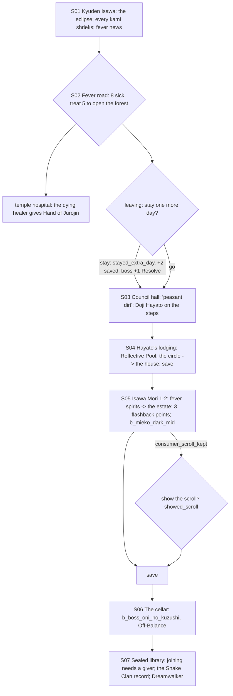

# STORYBOARD — Phoenix Ch3 · "The Darkfever"
Production: `production/phoenix-ch3.md` · Lv 30–35 · Region: **Kyuden Isawa and the Isawa Mori** (Map A: "Isawa
Elemental Academies", north-east, and the forest around it; Map B: the Isawa provinces).
Overworld: **KI** Kyuden Isawa → `fever_road` (3 fever villages + the temple hospital) → **IM** Isawa Mori → the
Mieko estate. Bestiary F: *Isawa Mori (Darkfever)* (28–35).

## Flow


## Maps

### T `kyuden_isawa` — Kyuden Isawa (city hub)
```
 [Council hall]!S03 (five masks)   [sealed library] (locked until S07)   [Tower of Air] (Uona, S07)
 = academy avenue =========================================================== > fever_road (south gate)
 [Isawa robe-house A] [temple-smith W: Jade T3] [scroll-shop S]  [inn I]  t  + [shrine of the five rings]
 [Hayato's lodging]!S04   1 apprentice  2 clerk  3 old Master's servant  4 refugee  5 Asako monk  6 a Lion envoy  c  C
```
| # | NPC | Path action | Result |
|---|---|---|---|
| 1 | Apprentice | **Charm** | Follows ("Elemental Spark": a random element hit, 2 uses) |
| 2 | Council clerk | **Eavesdrop** / **Pilfer** | Eavesdrop: "Rujo will be asked to abdicate before summer." (canon colour). Pilfer: Council Seal Paper (lore) |
| 3 | An old Master's servant | **Discern** | "The Masters fear the fever more than they say: they've sent their own families north." |
| 4 | Refugee from the villages | **Bless** | Follows ("Survivor's Prayer": cures Poison, 2 uses). Then sends you to her village |
| 5 | Asako monk | **Barter** | Rejuvenating Tea ×5 (normally 1 per visit) |
| 6 | Lion envoy | **Duel** / **Sumai** | Duel (Iaijutsu 5): Glory +1 · Naginata-style Yari (T3). Sumai: info that the Lion blame the Phoenix for the fever |
- Shops: **Phoenix T3:** Isawa Robe, Temple Bo, Jade variants (T3), Ginseng Tonic, Antidote, Rejuvenating Tea.
- `c`: 1,200 zeni. `C` (library porch, locked): Scroll: Summon Fog (duplicate; sells 300).

### R `fever_road` → `fever_village_1–3` + `temple_hospital` (field route with village stops) · Danger 28–35
```
 @KI south gate ≈≈ [fever_village_1: Goemon, Hana] ≈≈ [temple_hospital: the dying healer] ≈≈ [fever_village_2: priestess, twins, charcoal-burner]
            ≈≈ [river ferry: ferryman] ≈≈ [fever_village_3: Lion deserter, ronin bodyguard] ≈≈ > isawa_mori (opens at 5 treated)
```
- **Triage pressure rule (F-1):** while the fever rages, **the villages have no inn**: the inns are hospitals. The
  temple hospital lets you rest **once** (and that rest is the "stay one more day" choice if 5 are already treated).
  SP comes from items (Rejuvenating Tea, the Asako monk's stock) and Haruki's VP economy (Void spells cost VP, not
  SP). This keeps the production's "limited SP" intent, which a nearby inn would have erased.
- Treatment coverage: Haruki alone can treat 7 of 8 (the ferryman needs Remedy). With Sayo, all 8.
- Encounters on the road: Fever Spirit, Gaki; uncommon Blood-Hungry Acolyte (looters).
- `c` ×3 along the road: Antidote ×3 · Ginseng Tonic · Herbal Salve ×3.

### D `isawa_mori_1–2` → `mieko_estate` (dungeon) · Danger 30–35
```
 isawa_mori_1                  isawa_mori_2                        mieko_estate
 @fever road  ≈ bruised-smoke   >M1  b_forest_fever_spirits        [veranda: go board]* · [broken screen]* · [courtyard]*
  fever spirits ≈  c            ≈ tsuchigumo webs ≈ c*(Tremor:      [heart of the house]!S05 dark Mieko (b_mieko_dark_mid)
  c*(Hunting 5: deer trail →     a web-choked shrine → Jade          § save  :cellar → B (Oni no Kuzushi)
   a woodcutter's hut: Moxa ×3)   Dust ×4)  c (dead end: a fever       c (Mieko's childhood room: a Child's Go Stone — key, used in Ch4's dream as flavour)
                                  shrine → Purity Charm)
```
- Encounters: Fever Spirit, Tsuchigumo, Gaki; uncommon Blood-Hungry Acolyte.
- The estate's flashback points: three non-interactive replays (production).

## Simulated playthrough
1. Lv 30. The eclipse → the fever road. The triage takes about 20 minutes without an inn, using items and Void spells.
   Hand of Jurojin arrives at the temple hospital, mid-road, right when SP starts running short. Good pacing.
2. The leave choice → Council → Hayato → the circle (save) → the forest (about 6 encounters + the fixed battle) → the
   estate (flashbacks, the mid-boss, the scroll choice) → save → the cellar boss (Off-Balance: The Mountain's Feet /
   Defend / guest).
3. Library: joining needs a giver; Dreamwalker. Total ≈ 100 minutes.

## Findings → fixes
| # | Finding | Fix |
|---|---|---|
| F-1 | "Limited SP" triage had no resource rule; an inn would make it trivial | No village inns during the fever; one temple-hospital rest |
| F-2 | Kyuden Isawa had no town layout or NPC coverage | City screen + table |
| F-3 | The villages were separate maps with no connecting route | `fever_road` with stops |
| F-4 | The Tremor scroll (Phoenix Ch2) needs more uses to feel worth it | A Tremor web-shrine in isawa_mori_2 |
