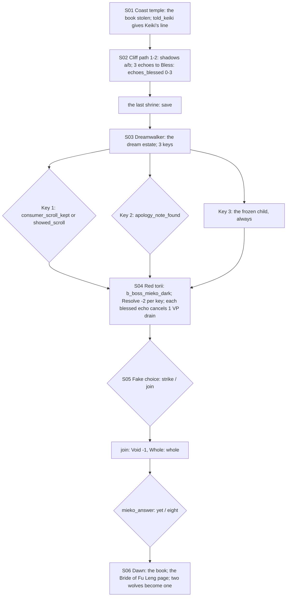

# STORYBOARD — Phoenix Ch4 · "Howl"
Production: `production/phoenix-ch4.md` · Lv 41–45 · Region: **the Phoenix coast** (Map A: the north-east coast
below Cliffside Shrine and the Castle of the Cat; Map B: the orange coast with a dotted sea lane).
Overworld: **CT** coast temple town → `cliff_path_1–2` → the last shrine → (dream) → **RT** the red torii cliff.
Reachable by road from KI, or **by ship** (Crane Ch3). Bestiary F: *Phoenix sea-cliffs* (40–46).

## Flow


## Maps

### T `coast_temple_town` — the coast temple town
```
 ~~~~~~~~~~~~~~~ storm sea ~~~~~~~~~~~~~ [harbour: ship mooring (Crane Ch3 ship)] ~~~~~~~~~~~~~~
 [temple scriptorium]!S01 (Keiki; monks copying)   [pilgrim inn I]   [Phoenix outfitter W/A/S: T4]   + [sea shrine]
 1 copy-monk  2 fisherwife  3 ronin guard  4 Shiba sentry  5 storm-watcher  6 child with a kite   c   C
 @coast road (from KI)                                           > cliff path (north)
```
- Shops: **Phoenix T4:** Elemental Master's Mantle, Togashi Bo (imported), Jade T4 variants, Rejuvenating Tea.
- NPC path actions:
  - Copy-monk: Discern → "The thief wore white and hummed."
  - Fisherwife: Barter → Eel ×3, Sea Salt.
  - Ronin guard: Sumai → the cliff path's shortcut ledge (opens `c*` on cliff 1).
  - Shiba sentry: Duel (Iaijutsu 7) → Glory +1 · Fine Katana Fragment.
  - Storm-watcher: Eavesdrop → "Two wolves on the cliff, every night. One white, one black."
  - Child with a kite: Charm → follows ("Kite Line": party Speed up, 1 use).
  - Pilfer: the outfitter → Kansen Mist ×2. Bless: a drowned sailor's ghost on the jetty → it leads you to `C`.
- `c`: 2,000 zeni. `C` (on the jetty, ghost-led): **Orochi Scale** (Water ++). A late, strong reward for Bless.

### D `cliff_path_1–2` → `last_shrine` · Danger 40–46
```
 cliff_1                                         cliff_2                                       last_shrine
 @town  rain ≈≈ little shrines ≈≈ b_mieko_shadows_a   >C1 ≈≈ echo 2 (counting song)* ≈≈ c          Mieko asleep on the floor; the book
  echo 1 (camellias)*  c   c*(ledge, ronin's shortcut)   echo 3 (writing the Consumer)* ≈≈ b_mieko_shadows_b   § save (production)
  >C2                                                     c (dead end: a wrecked shrine-boat → Pearl ×3)       → Dreamwalker
```
- **Echoes (F-1):** each Bless sets `echoes_blessed +1`, which previously had **no effect**. Now each blessed echo
  **cancels one of the dark Mieko's VP drains** in the boss: "The gentle echo stands between you." Up to 3.
- Encounters: Frost Spirit, Wako Raider (IV palette); uncommon Kansen Wisp.

### S `dream_estate` — the dream (set-piece)
```
 [garden in sunlight] gentle Mieko — Key 1 (the Consumer scroll)      |crack|      [ash] dark Mieko on the broken go board — Key 2 (the note)
                                [where the crack began] frozen child-Haruki — Key 3
```
- If Haruki has the **Child's Go Stone** (Phoenix Ch3 estate chest), there is a flavour line at Key 3: he sets it on
  the dream board: "I'm giving back the stone too."

### S `red_torii_cliff` — the boss
- `b_boss_mieko_dark` (a Void duel: she pays VP, drains VP). Resolve −2 per dream key; each blessed echo blocks one
  drain.

## Simulated playthrough
1. Lv 41 (by road or ship). The town: the T4 shop, the jetty ghost (Bless) → Orochi Scale.
2. Cliffs: about 6 encounters, 2 fixed battles, 3 echoes (Bless; each now matters) → save → the dream (3 keys:
   10 minutes) → the boss → the fake choice → Whole → the answer → dawn. Total ≈ 85 minutes.
3. **Flag check:** reads `consumer_scroll_kept`, `showed_scroll`, `apology_note_found` (made optional-but-
   available in Phoenix Ch1), `mieko_midnight_seen`, and `told_keiki` (Keiki's line). All are used.

## Findings → fixes
| # | Finding | Fix |
|---|---|---|
| F-1 | `echoes_blessed` was tracked but had no effect | Each blessed echo cancels one VP drain in the boss |
| F-2 | `mieko_midnight_seen` was in the header but unused in the text | A line in S01: KEIKI "You saw her at midnight. You knew before any of us." (production) |
| F-3 | Town NPC coverage | Table above (added to production) |
