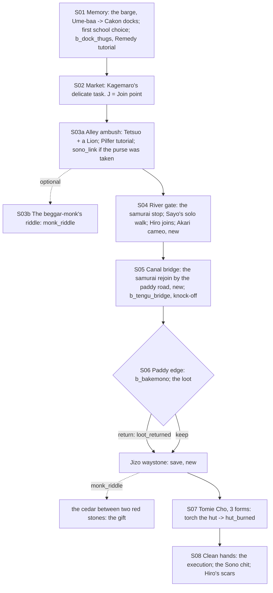

# STORYBOARD — Ronin Ch1 · "What's Eating the Eta"
Production: `production/ronin-ch1.md` · Lv 1–8 · Region: **Cakon, a Crane river city** (Map A: the southern Crane
coast at a river mouth, near Wall Above the Ocean Village; Map B: the blue Crane coast where a river meets the sea).
Overworld: **CK** Cakon (docks, market, alley, gate) → the eta village outside the walls → `canal_bridge` →
`paddy_edge` → `tomie_hut`. Bestiary F: *Cakon & the eta roads* (1–8).

## Flow


## Maps

### T `cakon_docks` · `cakon_market` · `cakon_alley` · `cakon_gate` — Cakon (town, 3 screens)
```
 screen A: docks                              screen B: market                                  screen C: alley + river gate
 ~~~ [Mantis ferry pier] (100 zeni → IS) ~~~   musicians · Kagemaro (behind the radishes)!S02 J   [narrow alley]!S03a (ambush)
 ~~~ barges · fish-seller (S01 thugs) ~~~      [House of Tranquillity] doorman                   [river gate]!S03b beggar-monk + dog
 [harbour inn I]  [chandler S]  c              [Crane armoury W/A: T1] [herb seller S]           > eta village (across the bridge)
 1 ferryman  2 bargeman                        3 Sono servant  4 guard  5 street kid  6 Crane duellist   c   C
```
**NPCs and path actions** (*(added)* rows, rule T-1)
| # | NPC | Path action | Result |
|---|---|---|---|
| 3 | Sono servant | Discern / Pilfer | production (the chit → `sono_link`) |
| — | House doorman | Eavesdrop | "O-Sode cries every night. She liked Ieko." |
| — | Herb seller | Barter | Remedy ingredients (the Remedy economy starts here) |
| 5 | Street kid | **Charm** *(added)* | Follows ("Pickpocket's Eye": item drops +, 1 battle) |
| 6 | Crane duellist | **Duel** *(added)* | Iaijutsu 1 → Glory +1 · Ronin's Katana (fine) |
| 2 | Bargeman | **Sumai** *(added)* | Win → "The Sono's barge goes upriver every night. Empty." (a sono hint) |
| 4 | Guard | **Bless** *(added)* | Haruki leads him to the dockside shrine to pray for his sick daughter → he looks away at the river gate later (no toll) |
- **Shops: Crane T1:** Ronin's Katana, Travelling Clothes, Jingasa; the herb seller has Remedy bases and catalysts.
- `c` (docks): 80 zeni + Rice wine (catalyst). `C` (House of Tranquillity storehouse): a love poem from Ieko (lore) +
  150 zeni.
- **Mantis ferry** pier (screen A): Cakon is the second ferry port (README §4c).
- `J` **Join point** (non-starter): the market. Kagemaro's call; "I'm a citizen. Mostly bold." Talk to Sayo → join →
  **Memory** (S01: the barge, Ume-baa, the docks; **the first-school choice is still asked**, F-1).

### T `eta_village` — the village outside the walls (the caste gate; solo walk)
```
 [bridge]! (samurai stop here)  →  low houses · [all-faiths shrine of salvaged lumber]!Hiro grinding the no-dachi
  Auntie Fumi!   frightened faces in doorways   7 a quiet young woman staring at the shrine fire (AKARI, new cameo)
  [Ume-baa's old hut] c (her herb box: Moxa ×3, a Remedy recipe card: Willow Bark + Honey)   > blood trail (out the far side)
```
- **Akari cameo (F-4):** Ronin Ch4's chosen successor is "the eta woman Sayo once nursed through fever". Here she's a
  silent young woman by the shrine fire. Talk: SAYO: "Akari? You're better!" AKARI: (quietly) "The fire talks when
  it's quiet. Don't tell anyone." It plants Ch4 early.
- **Rejoin rule (F-2):** the production stopped the samurai at the bridge but never said how they get back. Now they
  **circle round by the paddy road** and rejoin at `canal_bridge` (S05): NATSUKO / RENSEI / whoever: "We went round.
  It's a long way round. That's sort of the point, isn't it."

### R `canal_bridge` → `paddy_edge` → M `tomie_hut` (field route + boss) · Danger 3–8
```
 canal_bridge: a single log over the canal · two crow-tengu  b (knock-off mini-boss)   c (canal bank: Tengu Feather is the drop)
 paddy_edge:  """ paddies """  goblins with baskets  b_bakemono   [old cedar between two red stones]* (monk_riddle → dig)
              [wayside Jizo] § save (new, F-3)   c (a scarecrow's coat pocket: Antidote ×2)
 tomie_hut:   mud hut, smoke · Tomie Cho at the door (teapot)  B  (form 1 inside; torch the hut → form 2; form 3)
```
- Encounters: Dock Ruffian, Wild Boar, Carrion Crow; uncommon Hungry Ronin; rare Tengu Crow-Warrior near the canal.

## Simulated playthrough
1. **Starter:** the sepia memory → the docks (Remedy tutorial) → the market (Kagemaro) → the alley (Pilfer tutorial;
   the chit) → the beggar-monk → the gate. **Solo walk** (Sayo only): Fumi, Hiro joins, the Akari cameo → the canal
   (the samurai rejoin, if any) → the knock-off fight (Compliment command) → goblins (the loot choice) → **save** →
   Tomie Cho (3 forms; torching the hut is a satisfying shortcut) → clean hands. Total ≈ 80 minutes.
2. **Recruit:** the party in the Cakon market; Sayo answers Kagemaro → Memory (with the school choice) → S03.
3. **Samurai party:** each samurai's bridge line plays, the party splits, and rejoins at the canal. Under the old
   text the samurai would have vanished for the rest of the chapter.

## Findings → fixes
| # | Finding | Fix |
|---|---|---|
| F-1 | Recruit Memory would skip the first-ronin-school choice (a mechanical choice) | The choice is still asked inside the Memory |
| F-2 | The samurai stopped at the bridge and never rejoined | They rejoin at the canal bridge via the paddy road (a line) |
| F-3 | No save between the village and the boss (mini-boss + goblins + boss) | A Jizo waystone `§` at the paddy edge |
| F-4 | Ronin Ch4's Akari had no earlier presence | A cameo in the eta village |
| F-5 | Path-action gaps (Charm, Duel, Sumai, Bless) | NPC rows added |
