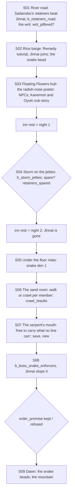

# STORYBOARD — Ronin Ch2 · "The Noble and the Ronin"
Production: `production/ronin-ch2.md` · Lv 20–25 · Region: **the River of Gold, downstream** (Map A: the river between
the Castle of the Fox and the Castle of the Sparrow, south of Kudo; Map B: where the Crab, Scorpion and Suzume borders
meet on the river).
Overworld: `river_road_winter` → `rice_barge` (a travel cutscene) → **FF** Floating Flowers → the snake den beneath
it. Bestiary F: *Floating Flowers & river* (18–25).

## Flow


## Night triggers (finding F-1)
"Night 1" and "night 2" had no trigger. **Rule:** the first inn rest in Floating Flowers is night 1 (the storm). The
next inn rest is night 2 (Jinnai's empty bed). In between, the hub is free (the sub-story, shopping, path actions).
The innkeeper hints: "Storm's coming tonight, miss. Lords' men ride in storms. They think it's dramatic."

## Maps

### R `river_road_winter` → `rice_barge` · Danger 18–25
```
 river_road_winter: @ (from Kudo / the Crab road) == lords in the middle, everyone else in the ditch == b_retainers_road
                    c (ditch: Herbal Salve ×2)   the writ on the snow!(choice)   c*(Hunting 3: fox tracks → a Fox shrine: Fox Charm)
 rice_barge: a cutscene + the Remedy tutorial; Jinnai joins
```
- Encounters: Wako Raider (river palette), Paddy Python, Kappa; uncommon Glory-Hungry Bushi (Sadanobu's men).

### T `floating_flowers` — the Village of Floating Flowers (hub)
```
 ~~~~~~~~~~~~ river ~~~~~ [jetties] (storm battle, night 1) ~~~~~ [rice barge mooring] ~~~~~~~~~~~~~~~~~~~
 [harbourmaster Tokubei's house]!(floor mats → snake den)   [Madame Hagi's geisha house] t   [riverside inn I]
 [market: fish, Sparrow ribbons, Yasuki goods S/W: T2]   + [river shrine]   grandmother (poster)!   Kanemori · Oyuki   fisherman
 1 Sparrow ronin  2 boatman  3 shrine maiden  4 Sadanobu's spy (a "pedlar")   c   C
```
**NPCs and path actions** (*(added)* rows, rule T-1)
| NPC | Path action | Result |
|---|---|---|
| Kanemori (Yasuki merchant) | Discern | "In love with a branded eta woman. Ashamed of being ashamed." |
| Oyuki (eta woman) | **Remedy** | Her cough → the sub-story (below) |
| Madame Hagi | Eavesdrop / Barter | "The harbourmaster has visitors at midnight. Men with snake rings." / information |
| Tokubei (harbourmaster) | Discern | "His floor mats are newer than his house." |
| Fisherman | Pilfer | Fish (heal) |
| 1 Sparrow ronin | **Duel** *(added)* | Iaijutsu 3 → Glory +1 · Lacquered Yari |
| 2 Boatman | **Sumai** *(added)* | Win → "Lord Sadanobu pays the storm-riders double." (night 1 warning) |
| 3 Shrine maiden | **Bless** *(added)* | Follows ("River Blessing": Water resist, 1 battle; useful on the jetties) |
| 4 Sadanobu's spy | **Charm** *(added)* / Discern | Charm: he gives up the retainer count (−1 enemy in `b_storm_jetties`). Discern: "Not a pedlar. Too clean." |

**Sub-story: "Kanemori and Oyuki"** (previously only named; F-3)
1. Remedy Oyuki's cough (Medicine 3: Willow bark + Honey, Ume-baa's card from Ronin Ch1, or bought here).
2. Discern or Eavesdrop Kanemori → he wants to ask for her hand in public and is terrified.
3. Charm *or* Bless gives him courage. He asks her on the jetty; the village pretends not to watch.
- Reward: **Kanemori's Discount** (Floating Flowers shops −10%) + Herbal Salve ×5. In the finale epilogue mention:
  none (local).

- Shops: **T2** (Lacquered Yari, Rattan Yumi, Herbal Salve, Antidote); Yasuki goods (pepper-leaf, a Remedy catalyst).
- `c` (jetty crate): 600 zeni. `C` (Tokubei's office): a snake-ring imprint (lore) + Herbal Salve ×2.

### D `snake_den_1` → `sand_room` → `serpent_mouth` → `snake_den_2` · Danger 22–25
```
 snake_den_1 (under the mats)                 sand_room (set-piece)                serpent_mouth             snake_den_2 (the way out)
 :trapdoor @  carved serpents, candles        white sand; snake shadows            giant stone mouth;        enforcers block the exit  B
  ≈ shadow-snakes ≈  c  c*(Calligraphy 3:      walk (bite) / crawl (Honor −1)        the Voice                 c (after: an enforcer's pack →
   a ciphered prayer → a hidden alcove:        per member                          § save (new, F-2)           Snake Ring (key, lore))
   Shadow Scale ×2, Antidote ×3)
```
- Encounters: Shadow-Snake (II palette here), Paddy Python; uncommon Kolat Agent (an Order "watcher", II palette).
- `§` after the judgement, before the enforcers (F-2).

## Simulated playthrough
1. Lv 20. The road (Sadanobu; the writ choice) → the barge (Remedy tutorial; Jinnai) → Floating Flowers (the poster;
   NPCs; the Kanemori and Oyuki sub-story is about 8 minutes and touches Remedy, Discern, Charm and Bless).
2. Rest → night 1 (the storm; the spy's Charm makes it easier; the spare choice) → rest → night 2 (Jinnai gone) → the
   den (about 4 encounters) → the sand room (comedy per member) → the Voice → save → the enforcers (Jinnai stops it at
   the first break) → the promise → dawn. Total ≈ 90 minutes.
3. **`writ_pilfered` (F-4)** had no use. It now pays off in Ronin Ch3: Sadanobu's writ gets the party through the
   Lion checkpoint on the way to the Village of the Wounded Lion without a fight.

## Findings → fixes
| # | Finding | Fix |
|---|---|---|
| F-1 | "Night 1" and "night 2" had no trigger | Inn rests in Floating Flowers advance the nights |
| F-2 | No save between the sand room and the boss | `§` after the serpent's mouth |
| F-3 | The "Kanemori and Oyuki" side story was named but not written | A 3-step town sub-story with a reward |
| F-4 | `writ_pilfered` had no effect | It passes the Lion checkpoint in Ronin Ch3 |
| F-5 | Path-action gaps | NPC rows added |
