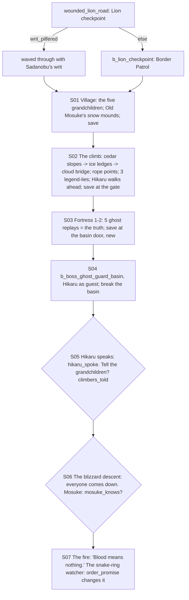

# STORYBOARD — Ronin Ch3 · "The Village of the Wounded Lion"
Production: `production/ronin-ch3.md` · Lv 30–35 · Region: **the northern Lion hills below the Dragon mountains**
(Map A: the foothills between Dragonfly Palace and the Swift Sword Castle; Map B: the northern edge of the yellow
Lion border).
Overworld: `wounded_lion_road` (with a Lion checkpoint) → **WL** Village of the Wounded Lion → the climb (3 stages)
→ the Castle of the White Snow → the basin. Bestiary F: *Mountain of the White Snow* (28–35).

## Flow


## Maps

### R `wounded_lion_road` — to the village (field route, new) · Danger 28–35
```
 @Lion north road ≈≈ [LION CHECKPOINT]!(F-1) ≈≈ c ≈≈ [frozen shrine +] ≈≈ c*(Hunting 5: snow-bear den → Snow Hide) ≈≈ > WL
```
- **Checkpoint (F-1, the payoff for `writ_pilfered` from Ronin Ch2):** a Lion sergeant: "Papers. Wave-folk go round."
  [IF writ_pilfered] SAYO (holding up Sadanobu's own writ): "Lord Ikoma Sadanobu's business." SERGEANT: (paling)
  "…Pass." [ELSE] `b_lion_checkpoint` (Border Patrol ×3; they can be bribed: Barter Coin).

### T `wounded_lion_village` — the Village of the Wounded Lion
```
 ^^^^^^^^^^ Mountain of the White Snow ^^^^^^^^^^
 [village gate: the snow mounds]!Mosuke   [mountain inn I] (the climbers lodge here)   [outfitter W/A/S: Lion T3, climbing gear]
 + [hero shrine] (the five champions' tablets)   1 innkeeper  2 Hida Ren  3 Doji Aoi  4 Bayushi Kei  5 Mirumoto Sen  6 village child   c   C
 > cedar_slopes (trailhead)
```
- NPC path actions:
  - Innkeeper: Eavesdrop → "The hermit buys nothing, eats nothing, and has never once come in out of the snow."
  - Hida Ren: Sumai → he respects Sayo (a later rope line changes).
  - Doji Aoi: Charm → "The Crane always said the champions *argued* on the mountain."
  - Bayushi Kei: Discern → "Ashamed of his ancestor's fame. Secretly."
  - Mirumoto Sen: Duel (Iaijutsu 5) → Glory +1.
  - Village child: Bless → follows ("Snow Charm": Frost resist, 1 battle).
  - Pilfer: the outfitter → Climbing Spikes (key: opens the `c*` ledges on the climb without Athletics).
  - Barter: Mosuke → Rice Cakes (a heal; also the offering).
- `c`: Ginseng Tonic ×2. `C` (shrine storeroom): the champions' old tablets (lore: the dates don't match the legend).

### D `cedar_slopes` → `ice_ledges` → `cloud_bridge` — the climb (dungeon, 3 stages) · Danger 30–35
```
 cedar_slopes                         ice_ledges                              cloud_bridge
 @trailhead  rope point*  ≈≈           >S1  rope point*  scorched gate (gunpowder)!  >S2  rope point*  Mirumoto armour facing DOWN!
  Crane grave + Lion arrow!            b_frost_spirits   c*(Athletics 6 / Spikes)    Hikaru (silent) at each stage end
  b_snow_beasts   c                    c (a frozen climber's pack: Frost Shard ×2)    c   § save (the castle gate)
```
- Encounters: Snow Bear, Winter Wolf, Frost Spirit; uncommon Ghost-Guard; rare Wolf-Spirit.
- **Rope points:** Sayo's knots hold; the samurai's slip (the comic lines in production).

### D `white_snow_fortress_1–2` → `basin_hall` · Danger 32–35
```
 fortress_1                           fortress_2                                  basin_hall
 @gate  ghost-guard replays ≈≈        >F1  replay 3 (the gate fuse)*  replay 4*    the bloodstone basin (glowing red)  B
  replay 1 (kidnapping)*  replay 2*   c (the prince's nursery: a Silver Rattle,    ghost-guards draw swords · Hikaru steps in
  c (guardroom: Ginseng Tonic ×2)       lore)   replay 5 (the basin hall door)*      (after: the child's bed of stone)
                                      § save at the basin door (new, F-3)
```
- **The replays** are open to every party (Discern-*style* prompts; no path action needed). Each one corrects a legend
  line from the climb.
- Encounters: Ghost-Guard (it rises again near the basin), Frost Spirit.

## Simulated playthrough
1. Lv 30. The road: the checkpoint is a fight, or `writ_pilfered` turns it into a joke. The village: the
   grandchildren, Mosuke. Shop T3; the Climbing Spikes Pilfer helps non-Natsuko parties.
2. The climb (about 6 encounters + 2 fixed battles, 3 lies seen) → save → the fortress (5 replays, about 4
   encounters) → **save** → the basin boss (Hikaru's Endless Strike; break the basin).
3. Hikaru speaks → tell the climbers? → the blizzard descent (a cutscene walk, no encounters) → Mosuke → the fire.
   **`order_promise` (F-2)**: [IF kept] the snake-ring watcher bows toward Sayo before slipping away. [ELSE] the
   watcher writes something on a slip of paper. This sets up the Order's pressure in Ch4 ("they want your secret").
   Total ≈ 95 minutes.

## Findings → fixes
| # | Finding | Fix |
|---|---|---|
| F-1 | `writ_pilfered` (Ronin Ch2) had no payoff; the village had no approach road | `wounded_lion_road` with a Lion checkpoint: the writ passes it; otherwise `b_lion_checkpoint` (bosses.md) |
| F-2 | `order_promise` was read but unused | The watcher's behaviour at the fire differs |
| F-3 | No save between the fortress and the basin boss | `§` at the basin door |
| F-4 | Village NPC coverage | Table above; Climbing Spikes as a non-Athletics key |
