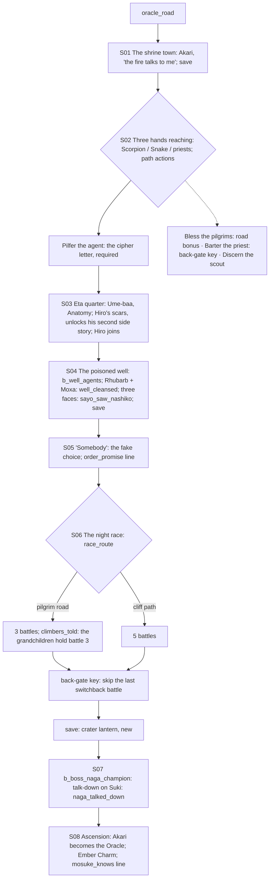

# STORYBOARD — Ronin Ch4 · "The Oracle's Choice"
Production: `production/ronin-ch4.md` · Lv 41–45 · Region: **the Oracle of Fire's volcano** (Map A: the Great Northern
Mountains between the Dragon and Phoenix lands; Map B: the green/orange border peaks).
Overworld: `oracle_road` → **OV** the shrine town (+ the eta quarter) → the rooftops → the switchback stair → the
crater shrine. Bestiary F: *Oracle's volcano town* (40–46).

## Flow


## Maps

### R `oracle_road` — the pilgrim road up the volcano (field route, new) · Danger 40–46
```
 @Phoenix / Dragon road ≈≈ pilgrims in their thousands ≈≈ prayer flags ≈≈ c ≈≈ [lava-field shortcut]* (heat tiles) ≈≈ > OV
                                         c*(Athletics 7: an old lava tube → Fire Elemental den, Ember Core ×3)
```
- Encounters: Fire Elemental, Kolat Agent; uncommon Shosuro Renegade.

### T `oracle_town` + `eta_quarter_oracle`
```
 [the shrine town: pilgrims, prayer flags, heat-shimmer]   Akari (hiding in a doorway)!S01
 [pilgrim inn I]  [temple outfitter W/A/S: T4 + Jade]  + [lower shrine]  [quiet teahouse]!S05 (the Snake elder)
 Scorpion agents (too well-shod)  ·  Snake scouts (rings)  ·  temple priests  ·  frightened pilgrims  ·  old priest   c   C
 > eta_quarter_oracle (the mud walls; samurai stop at the edge) > poisoned_well (inside the quarter) > oracle_rooftops (S06)
```
- Path actions (production table): Pilfer the agent (**required**: the cipher → S04; Sayo is always present),
  Eavesdrop the agent, Discern the scout, Bless the pilgrims, Barter the old priest.
- **The back-gate key (F-3)** (Barter, Tamotsu) had no use. Now it opens the crater shrine's back gate: **skip the
  last switchback battle** of the race.
- `c`: Ginseng Tonic ×3. `C` (the Scorpion agents' lodging): a Shosuro Renegade's kit: Shosuro Powder, Actor's Mask,
  Ninja-to Tanto (T4).
- Eta quarter: Ume-baa (Anatomy), Hiro at the gate. Samurai stop at the edge (Rensei's "Next time.").

### M `poisoned_well` (S04)
- A night battle (`b_well_agents`) → the story brew → the three faces of the blue-eyed woman → `[SAVE]`.

### D `oracle_rooftops` → `switchback_stair` → `crater_shrine` — the night race (set-piece)
```
 oracle_rooftops: tiles, lanterns · b_race_assassins_1 (roofs) · b_race_assassins_2 (the alley; Hiro stays behind)
 switchback_stair: [pilgrim road: switchback 1, battle 3] / [cliff path: battles 3, 4, 5]
                   [back gate]* (key: skip the last switchback battle)
                   [crater lantern] § save (new, F-2) — before the Naga champion  B
 crater_shrine (dawn): the old Oracle; the ascension
```
- **No full heal between race battles** (production). Saving at the crater lantern **before the boss** doesn't break
  the race pressure: the race itself has no save. The old text went race → boss → no save (F-2).
- **[IF climbers_told] (F-1):** on the pilgrim road, Matsu Hanae and the other grandchildren are among the pilgrims:
  "Ronin! *Sayo!* Go — we'll hold this switchback!" They replace battle 3 (a payoff for telling them the truth).

## Simulated playthrough
1. Lv 41. The road (heat tiles; about 4 encounters) → the town: Akari → the factions. The Pilfer is required, and
   Sayo is always present, so it's never blocked.
2. The eta quarter: Anatomy. **Hiro's scars (F-4):** the old text gated this beat on "Hiro's curse side-story
   active", but that side story (Hiro SS2) unlocks **after** Ronin Ch4, so the beat could never play. Now it always
   plays, and it **unlocks Hiro SS2**.
3. The well → save → the fake choice → the race: pilgrim road (3, or 2 with `climbers_told`) or cliff (5); the back
   gate skips one → **save** → the Naga champion (talk-down on Suki) → the ascension.
   **[IF mosuke_knows] (F-1):** SAYO (descending): "Old Mosuke's rice cakes. That's who I'm keeping it for." Total
   ≈ 95 minutes.

## Findings → fixes
| # | Finding | Fix |
|---|---|---|
| F-1 | `climbers_told` and `mosuke_knows` were read but unused | The grandchildren hold a switchback; a Mosuke line on the descent |
| F-2 | No save before the boss after the race | `§` at the crater lantern |
| F-3 | The back-gate key had no use | It skips the last switchback battle |
| F-4 | The Hiro scars beat was gated on a side story that unlocks only after this chapter | Always plays; it unlocks Hiro SS2 |
| F-5 | No approach road; town NPC coverage was only the faction table | `oracle_road`; the town map above |
