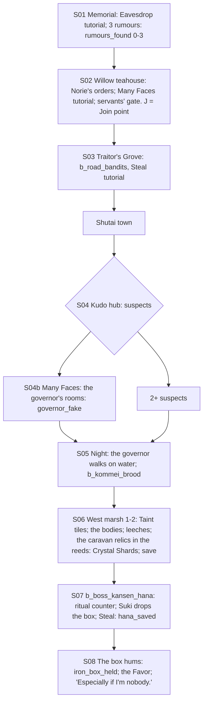

# STORYBOARD — Scorpion Ch1 · "Blood and Iron"
Production: `production/scorpion-ch1.md` · Lv 1–8 · Regions:
- **Kyuden Bayushi** (Map A: Silk and Shadow Palace, central Scorpion).
- The road south through Traitor's Grove.
- **Kudo** on the River of Gold (Map A: by the Castle of the Fox and the Castle of the Sparrow; Map B: the small
  Kitsune/Suzume pockets at the southern Scorpion border).

Overworld: **KB** → `traitors_grove` → **Shutai** (border town) → **KU** Kudo → `river_crossing` → `west_marsh_1–2` →
the clearing. Bestiary F: *Scorpion south & Kudo* (1–8), *River of Gold west bank (marsh)* (4–8).

## Flow


## Maps

### T `bayushi_gardens` / `willow_teahouse` + the **Kyuden Bayushi castle town** (screen added, F-3)
```
 screen A: castle town (south of the palace walls)                 screen B: palace gardens (S01, starter only)
 [Scorpion outfitter W/A: T1]  [apothecary S: poisons, antidotes]   koi pond: 2 courtiers*R1 · dinner pavilion: Mantis envoy*R2
 [inn I]  t [teahouse district]  + [shrine to the Fortune of Secrets]  pale courtier*R3 · Norie · incense timer
 [servants' gate]!J (Mitsue walks out as a teahouse servant)        [willow teahouse] (pond peninsula)!S02
 1 mask-maker  2 street actor  3 Bayushi guard  4 beggar (a Scorpion informant)   c   C   $ (black market: Underworld 3)
 @road north   > traitors_grove (south road)
```
- Shops: **Scorpion T1:** Kozuka, Travelling Clothes, Antidote ×, Smoke Pellet (one). `$` black market from Underworld
  3 (later).
- NPC path actions:
  - Mask-maker: Barter → Actor's Mask (sell; Mitsue flavour).
  - Street actor: Charm → follows ("Stage Fright": Confuse 1 enemy).
  - Bayushi guard: Duel (Iaijutsu 2) → Glory +1.
  - Beggar: Discern → "He's a Scorpion informant. He knows Mitsue's real face." (a lovely chill)
  - Pilfer: the outfitter → Smoke Pellet. Sumai: a drunk porter → 50 zeni. Bless: a pilgrim at the shrine → follows
    ("Secret Prayer": Evasion up, 1 use).
- `c`: Rice Ball ×2. `C` (teahouse back room): 200 zeni + Antidote ×2.
- **The rumours (F-4):** `rumours_found` was tracked but **had no effect**. Now Norie rewards each one at the
  willow teahouse: 1 → Antidote ×2; 2 → + Smoke Pellet ×2; **3 → + Norie's Kozuka** (T1 Tanto, Pilfer +). Failures
  cost Honor (Low Skill tutorial).
- `J` **Join point** (non-starter): the servants' gate, after S02. "The teahouse servant" stops beside the party:
  "You're going south? So am I. I'd like to look like I'm with someone."

### R `traitors_grove` → T `shutai_town` (route + border town) · Danger 1–8
```
 traitors_grove: old posts, rusting chains (19 of them; Mitsue counts) · b_road_bandits · c (a chained traitor's purse: 80 zeni)
 shutai_town: [inn I] innkeeper (Eavesdrop) · ronin drifter (Pilfer: Kudo Pass) · priest · [general store S] · + shrine
```
- **Kudo Pass (F-5):** before, it had no use. Now it opens the Suzume hall in Kudo without Many Faces, an alternative
  route to the steward's Eavesdrop for non-Mitsue players.

### T `kudo_town` — Kudo (investigation hub)
```
 [Fox street: lanterns]  ~~~ [the bridge nobody likes] ~~~  [Sparrow street: ribbons]
 [governor's house]!S04b (Many Faces)   [Mantis magistrate's office] (sick clerk)   [Suzume hall] (steward; Kudo Pass or Many Faces)
 [river docks] dock-hand · Tortoise envoy   [inn I]   [fishmonger S]  + [Inari shrine]   old woman (east)   c   C
 > river_crossing (west)
```
| Target | Path action | Result |
|---|---|---|
| Kitsune governor | Eavesdrop (night) | raw fish, whispering (production) |
| Suzume steward | Eavesdrop | "There was no assassin." |
| Kitsune Hana | Discern | "Frightened; hiding the governor's change." · **Charm** *(added)*: she shows the Fox charm-box (a hint) |
| Tortoise envoy | Eavesdrop | smuggling, a red herring · **Barter** *(added)*: Mantis-isles goods (Sea Salt, Eel) |
| Dock-hand | talk | "Everything got dumped in the reeds — except a little iron box." **This now points to the relics in the marsh (F-1).** |
| Old woman | **Bless** *(added)* | Follows ("Neighbour's Charm": heal, 1 use); her empty street shows the bloodless pattern |
| Sparrow ronin | **Duel** *(added)* / **Sumai** *(added)* | Duel: Glory +1, Oak Bo. Sumai: "The Fox governor bought every jar of river salt in town." |
| Fishmonger | **Pilfer** *(added)* | Salt Herring ×3 |
- `S05` gate: `governor_fake` + 2 suspects (production).
- `c` (docks): Eye Drops ×2. `C` (magistrate's office): the magistrate's case notes (lore) + 150 zeni.

### D `west_marsh_1–2` → `heart_clearing` · Danger 4–8
```
 west_marsh_1                                     west_marsh_2                          heart_clearing
 @river crossing  reeds ≈≈ Taint tiles ≈≈ c        >M1  bleeding trees ≈≈ b_marsh_leeches   breathing ground
  [drifting barge]! (the magistrate + the real       [reeds: the Miya caravan's dumped     blood pit  Hana!  B
   governor, bloodless)                               relics]* → **Crystal Shard ×4** (F-1)
  c*(Athletics 2: a dead tree → Spirit Flame ×2)     c (dead end: fleeing animals' burrow → Herbal Salve ×2)
                                                     § emergency shrine (production [SAVE])
```
- **Crystal (F-1):** the boss is weak only to Air, Water and **Crystal**, with physical damage halved. A starter
  Mitsue at Lv 8 has none of those, so she could not reliably Suki the boss and stop the ritual counter. The relic
  pile in the reeds (which the dock-hand mentions) now holds **Crystal Shard ×4**, plus a hint: MITSUE: "Miya relics.
  Crystal. Somebody was carrying these to bind something."
- Encounters: **Blood Leech** (new bestiary entry, F-6), Goblin I; uncommon Mamushi Viper.

### Boss rule check (F-2)
- Ritual counter: the production defines 5, 7 and "at 10 the Oracle begins to rise", but not what happens at 10.
  **Now:** at 10 the Oracle of Blood rises fully: *Blood Tide* (heavy party damage every turn) until Hana is broken.
  The fight is still winnable, just much harder. Not an instant fail.

## Simulated playthrough
1. **Starter:** the memorial (Lv 1; rumours; Honor risk) → the teahouse rewards → the gate (Many Faces) → the grove
   (Steal tutorial) → Shutai → Kudo (about 20 minutes of investigation) → night → the mid-boss → the marsh (Taint
   tutorial if this is its first appearance; the crystal relics) → save → the boss (Crystal Shards break her; Steal
   the box) → dawn. Total ≈ 85 minutes, Lv 8.
2. **Recruit:** the party in the Kyuden Bayushi castle town meets "the servant" at the gate → Memory (S01–S02: the
   memorial, three faces, Norie's orders) → the grove.

## Findings → fixes
| # | Finding | Fix |
|---|---|---|
| F-1 | The boss's only weaknesses (Air, Water, Crystal) weren't available to a starter Mitsue | The caravan relics in the marsh: Crystal Shard ×4 |
| F-2 | The ritual counter's end (10) had no defined outcome | The Oracle rises: *Blood Tide*; still winnable |
| F-3 | Kyuden Bayushi had no town for shops, an inn or recruiting | A castle-town screen (Scorpion T1, black market later) |
| F-4 | `rumours_found` had no effect | Norie's tiered reward |
| F-5 | The Kudo Pass (Pilfer in Shutai) had no use | It opens the Suzume hall without Many Faces |
| F-6 | `blood-leech` was in the tables but had no bestiary entry | Added (bestiary B5) |
| F-7 | Non-starter version | Join point (the servants' gate) + Memory |
