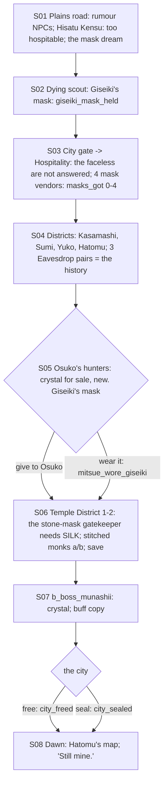

# STORYBOARD — Scorpion Ch2 · "City of Masks"
Production: `production/scorpion-ch2.md` · Lv 20–25 · Region: **the plains north of Shiro no Soshi**, a day from
Seikitsu Pass (Map A: Scorpion's north-west edge, toward the Spine and the Unicorn road; Map B: the plain between
the Soshi lands and the Unicorn border).
Overworld: **SS** → `plains_road` → **Hisatu Kensu** (Unicorn hot-spring village) → **CM** the City of Masks (exists
only during this chapter). Bestiary F: *Plains north of Shiro no Soshi* (18–25).

## Flow


## The mask puzzle, made concrete (finding F-2)
The production gave the material cycle and "dialogue gates on 4 key NPCs", but named neither the NPCs nor which mask
each one needs. From the production's own example (the sake-seller wears **wood** and welcomes **iron**; wood fears
metal), the rule is: **a masked citizen welcomes the mask their own material fears**. Wearing the material *they*
overcome makes them flee in contempt.
| Key NPC | Their mask | Welcomes | Flees from | What they give |
|---|---|---|---|---|
| Masked sake-seller (Hospitality) | wood | **Iron** (metal) | earth | the "three hundred years" line; points to the Merchant District |
| Kakita Yuko (Merchant, puppets) | fire-lacquer | **Ink** (water) | metal | the party's puppet faces; info on Munashii's fear |
| Miya Hatomu (Merchant) | clay (earth) | **Cedar** (wood) | water | **Hatomu's Map** (world-map reveal) |
| Temple District gatekeeper | stone | **Silk** | porcelain | **opens the Temple District** (a hard gate) |
- So all four vendors matter. `masks_got` (0–4) gates the content: silk is required, the rest are optional rewards.
- The **SP drain** (5% per district entry while masked) and the **shrine "Remove masks?"** at each district gate are
  as in production.

## Maps

### R `plains_road` + T `hisatu_kensu` · Danger 18–25
```
 @SS north road ≈≈ rumour NPCs (farmer, pilgrim, ronin, merchant, Lion scout) ≈≈ [Hisatu Kensu]
 hisatu_kensu: [hot-spring inn I] (free baths, fixed smiles) · [Unicorn trader S/W: T2, Yumi, Riding Armour] · + spring shrine
               innkeeper (Discern: "Terrified. The city 'took' her husband.") · bath attendant (Eavesdrop: "the masks talk at night")
 (morning) ≈≈ the dying scout!S02 ≈≈ > city_gate
```
- Encounters: Shadow-in-Black, Paddy Python, Giant Hornet; uncommon Glory-Hungry Bushi; rare Yurei.
- More NPC path actions at Hisatu Kensu: Charm the innkeeper's daughter → follows ("Hot Towel": cures 1 status). Duel a
  Unicorn rider (Iaijutsu 3) → Glory +1. Sumai a bath brawler → Herbal Salve ×3. Bless an old widow → Rejuvenating
  Tea. Barter the trader → Gaijin Spyglass (expensive). Pilfer → Smoke Pellet.

### T `city_gate` → `hospitality_district` · `merchant_district` (the city: town districts, no encounters)
```
 [city gate] (open; masked guards ignore the faceless)
 Hospitality: [Sweet Cup sake house] (back room: Osuko's hunters, S05; **crystal shop**, new) · sake-seller (wood) · [district shrine: "Remove masks?" §]
 Merchant: Kaiu Naname's forge (iron) · Ichiro Itami (cedar) · the tattooist (ink) · the silk seller (silk) · Kasamashi (jade) · Kakita Yuko · Miya Hatomu
 Temple gate: the stone-mask gatekeeper → (silk) → temple_district_1
```
- **Crystal shop (F-1):** the production's boss note says "crystal shard from the hunters, if bought", but no scene
  sold any. Osuko's back room now sells **Crystal Shard** (400 each) and one **Crystal Rosary** (equipment: reveals
  invisible foes; crystal damage on Bo/Tanto hits).
- Kasamashi: **Barter** → a real Jade Mask (accessory: Taint resist +; "That's why I still remember my name"). Togashi
  Sumi: the riddle (talk).

### D `temple_district_1–2` → `monastery_silent_self` · Danger 22–25
```
 temple_1                                   temple_2                                   monastery_silent_self
 @gate (silk)  stitched-face monks ≈≈        >T1  ≈≈ shrine of sewn faces ≈≈ c          the vast mask-shadow  Munashii  B
  b_stitched_monks_a   c   c*(Tremor: a      b_stitched_monks_b   c (dead end: an
  cracked wall → a hidden reliquary:          abandoned scriptorium → Old Paper,
  Rejuvenating Tea ×3, Purity Charm)          Scroll: Summon Fog duplicate)        § save (monastery steps)
```
- Encounters (new bestiary row): **Stitched-face Monk** (F-3), Kansen Wisp (II palette), Paper-spirit.
- Breaking a stitched monk frees its soul (production note): Honor +1 each, to a maximum of +3.

## Simulated playthrough
1. Lv 20. The road (about 4 encounters) → the hot springs (rest) → the dream → the dying scout (mask).
2. The city: snubbed until masked. The four vendors (about 10 minutes), then the four key NPCs (about 10 minutes).
   **Silk is required** for the Temple District: the silk seller is in the Merchant District next to the others, so
   it's hard to miss. The Eavesdrop pairs give the history.
3. S05: Osuko's choice. Crystal can now be bought. Wearing Giseiki gives a stronger ritual but Void −1.
4. Temple District (about 5 encounters + 2 fixed battles, freeing souls) → save → Munashii (crystal does full
   damage; phase 2 copies buffs, so don't over-buff) → the city choice → dawn. Total ≈ 95 minutes.

## Findings → fixes
| # | Finding | Fix |
|---|---|---|
| F-1 | "Crystal shard from the hunters, if bought" — but no shop | Osuko's back room sells Crystal Shards and one Crystal Rosary |
| F-2 | The mask-material gates named neither the 4 NPCs nor the masks they need | Table above (the "welcomes what their material fears" rule); silk opens the Temple District |
| F-3 | Stitched-face Monk wasn't in the bestiary | Added (A6 Cultists, II) |
| F-4 | The Hisatu Kensu inn had no other NPCs or path actions | NPC rows added |
