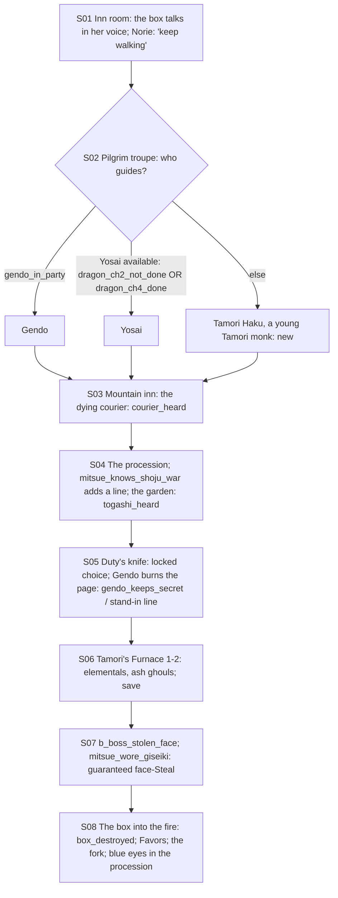

# STORYBOARD — Scorpion Ch4 · "The Eve" (Crossroads: Tamori's Furnace)
Production: `production/scorpion-ch4.md` · Lv 41–45 · Owner: Mitsue · Partner: Gendo (stand-in: Togashi Yosai, **or
Tamori Haku when Yosai is lost in the ink**, F-1)
Region: **the Dragon mountains** (Map A: the Great Northern Mountains around the High House of Light and the volcano
near Fire Tooth Castle; Map B: the green Togashi and Mirumoto/Tamori lands).
Overworld: **DM** Dragon mountain town → `mountain_inn` (on the road) → `togashi_road` → **KT** Kyuden Togashi garden
(cutscene) → **TF** Tamori's Furnace → the crater. Bestiary F: *Dragon mountains* (40–48), *Tamori's Furnace* (42–46).

## Flow


## Maps

### T `dragon_mountain_town` — the Dragon mountain town (hub)
```
 ^^^^^^^^^^^^^^^^^ peaks ^^^^^^^^^^^^^^^^^^^^^^^^^^^^^^^^^^^^^^^^^^^^^^^^^^^^^^^^^^^^^^^^^
 [pilgrims' inn I]!S01   [Togashi outfitter W/A: T4 Bo, Robes]   [incense-seller S]   + [mountain shrine]
 1 Mirumoto sentry  2 tattooed beggar  3 Tamori apprentice  4 a Kitsuki clerk  5 a mule-driver   c   C
 @lowland road (from SK / the Lion north)                 > togashi_road (up) · > mountain_inn (on the road)
```
- Shops: **Dragon T4:** Togashi Bo, Elemental Master's Mantle, Incense, Rejuvenating Tea, Calming Tea.
- NPC path actions:
  - Mirumoto sentry: Duel (Iaijutsu 7) → Glory +1 · Fine Katana Fragment.
  - Tattooed beggar: Discern → "His tattoo is a real one. He was a monk once. Kokujin's?" (Kokujin colour).
  - Tamori apprentice: Barter → Ember Core ×2 (Fire items).
  - Kitsuki clerk: Eavesdrop → "The Scorpion Champion's procession passes the Togashi road tomorrow".
  - Mule-driver: Sumai → a shortcut ledge on `togashi_road`.
  - Bless an old pilgrim → follows ("Mountain Prayer": party Def up, 1 use). Charm a pilgrim girl → Calming Tea.
    Pilfer the incense-seller → Incense ×3.
- `c`: 3,000 zeni. `C`: a Tamori heat-ward (accessory: Fire resist +; very useful for the Furnace).

### M `mountain_inn` (S03) and R `togashi_road` → `kyuden_togashi_garden` (S04)
```
 mountain_inn: [common room] dying courier (corner)!S03 · [beds = I] · c (courier's pack: Bayushi orders — sealed; taking it is NOT allowed: "No. He believed he delivered it.")
 togashi_road: @town == switchbacks ≈≈ c ≈≈ [the procession]!S04 (Many Faces: join the servants) ≈≈ > KT garden (cutscene) → back on the road (night, S05)
               c*(Sumai shortcut) → a cliff shrine: Incense ×5 + Snow-lotus (Remedy)
```
- Encounters on the road: Winter Wolf, Snow Bear, Mountain Bandit (IV); uncommon Tengu Crow-Warrior; rare
  Wolf-Spirit.

### D `tamori_furnace_1–2` → `crater_mouth` · Danger 42–46
```
 furnace_1 (lava tubes)                         furnace_2 (ash-shrines)                    crater_mouth
 @road  heat tiles (Fire dmg unless warded)      >F1  ash ghouls ≈≈ b_ash_ghouls           the lip; the Bloodspeaker in Mitsue's face  B
  Tamori monks bow; b_furnace_elementals          c (a Tamori offering: Ember Core ×3)       (after: the box falls; the fork road)
  c   c*(Athletics 7: a lava-step jump → Tamori Ward-Robe)   § the last shrine (production [SAVE])
```
- **Heat tiles:** Fire damage per step unless the Tamori heat-ward (town `C`) is equipped. It's a status-tile mechanic
  like Taint, not the chapter gimmick (the gimmick is the boss's Stolen Face).
- Encounters: Fire Elemental, ash-ghoul.

## Simulated playthrough
1. Lv 41. The inn → the guide choice. **Y-1:** if Dragon Ch2 is done and Dragon Ch4 isn't, Yosai is lost in the
   ink, so the old ELSE branch would show him impossibly here. Now **Tamori Haku** (a young Tamori monk sent down to
   escort "pilgrims") stands in, with his own 3 lines (F-1).
2. Courier (Eavesdrop; Mitsue is always present) → the procession → the garden (fated) → the locked choice → the
   Furnace (about 6 encounters + 2 fixed battles; the heat tiles make the town's heat-ward valuable) → save → the boss.
3. **Unused flags (F-2):** `mitsue_knows_shoju_war` (from the shared Unicorn/Scorpion chapter) and
   `mitsue_wore_giseiki` (Ch2) were read in the header but nowhere in the text. Now:
   - S04: [IF mitsue_knows_shoju_war] MITSUE (internal): "The Ojatara war was his distraction. Every court looking
     west. Now I know what he was distracting them *from*."
   - Boss: [IF mitsue_wore_giseiki] GISEIKI's echo: "A borrowed face, Shosuro. You know how to take it back." →
     Mitsue's **Steal on the stolen face can't fail** (it ends the face-copy immediately).
4. The ending: the box, the Favors, the fork, the blue eyes. Total ≈ 90 minutes.

## Findings → fixes
| # | Finding | Fix |
|---|---|---|
| F-1 (Y-1) | The Yosai stand-in appeared even while Yosai was lost in the ink (Dragon Ch2 done, Ch4 not) | Gate it: `[IF dragon_ch2_not_done OR dragon_ch4_done]` Yosai, `[ELSE]` **Tamori Haku** with his own lines |
| F-2 | `mitsue_knows_shoju_war` and `mitsue_wore_giseiki` were read but unused | An S04 line; a boss bonus |
| F-3 | The town had no NPC coverage, and the Furnace no environmental rule | NPC table; heat tiles plus the heat-ward |
