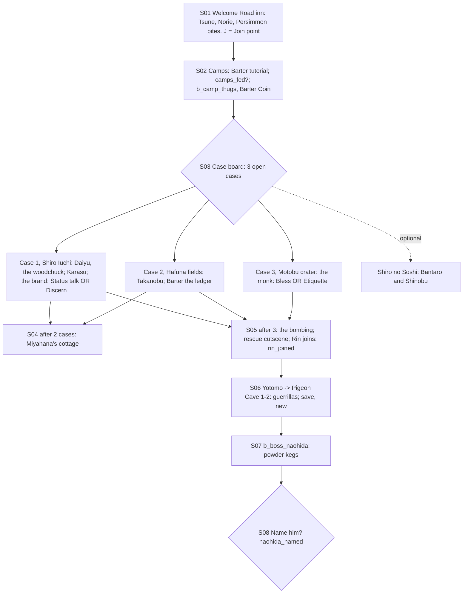

# STORYBOARD — Unicorn Ch1 · "Fault Lines"
Production: `production/unicorn-ch1.md` · Lv 1–8 · Region: **the Ojatara Valleys** (the Fortune's Lost area map;
Map A: the Spine of the World south of Gatherer of Winds Castle, west of the Castle of Organization; Map B: the
purple Iuchi pocket against the brown Soshi lands).
Overworld: the valley is a **mini-region** of 7 nodes joined by `ojatara_road`. Bestiary F: *Ojatara Valleys*
(1–8 band for Ch1).

## The valley (from the Fortune's Lost area map)
```
                  [Yotomo] (pigeon cliffs)              [jade mines] ⛏ ⛏          ==== Merchant Road (NE)
   [Perfume Petal Blossom]          \                 /                                  
 [SHIRO IUCHI] =(wind tunnel)== ojatara_road ===== [battlefield] ===== [Motobu crater: Temple of Jizo]
                         \            |                 
                          [TOWN OF BURIED LEAVES] ===== [Hafuna fields (salted)]
                          [refugee camps] (around the town)        \
                         [Miyahana's cottage] (hills, S)        [SHIRO NO SOSHI] == Imperial Road (SE)
```
- `ojatara_road` is one field route with branches (**Danger 1–8** in Ch1, scaling per chapter: the bestiary row
  says "by chapter").
- Encounters (Ch1): Road Bandit, Grey Wolf, Border Patrol (Iuchi and Soshi palettes); uncommon Hungry Ronin.

## Flow


## Maps

### T `buried_leaves_inn` — the Town of Buried Leaves (town; the Welcome Road inn) + `refugee_camps`
```
 [Welcome Road inn I]!S01/S05/S08 (case board!)   [stable: Persimmon]   [Unicorn trader W/A: T1, Yumi]   [rice merchant S]
 = river road ======================================================================== > ojatara_road
 [tribunal room] (after S05: the one standing room)   + [roadside Jizo]   1 Crane clerk  2 Scorpion yojimbo  3 Iuchi farmer
 refugee_camps (around the town): grandmother!  rice merchant (Barter)  thugs (b_camp_thugs)  4 orphan  5 ronin cook   c   C
```
| # | NPC | Path action | Result |
|---|---|---|---|
| 1 | Crane clerk | **Charm** | Follows ("Ledger Clerk": reveals enemy HP numbers for 1 battle) |
| 2 | Scorpion yojimbo (bitten) | **Discern** / **Eavesdrop** | "Norie sent him to watch Tamotsu, not guard her." |
| 3 | Iuchi farmer | **Sumai** | A Jade Dust and a lead to Case 2 |
| 4 | Orphan (camps) | **Bless** | Follows ("Small Hands": item-steal chance +, 1 battle) |
| 5 | Ronin cook (camps) | **Duel** / **Pilfer** | Duel: Glory +1 · Ronin's Katana. Pilfer: Rice Ball ×5 (Honor −: it's camp food) |
- Shops: **Unicorn T1:** Bamboo Yumi, Ashigaru Yari, Travelling Clothes, Riding Armour (T1 version), Rice Ball,
  Antidote.
- `c` (stable loft): 100 zeni. `C` (the tribunal strongbox): case notes (lore) + Herbal Salve.
- `J` **Join point** (non-starter): the inn common room. Tamotsu hands the party rice cakes before they've said a word.

### Case locations
| Case | Map | Gate (fixed, F-1) |
|---|---|---|
| 1 Assassins | `shiro_iuchi_court` (garden + woodchuck) | The old text required **Discern on Karasu**, so a solo Tamotsu couldn't solve it. Now Tamotsu's **Status** opens the audience: "Emissary — ask me properly." Karasu shows the Soshi shadow-brand himself. Discern (Gendo) adds the doubt line ("he doubts the Soshi sent them"), which is optional |
| 2 Salted fields | `hafuna_fields` | **Barter** the supply ledger (Tamotsu) |
| 3 Temple of Jizo | `motobu_crater` | **Bless** the monk (Haruki) **or** Etiquette (Tamotsu): unchanged |
- Shiro Iuchi court: Iuchi Hiroichi has a gaijin telescope. **Barter** → Gaijin Spyglass (expensive), per
  `equipment.md`.

### D `yotomo_village` → `pigeon_cave_1–2` — the Pigeon Cave (dungeon; layout from the Fortune's Lost cave map)
```
 yotomo_village: dovecotes · village boy (rice cake → "Twenty. And the angry one.") · c (pigeon loft: Crow Feather ×3)
 pigeon_cave_1                                              pigeon_cave_2 (the vat chamber / overhang)
 [disguised entrance]* (Discern or the boy's hint)          [overhang: powder kegs]  N = Naohida  B
  ladder ":"  guards ×3 → b_cave_guerrillas                  [food store] c (Rice Ball ×4, Saltpeter: sell)
  [dead-end tunnel] c (a guerrilla's stash: Powder Bomb ×1 — Honor − to carry in towns)   [spare weapons] c (Ashigaru Yari, Bamboo Yumi)
  § save (new, F-2) → the overhang passage
```
- Encounters: Cave Beetle, a pigeon swarm (Carrion Crow palette); uncommon guerrillas (they surrender).
- **Powder kegs** are the chapter's one gimmick (the boss arena). Fire sets them off.

## Simulated playthrough
1. **Starter Tamotsu (Lv 1):** the inn → camps (rice choice → thugs: the Barter Coin tutorial).
2. Cases: Hafuna (Barter) and Motobu (Etiquette) are solo-friendly. **Case 1 was blocked** for a solo Tamotsu
   (F-1); his Status now opens it.
3. 2 cases → Miyahana; 3 cases → the bombing. The rescue cutscene is great Octopath material. Rin joins.
4. Yotomo → the cave (about 6 encounters + the guerrillas, who surrender). **New save** before the overhang (F-2).
   The boss fight is all about the kegs. Naohida escapes.
5. The name choice. Total ≈ 80 minutes.
6. **Recruit:** the party at the inn, given rice cakes → Memory (S01) → resume at S02.

## Findings → fixes
| # | Finding | Fix |
|---|---|---|
| F-1 | Case 1 needed Gendo's Discern; a solo Tamotsu was stuck | Status opens the audience; Discern adds a line |
| F-2 | No save in the pigeon cave before the boss | `§` before the overhang |
| F-3 | Town NPC coverage (Charm, Bless, Sumai, Duel, Pilfer) | NPC table |
| F-4 | The valley had no node layout | The mini-region map (from the Fortune's Lost area map) |
| F-5 | Non-starter version | Join point (the inn) + Memory |
