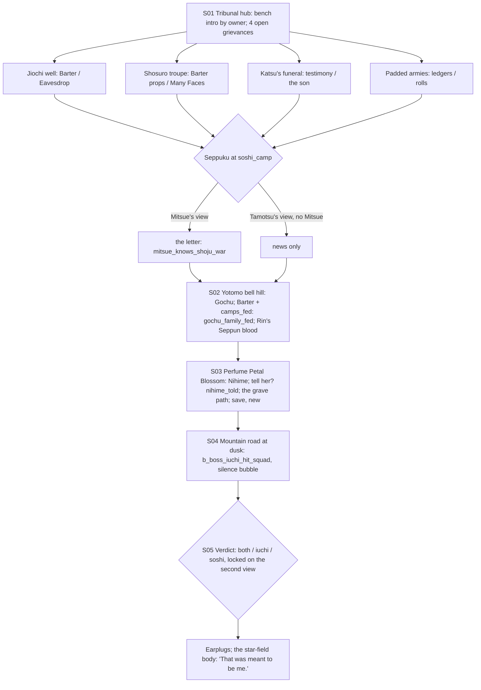

# STORYBOARD — Unicorn Ch2 "The Bell Without a Clapper" = Scorpion Ch3 "Fortunes Lost" (co-owned)
Production: `production/unicorn-ch2-scorpion-ch3.md` · Lv 22–30 (Mitsue's view scales to 30–35, F-2) · Region: **the
Ojatara Valleys** (see `storyboards/unicorn-ch1.md` for the valley mini-region).
Nodes used: Buried Leaves (`tribunal_hall`, rebuilt), `soshi_camp` (near Shiro no Soshi), Yotomo (`yotomo_bell_hill`),
Perfume Petal Blossom (+ the grave path toward the jade mines), `mountain_road_dusk`.
Bestiary F: *Ojatara Valleys* (Ch2 band: Mountain Bandit, Border Patrol, Mountain Wolf).

## The co-owned rule (finding C-1, same family as P-1)
- **Both owners in the active party:** it plays once, with merged lines, and **counts as Unicorn Ch2 and Scorpion Ch3**.
- **One owner only:** it plays from that owner's view. The absent owner's bench is voiced by **Tsune** (for Tamotsu)
  or **Norie** (for Mitsue), as in production. The other owner's chapter then becomes a **flashback** ("That season at
  the tribunal"), playable later from their view. `verdict` is **locked** to the first playthrough's choice.
- **Mitsue-only scenes:** the seppuku letter and `mitsue_knows_shoju_war` play only in Mitsue's view. In Tamotsu's
  view without Mitsue, the general's death arrives as news ("He opened his belly before he could testify"), and the
  flag isn't set. Before this pass the scene had Mitsue slipping into the tent even when she wasn't in the party.

## Flow


## Maps

### T `tribunal_hall` (Buried Leaves, rebuilt) + `soshi_camp`
```
 tribunal_hall: [three benches: Unicorn · Scorpion · swing judge]  case board!  [rebuilt inn I]  [shops: Unicorn T2 + Scorpion T2 traders]
 soshi_camp (east, toward Shiro no Soshi): [general's tent]!seppuku  [Soshi officers' fire]* (Eavesdrop)  [quartermaster] (rolls)  c  C
```
- **Grievance gates:** each grievance has a Tamotsu path and a Mitsue path (production). With only one owner, that
  owner's column is the path, and the other column is optional flavour if that traveler happens to be present.
- **Swing judge** (likes horses, poetry, scandal): Charm (Rensei) → +1 "favour" on the verdict screen (flavour);
  Barter Persimmon's company (Tamotsu) → the judge's warmth line.
- Shops: **Unicorn T2** (Rattan Yumi, Riding Armour T2) + **Scorpion T2** (Aiguchi, Lacquered Do-maru, Smoke Pellets).

### M `yotomo_bell_hill` (S02)
```
 [bell frame, no clapper] Gochu (starving)!  ·  ridge above: watchers (Discern: a meishodo glint)  ·  c (a miner's lunch tin: Rice Ball ×2, Raw Jade ×1)
```

### D `perfume_petal_blossom` + the grave path (a dungeon-village) · Danger 22–28
```
 [swept streets, blossom]  [the most beautiful house]!Nihime   + [village shrine] § save (new, F-3)
 (behind the houses) the grave path ≈≈ unclaimed mounds, prayer strips ≈≈ c ≈≈ [jade-mine gate: sealed, "until Ch3"]
  ≈ encounters on the path: Gaki (the unburied), Mountain Wolf; uncommon Blood-Hungry Acolyte (the Iuchi master's agents)
  c (dead end: a child's grave with a toy horse → Bless (Haruki): Honor +1, "Small Horse" sell item)
```
- `§` at the village shrine **before** leaving for the mountain road (F-3). The production had no save between the
  village and the dusk boss.

### S `mountain_road_dusk` (boss)
- `b_boss_iuchi_hit_squad` (the silence bubble; break the amulet-bearer).

## Simulated playthrough
1. **Tamotsu view, without Mitsue (Lv 22):** Tsune's bench lines → 4 grievances by Barter (all solvable solo) → the
   seppuku arrives as news (C-1) → the bell hill (with `camps_fed`, Gochu tells everything) → Nihime → the grave path
   (about 4 encounters) → save → the boss → the verdict → the star-field hook. ≈ 85 minutes.
2. **Later, Mitsue's flashback:** recruited Mitsue → "That season at the tribunal". Her view: Eavesdrop / Many Faces
   on the grievances; **the seppuku letter** (`mitsue_knows_shoju_war`); the verdict **locked** (as chosen in
   Tamotsu's view). Enemies use the 30–35 band, so it works as her Ch3 (F-2).
3. **Both present:** one playthrough, merged lines (the "swallowed a stone" banter), and both chapters done.

## Findings → fixes
| # | Finding | Fix |
|---|---|---|
| F-1 (C-1) | No rule for which owner's chapter completes, or how the second view plays; the seppuku scene used Mitsue even when she wasn't present | The co-owned rule: both present → counts for both; else a second-view flashback with a locked verdict; Mitsue-only scenes are gated |
| F-2 | A Lv 22–30 band is low for Scorpion Ch3 (normally 30–35) | Mitsue's view scales enemies to 30–35 |
| F-3 | No save between Perfume Petal Blossom and the dusk boss | `§` at the village shrine |
| F-4 | The "dungeon-village" had no dungeon part | The grave path (encounters, chests) toward the sealed mine gate |
