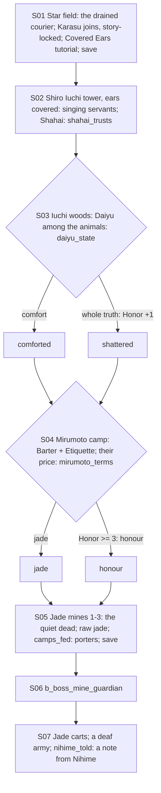

# STORYBOARD — Unicorn Ch3 · "The Noblest Blood"
Production: `production/unicorn-ch3.md` · Lv 30–35 · Region: **the Ojatara Valleys, west end** (Shiro Iuchi, the Iuchi
woods, the jade mines; the Fortune's Lost area map), plus the **Mirumoto camp** at the valley mouth (a Dragon army
in the Spine).
Bestiary F: *Ojatara Valleys* (Ch3 band), *the jade mines* (Gaki rare), and a new *Shiro Iuchi tower* row.

## Flow


## Maps

### S `star_field` (S01) — a field outside Shiro Iuchi
- The burned star; the courier; Karasu. **Guests (G-1):** Karasu is **story-locked** as the active guest for this
  chapter (his lines drive the mines), so Rin waits on the roster. Rin's scene lines still play: she's a story NPC
  at the start.
- `[SAVE]` (production).

### D `shiro_iuchi_tower` — the tower (silent dungeon, 3 floors) · Danger 30–35 · ears covered
```
 1F hall: humming servants sway ≈ (silent encounters: Singing Servant) ≈ c (a dropped tray: Herbal Salve ×3)
 2F stair: b_tower_servants (break them to wake them) · c*(Athletics 5: a wind-shaft ledge → Daikyu-pattern Yumi)
 3F: [barricaded door] — notes under the door → Shahai
```
- **Covered Ears:** path actions are disabled, and NPCs "talk" in NOTE lines. Random encounters are **silent**
  battles (no voice barks; spell names are shown as mimed icons).
- Encounters (new): **Singing Servant** (bestiary D, III): weak Water and Bo; breaking one **wakes** it (non-lethal;
  half exp; Honor +1 each, max +3).

### M `iuchi_woods` (S03) — ears uncovered
```
 sunlit clearing: Daiyu among woodchucks, a fox, sparrows · Shahai runs in [IF shahai_trusts]
 c (a woodchuck's hoard: a Carrot ×3 (heal; a joke callback to Ch1) + 800 zeni) · + forest shrine (save/cleanse)
```

### T `mirumoto_camp` — the Dragon war-camp (hub for Ch3 and the start of Ch4)
```
 [command tent] Tsukaru, Tabezu!S04   [quartermaster: Dragon T3: Temple Bo, Isawa-pattern robes, Jade T3]   [field kitchen = I]
 1 Mirumoto duellist  2 Kitsuki scout  3 Togashi monk  4 camp follower  5 drummer   c   C
 > jade_mines (valley path)   > (Ch4) siege_camp
```
- NPC path actions:
  - Mirumoto duellist: Duel (Iaijutsu 5) → Glory +1 · Fine Katana Fragment.
  - Kitsuki scout: Discern → "Kurosho has been seen at the tower window, every dusk". Eavesdrop → "the generals
    hate wax".
  - Togashi monk: Bless → follows ("Silent Mantra": Silence immune, 1 battle).
  - Camp follower: Charm → Calming Tea ×3.
  - Drummer: Sumai → the war-drum rhythm (lore; flavour for Ch4's charge).
  - Pilfer: the quartermaster → Raw Jade ×3.
- `c`: Ginseng Tonic ×3. `C`: a Mirumoto Daisho Box: Fine Katana (T3) + the wakizashi set.

### D `jade_mines_1–3` · Danger 32–35
```
 jade_mines_1 (entrance)                  jade_mines_2 (galleries)                     jade_mines_3 (deep gallery)
 @valley path  graves + flowers!(Karasu)   >M1  carts of glowing jade  b_mine_dead_b      cracked shrine; the guardian  B
  b_mine_dead_a  raw jade nodes*(free items)   miners' tools in rows (Bless: Honor +1)       (after: motes of light up the shaft)
  c  c*(Tremor: a collapsed side-gallery →   c (dead end: the foreman's office →
   Raw Jade ×5, Jade Dust ×3)                  ledger, lore: the order came from Kurosho)  § save (production, end of S05)
```
- Encounters: Zombie, Gaki, Cave Bat Swarm (III palette); rare Ghost-Guard.
- **Raw jade nodes:** free Jade items (production battle note). **[IF camps_fed] refugee porters (F-2)** carry the
  carts: the party keeps every raw-jade node. Otherwise half the nodes go "to the carts" (greyed out after one pickup).

## Simulated playthrough
1. Lv 30. The star field (Karasu joins; Rin to the roster). The tower, ears covered (about 4 silent encounters + the
   fixed battle; the notes are charming).
2. The woods (Daiyu choice; Shahai's reunion) → the camp (Barter + Etiquette; the price choice) → the mines (about 6
   encounters + 2 fixed battles; raw jade is plentiful with `camps_fed`) → save → the guardian.
3. The ending at the camp: [IF nihime_told] a note arrives from Perfume Petal Blossom: "My son goes to the castle.
   Bring him home, if there is a home." This seeds Naohida's Ch4 presence (F-2). Total ≈ 90 minutes.

## Findings → fixes
| # | Finding | Fix |
|---|---|---|
| F-1 | Two guests (Rin, then Karasu) | G-1: Karasu story-locked; Rin to the roster |
| F-2 | `camps_fed` and `nihime_told` were read but unused | Porters keep all the raw jade; Nihime's note at the end |
| F-3 | The tower's possessed servants had no bestiary entry | Singing Servant (D, III) |
| F-4 | Camp hub had no NPC coverage | Table above |
