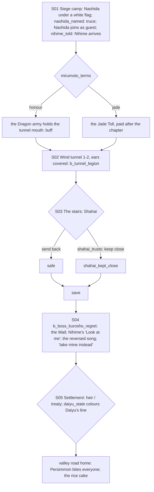

# STORYBOARD — Unicorn Ch4 · "Regret"
Production: `production/unicorn-ch4.md` · Lv 41–45 · Region: **Shiro Iuchi in its wind tunnel** (the west end of the
Ojatara Valleys; Fortune's Lost area map) → `valley_road_home`.
Bestiary F: *Shiro Iuchi wind tunnel* (40–46).

## Flow


## Maps

### T `siege_camp` — the siege camp (hub)
```
 [Mirumoto lines: wax in their ears]   [Iuchi survivors' tents] Hiroichi · Daiyu · Shahai   [Unicorn remount lines: Persimmon]
 [quartermaster: Unicorn + Dragon T4: Tsuruchi-pattern Longbow, Riding Armour T4, Togashi Bo, Jade T4]   [field kitchen = I]
 1 Iuchi shugenja  2 Mirumoto sergeant  3 a Soshi envoy  4 a refugee grandmother (Ch1)  5 a pigeon-keeper   c   C   > wind_tunnel
```
- NPC path actions:
  - Iuchi shugenja: Bless → Meishodo Ward (consumable: Silence resist for 1 battle).
  - Mirumoto sergeant: Duel (Iaijutsu 7) → Glory +1.
  - Soshi envoy: Eavesdrop → "The Soshi want a treaty, not an heir. They fear a peasant lord."
  - The refugee grandmother: **[IF camps_fed]** "You fed us. Here." → Persimmon's Saddle (accessory: Speed +;
    Tamotsu only). Otherwise she just looks at him.
  - Pigeon-keeper: Barter → the Pigeon Messenger (key: the "Nihime's curse" letter plays even without Nihime, as in
    production).
  - Charm, Sumai and Pilfer: soldiers in the lines → Calming Tea, Incense, Raw Jade.
- `c`: Ginseng Tonic ×3. `C` (Hiroichi's chest): the Gaijin Spyglass, if not yet owned (otherwise 4,000 zeni).

### D `wind_tunnel_1–2` → `shiro_iuchi_stairs` → `storm_room` · Danger 42–46
```
 wind_tunnel_1                         wind_tunnel_2                          shiro_iuchi_stairs                storm_room
 @camp  gale tiles (push you back)      >W1 pigeons carry whispers  c          great stair: kneeling servants    Kurosho + Regret  B
  possessed Legion march ≈≈  c          b_tunnel_legion                        (servants' passages around them)
  c*(Athletics 7: a wind-ledge →         c (dead end: an Emerald Legion          Shahai choice!S03   § save
   Riding Armour T4)                     banner + a dead officer's Kabuto T4)
```
- **Gale tiles:** a field tile that pushes the party back a step unless they move in the wind's lull (a 2-beat
  rhythm). A traversal texture like Taint, **not** a battle gimmick (the Wail is the gimmick).
- Encounters: possessed Emerald Legion soldiers, Moto Akutsukai (palette); uncommon Singing Servant (IV palette).
- **Covered Ears:** voice skills off (production). Karasu speaks in NOTE lines as a **story companion** (no battle
  slot; F-1). **Naohida is the guest** (Powder Charge).

## Flag payoffs added (F-2)
| Flag | Payoff |
|---|---|
| `mirumoto_terms honour` | At the tunnel mouth: MIRUMOTO TSUKARU: "We came for the children. We hold the door." → `b_tunnel_legion` enemies start at **−1 Resolve** |
| `mirumoto_terms jade` | After the chapter: MIRUMOTO TABEZU: "The jade, Ide." → the **Jade Toll**: Jade-variant prices +25% in the valley shops (an Octopath-style lingering cost) |
| `daiyu_state comforted` | At the settlement: IUCHI DAIYU: "I'll speak for the boy. I've listened long enough." (supports *heir*) |
| `daiyu_state shattered` | At the settlement: IUCHI DAIYU: "My father did this. The Iuchi will say so, in court." (Honor +1; the Soshi soften on *treaty*) |

## Simulated playthrough
1. Lv 41. The camp: Naohida's arrival (the truce with `naohida_named`, otherwise the pebble line). Nihime arrives
   [IF nihime_told]. Shopping (T4).
2. The tunnel: gale tiles plus about 6 encounters plus the Legion battle. The `mirumoto_terms` buff helps.
3. The stairs: the Shahai choice → save → the boss: the Wail (who listens?), Nihime's breath, the reversed song,
   Tamotsu's gold. ≈ 12 minutes.
4. The settlement (Daiyu's line by state) → home. Total ≈ 85 minutes.

## Findings → fixes
| # | Finding | Fix |
|---|---|---|
| F-1 | Karasu's NOTE lines plus Naohida as the guest | G-1 extended: **story companions** speak in scenes without taking the guest slot |
| F-2 | `mirumoto_terms` and `daiyu_state` were read but unused | The payoffs above (production lines) |
| F-3 | The siege camp had no hub content; the tunnel had no traversal texture | Camp table; gale tiles |
